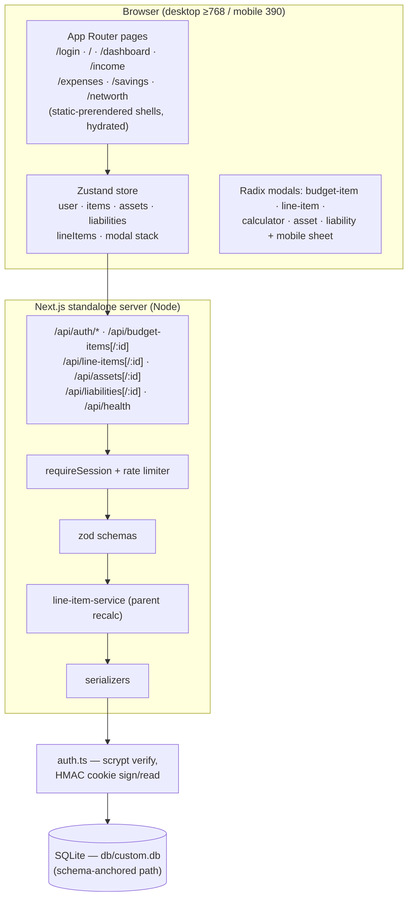
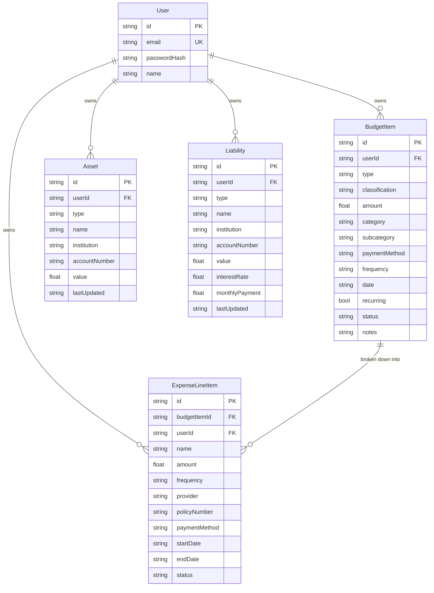

# ZeroBalance — Master Project Architecture Document (PAD) v1.1.27

**Classification:** Internal Engineering Reference
**Status:** DEFINITIVE, PRODUCTION-LOCKED BLUEPRINT
**Companion Document:** README.md (user-facing); AGENTS.md / CLAUDE.md (agent operating rules)
**Last Updated:** 2026-10-18
**Audience:** Senior Engineers, Tech Leads, DevOps, and Onboarding Engineers
**Rule:** Every architectural decision in this document traces to a specific rationale.
           Nothing is here "because it's popular."

#### Revision Block — v1.1.58 (Tracked Changes)
- `[UI]` v1.1.58 (2026-10-20) — the v101 parity iteration (PIN-ONLY — no production-code change): the counts 108 unit / **304 e2e** (+1) / 35 smoke; **the re-run cycle's next-oldest candidate (the v95-era DASHBOARD pair's SIXTH re-run [v61 -> v68 -> v77 -> v83 -> v89 -> v95 -> v101] — the DASHBOARD FULL-PAGE's below-the-fold surfaces [the BUDGET GUIDELINES card + the QUICK-ACTION row] at desktop 1280x800, last re-shot v95; the TWENTY-FOURTH consecutive queue/ledger agreement, the surface names verified against vlm-shots-v95.sh's own header before the derivation) + the axe watch (NO DRIFT — 4.14.0 npm-latest, only rc/next sha prereleases beyond, no stable 4.14.1, no 5.x; the v68 dedupe holds; the engine-contract pin 2 passed standalone) + the 95th standing checks (the mobile menu verified the 95th consecutive time; the reference's four bugs all live; the data census the 95th clean drift check — clean on the FIRST read)**: the DASHBOARD pair's verdict IDENTICAL — the FOURTH consecutive IDENTICAL verdict for this pair [v83 -> v89 -> v95 -> v101] (the only flags the documented standing classes: the root-URL active-nav the v56 SUPERSET class, the avatar the user-identity class, the seed-data figures); the both-sides census — executed in the TWO-HALF controlled form BUILT two-half from the start (ref-arbit-v101.sh + clone-arbit-v101.sh via build-twohalf-v101.py, the THREE census JS blocks [ARBIT_G 61 lines + ARBIT_Q 58 lines + ARBIT_X 25 lines] byte-identical across the halves by the md5 line-block contract [b500dd29 / da04e995 / 7a381755 — the v95 census blocks verbatim]) — REPRODUCING the v89/v95 census values EXACTLY (PART G the guidelines card family [the only delta the shadow's transparent lead-layer count — the v66 INVISIBLE class]; PART Q the quick-action family [the TWO documented deltas: the grid mt the v77 mechanism class, the label finder's wrapper catch the v61 label lesson]; PART X cardBottom 1122/gridTop 1462/gap 340 byte-identical); NO NEW CLONE GAP; the +1 e2e pin the spending+guidelines 2-COL ROW's grid + the Spending Breakdown card's own box/header census at 1280 (tests/e2e/dashboard.spec.ts — the FAMILY-EXTENSION pattern, the v100 junction-walk lesson applied: the v61 F2 pin walks the row only for rowH 656 + the guidelines card's own box, the v77 pin the guidelines card's interior text, the v83 F4 pin the card-level cross-row gap — the ROW'S OWN GRID CHROME [the "468px 468px" template, the 24px column gap, the 960 width, the two children's 468 widths] and the SPENDING CARD'S OWN BOX + HEADER [the card radius/border/bg/shadow, the title's typography, the subtitle's chrome, the title→subtitle rhythm, the body's pt-0 contract] never pinned at ANY viewport in ANY spec, the coverage-map grep across all 24 specs; the pin's own axes first measured byte-identical on both sides by the supplemental two-half census spending-arbit-v101.sh + spending-clone-v101.sh via build-spending-v101.py, the census JS byte-identical by the md5 line-block contract [7e6a13c3]; every axis DATA-INDEPENDENT [the structural chrome + the fixed header texts; the data-locked heights stay with the v61 F2 pin's own rowH contract]); the pin-sanity mutation rounded-xl -> rounded-2xl at src/components/budget/dashboard-view.tsx:695 (by LINE NUMBER; the line carries EXACTLY ONE rounded-xl — the line-scoping keeps the BudgetGuidelinesCard's own rounded-xl at line 832 untouched): ONLY the v101 pin red (42 green under the mutation, AFTER the standalone REBUILD — the v98 mutation-rebuild discipline), the failure diff reads as the card radius axis ALONE ("12px" -> "16px") — cascade-free BY CONSTRUCTION (the v99 precedent), then restored (git diff src/ = 0; the standalone REBUILD; the post-restore full file run 43/43 green); the ship chain three disjoint chunks = 116+92+98 = 306 chunk executions = 304 unique tests, zero flakes; the screenshots **16/16 BYTE-IDENTICAL** (the same-day-seed byte-identity law); the operational lessons: the residual-check asymmetry (the era-asymmetric derivation whitelist re-derived per cycle, never copied blindly), the cumulative-pin coupling (the dashboard's cumulative y-position pins make any inter-row margin mutation non-cascade-free — mutation-selection must target box-chrome axes), and the left-column completion (the 2-col row's coverage now complete — both columns' boxes).
- `[UI]` v1.1.57 (2026-10-20) — the v100 parity iteration (PIN-ONLY — no production-code change): the counts 108 unit / **303 e2e** (+1) / 35 smoke; **the re-run cycle's next-oldest candidate (the v94-era NETWORTH + DRILL-DOWN pair's SIXTH re-run [v60 -> v67 -> v76 -> v82 -> v88 -> v94 -> v100] — the NETWORTH view + the DASHBOARD's drill-down EXPANDED state at desktop 1280x800, last re-shot v94; the TWENTY-THIRD consecutive queue/ledger agreement, the surface names verified against vlm-shots-v94.sh's own header before the derivation) + the axe watch (NO DRIFT — 4.14.0 npm-latest, only rc/next sha prereleases beyond, no stable 4.14.1, no 5.x; the v68 dedupe holds; the engine-contract pin 2 passed standalone) + the 94th standing checks (the mobile menu verified the 94th consecutive time; the reference's four bugs all live; the data census the 94th clean drift check — clean on the FIRST read)**: the NETWORTH pair's verdict IDENTICAL (zero layout/style flags — only the expected data classes + the platform-chrome FAB); the DRILL-DOWN pair's verdict DIFFERENT with every flag DOM-arbitrated to a documented class (the nav-highlight the v56 SUPERSET class [the census: INERT rgb(63,63,70)/fw 400 on the reference vs ACTIVE rgb(255,255,255)/fw 500 on the clone — the deliberate superset delta, not a drift]; the avatar U-vs-D the user-identity class; the Edit-with-Base44 FAB the platform-chrome class [fabCount 0 + bodyHasBase44 false on BOTH sides]; the donut-labels the v60 perception class [the reference's own labels ARE in its DOM — count 4, labelFs 16px, labelFill rgb(0,0,0), labelLineCount 0, sectors 3 — the chrome byte-identical to the clone's; the reference's own seed renders its three labels overlapping and illegible]; the slice proportions the seed-data class); the both-sides census — executed in the TWO-HALF controlled form BUILT two-half from the start (ref-arbit-v100.sh + clone-arbit-v100.sh via build-twohalf-v100.py, the TWO census JS blocks [ARBIT_A 90 lines + ARBIT_B 111 lines] byte-identical across the halves by the md5 line-block contract [50e0cbf2 / cb3afbfc]) — REPRODUCING the v88/v94 census values EXACTLY (the drill-down PART A families + the networth summary-card PART B families — the labelBlock's WIDTH the ONE delta [ref 304 vs clone 357 — the v82 DATA-CONDITIONAL width class]; the docSW 1280 guard); NO NEW CLONE GAP; the +1 e2e pin the networth TABLIST→SECTION-ROW junction census at 1280 (tests/e2e/networth.spec.ts — the FAMILY-EXTENSION pattern: the v41 F2 pin walks the UPPER rhythm, the v60 F1 pin the summary card + tablist interiors, the v94 F4 pin the section row's chrome + the row-to-group rhythm — the JUNCTION between them [the tablist bottom → the section row top gap, the TabsContent's mt-6] never pinned at ANY viewport in ANY spec, the coverage-map grep across all 24 specs; the pin's own axes first measured byte-identical on both sides by the supplemental two-half census nwjunction-arbit-v100.sh + nwjunction-clone-v100.sh via build-nwjunction-v100.py, the census JS byte-identical by the md5 line-block contract [5f124436]; every axis DATA-INDEPENDENT [the structural chrome]); the pin-sanity mutation mt-6 -> mt-8 at src/components/budget/net-worth-view.tsx:415 (by LINE NUMBER; the line carries EXACTLY ONE mt-6 — the line-scoping keeps the liabilities TabsContent's own mt-6 at line 479 untouched): ONLY the v100 pin red (31 green under the mutation, AFTER the standalone REBUILD — the v98 mutation-rebuild discipline), the failure diff reads as the junction position family ALONE (sectionRow.top 549 -> 557 — the direct y-consequence of the 24 -> 32 gap; no width/height/chrome axis touched) — cascade-free BY CONSTRUCTION, then restored (git diff src/ = 0; the standalone REBUILD; the post-restore full file run 32/32 green); the ship chain three disjoint chunks = 105+105+95 = 305 chunk executions = 303 unique tests, zero flakes; the screenshots **16/16 BYTE-IDENTICAL** (the same-day-seed byte-identity law); the operational lessons: the reaping budget as the standing step (the two-half form necessary but not sufficient — the reaping BETWEEN halves is load-bearing on this sandbox), the clean-parenthetical derivation (future derivations carry the clean "last re-shot vN" form forward), and the junction-complete rhythm map (the networth view's inter-block rhythm now fully pinned — the family-extension survey should walk the JUNCTIONS between pinned blocks).

#### Revision Block — v1.1.56 (Tracked Changes)
- `[UI]` v1.1.56 (2026-10-20) — the v99 parity iteration (PIN-ONLY — no production-code change): the counts 108 unit / **302 e2e** (+1) / 35 smoke; **the re-run cycle's next-oldest candidate (the v93-era LOGIN + CALCULATOR pair's SIXTH re-run [v59 -> v66 -> v75 -> v81 -> v87 -> v93 -> v99] — the LOGIN view + the CALCULATOR dialog at desktop 1280x800, last re-shot v93; the TWENTY-SECOND consecutive queue/ledger agreement, the surface names verified against vlm-shots-v93.sh's own header before the derivation) + the axe watch (NO DRIFT — 4.14.0 npm-latest, only rc/next sha prereleases beyond, no stable 4.14.1, no 5.x; the v68 dedupe holds; the engine-contract pin 2 passed standalone) + the 93rd standing checks (the mobile menu verified the 93rd consecutive time; the reference's four bugs all live; the data census the 93rd clean drift check — clean on the FIRST read)**: the CALCULATOR pair's verdict DIFFERENT with every flag DOM-arbitrated to a documented class (the "Will update category total" line the SEED-DATA class [hasWillUpdateSpan false-vs-true: the reference's own Rent $25.00 EQUALS its calculated total so the note stays hidden; the clone's Rent $1850 vs the recalculated $25.00 shows it — the v73-documented DATA-CONDITIONAL class]; the hover-state flags the resting-parity class [actionsAtRest opacity 0 / btnCount 2 byte-identical on both sides]); the LOGIN pair IDENTICAL (zero flags); the both-sides census — executed in the TWO-HALF controlled form BUILT two-half from the start (ref-arbit-v99.sh + clone-arbit-v99.sh via build-twohalf-v99.py, the TWO census JS blocks [CALC 61 lines + LOGIN 36 lines] byte-identical across the halves by the md5 line-block contract [e1092d12 / 9e5a52d2]) — REPRODUCING the v87/v93 census values EXACTLY (the login card/h1/subtitle/logo/input/signIn families + the calculator panel/scrim/title/desc/totalCard/nameH4/row/pillRow/pill1/amountP/actionsAtRest/addBtn families; the docSW 1280 guard); NO NEW CLONE GAP; the census's own close-button finder artifact arbitrated geometrically (the reference's TEXTLESS SVG close button — the v98 unlabelled-trigger class EXTENDED; the supplemental closebtn-arbit-v99.sh reads it {36x36, radius 6px, bg transparent, border 0} — byte-identical to the clone's labelled Radix button); the +1 e2e pin the login SOCIAL-LOGIN ROW census at 1280 (tests/e2e/login-parity.spec.ts — the v97 missing-middle lesson applied to the LOGIN surface: the v75 F4 pin walked the card/h1/subtitle/inputs/signIn/logo, the v7 G3 pin holds the Google button's COLORS, the v45 F4 pin its HOVER shadow, the auth.spec pins the OR divider's PRESENCE — but the OR divider's computed chrome [the "or" text 12px/500/rgb(100,116,139)/uppercase/ls 0.6px/px-3 + the single 1px slate-200 rule] and the Google button's GEOMETRY/typography [368x54/radius 12px/16px/500/lh 24px/pad 14px 20px/gap 12px/svg 20x20] were never pinned at ANY viewport in ANY spec — the coverage-map grep across all 24 specs; the pin's own axes first measured byte-identical on both sides by the supplemental two-half census social-arbit-v99.sh + social-clone-v99.sh via build-social-v99.py, the census JS byte-identical by the md5 line-block contract [d7add89b]; the googleToOr rhythm 32 — the my-6 24px margin + the 16px row's half; the rule's tag DIV-vs-SPAN the inert construct class, the pin asserts chrome + count]); the pin-sanity mutation rounded-xl -> rounded-lg at src/components/budget/login-card.tsx:172 (by LINE NUMBER; the line carries EXACTLY ONE rounded-xl — the line-scoping keeps the INPUT_CLS constant and the card's rounded-2xl untouched): ONLY the v99 pin red (29 green under the mutation, AFTER the standalone REBUILD — the v98 mutation-rebuild discipline), the failure diff reads as the google radius axis ALONE ("12px" -> "8px") — cascade-free BY CONSTRUCTION (border-radius never changes the layout box), then restored (git diff src/ = 0; the standalone REBUILD; the post-restore full run 30/30 green); the F5 chain 114+100+90 = 304 chunk executions = 302 unique tests, zero flakes (ONE first-run timing flake in the F0 pass — the not-found head-parity test at the 15-file chunk's tail — clean on BOTH re-runs, the documented v96-era class); the screenshots **16/16 BYTE-IDENTICAL** (the same-day-seed byte-identity law — the carried-over workspace's seed and the shots on one calendar day); the operational lessons: the unlabelled-trigger finder class extended (census finders must be geometric or labelled-on-both-sides), the social-block-above-the-form order note (the reference renders Google + OR ABOVE the email/password form — the clone's GoogleBlock-before-AuthForm order is the parity-correct one), and the census-tag construct class (pins assert computed chrome + geometric count, never the tag name).

#### Revision Block — v1.1.55 (Tracked Changes)
- `[UI]` v1.1.55 (2026-10-20) — the v98 parity iteration (PIN-ONLY — no production-code change): the counts 108 unit / **301 e2e** (+1) / 35 smoke; **the re-run cycle's next-oldest candidate (the v92-era SAVINGS pair's SIXTH re-run [v58 -> v65 -> v74 -> v80 -> v86 -> v92 -> v98] — the SAVINGS view at desktop 1280x800, full-page, last re-shot v92; the twenty-first consecutive queue/ledger agreement, the surface names verified against vlm-shots-v92.sh's own header before the derivation) + the axe watch (NO DRIFT — 4.14.0 npm-latest, only rc/next sha prereleases beyond, no stable 4.14.1, no 5.x; the v68 dedupe holds; the engine-contract pin 2 passed standalone) + the 92nd standing checks (the mobile menu verified the 92nd consecutive time; the reference's four bugs all live; the data census the 92nd clean drift check — clean on the FIRST read)**: the verdict DIFFERENT with every flag DOM-arbitrated to a documented class (the "Card Footer Alignment" the v57 DATA-CONDITIONAL class [the footer childCount 1-vs-2 with the clone's "Brokerage" chip]; the card grid the seed-count class [1 vs 2]; the header subtitle + card contents the seed-data classes; the avatar the user-identity class); the both-sides census — executed in the TWO-HALF controlled form BUILT two-half from the start (ref-arbit-v98.sh + clone-arbit-v98.sh via build-twohalf-v98.py, the ONE census JS block [SV_CENSUS_JS 153 lines] byte-identical across the halves by the md5 line-block contract [31d181ed]) — REPRODUCING the v86/v92 census values EXACTLY (the h1/grid/card/cardTitle/titleRow/cardAmount/footer/badge families; the docSW 1280 guard); NO NEW CLONE GAP; the +1 e2e pin the goal-card ACTION-MENU PANEL + MENUITEM-RESTING interior census at 1280 (tests/e2e/items.spec.ts — the v97 missing-middle lesson applied to the ACTION layer: the G5/G9 pins hold the menu ITEM's COLOR family + the CONTENT's border-COLOR, the v35 S1 the keyboard contract, but the menu PANEL's GEOMETRY [bg/radius/shadow/min-w/overflow/z/w/h] and the menuitem's RESTING interior [fs/fw/pad/radius/lh/h] were never pinned at ANY viewport in ANY spec — the coverage-map grep across all 24 specs; the pin's own axes first measured byte-identical on both sides by the supplemental two-half census menu-arbit-v98.sh + menu-clone-v98.sh via build-menu-v98.py, the census JS byte-identical by the md5 line-block diff 0f83b786]); the pin-sanity mutation rounded-md -> rounded-lg at src/components/ui/dropdown-menu.tsx:20 (by LINE NUMBER; the line-scoping keeps the DropdownMenuItem's own rounded-sm at line 36 untouched [the item's 4px radius axis]): ONLY the v98 pin red (42 green under the mutation), the failure diff reads as the panel radius axis ALONE ("6px" -> "8px") — cascade-free BY CONSTRUCTION (no spec asserts any dropdown-menu panel radius — this pin is the first; the v97 listbox panel radius reads select.tsx's SelectContent, a DIFFERENT component; the tokens G5 contentBorder is the border-COLOR axis), then restored (git diff src/ = 0; the standalone REBUILD; the post-restore full run 43/43 green); the F5 chain 136+96+71 = 303 chunk executions = 301 unique tests, zero flakes; the screenshots **10/16 BYTE-IDENTICAL + 6/16 the fresh-reseed DATE class** (the fresh-clone re-seed re-anchoring the seed's isoDate offsets — db/ is gitignored, it does not travel; every differing region pixel-arbitrated to a date-digit span or a max-channel-2 sub-perceptual re-render region, the v68 calculator precedent); the census discoveries: the reference's action trigger is UNLABELLED (the clone's aria-label is the a11y superset — the cross-side finder is GEOMETRIC) and the reference's menu opens only on the full POINTER EVENT SEQUENCE; the operational lessons: the reference pointer-event family, the unlabelled-trigger finder class, and the data-independent panel.

#### Revision Block — v1.1.54 (Tracked Changes)
- `[UI]` v1.1.54 (2026-10-20) — the v97 parity iteration (PIN-ONLY — no production-code change): the counts 108 unit / **300 e2e** (+1) / 35 smoke; **the re-run cycle's next-oldest candidate (the v91-era ITEMS pair's SIXTH re-run [v57 -> v64 -> v70 -> v79 -> v85 -> v91 -> v97] — the INCOME + EXPENSES view pair at desktop 1280x800, full-page, last re-shot v91; the twentieth consecutive queue/ledger agreement, the surface names verified against vlm-shots-v91.sh's own header before the derivation) + the axe watch (NO DRIFT — 4.14.0 npm-latest, only rc/next sha prereleases beyond, no stable 4.14.1, no 5.x; the v68 dedupe holds; the engine-contract pin 2 passed standalone) + the 91st standing checks (the mobile menu verified the 91st consecutive time; the reference's four bugs all live; the data census the 91st clean drift check — the expenses leg's timing-artifact re-read documented)**: BOTH verdicts DIFFERENT (the pair's documented verdict class) with every flag DOM-arbitrated to a documented class (the avatar the user-identity class; the stats/grids/contents the seed-data classes; the payment-method footer chips the v57 DATA-CONDITIONAL class [the reference renders payment chips when data carries them — its own income card's footer childCount 2 with the "Bank Account" chip — while its expense items ship none]; the badge wrap + the card h 200-vs-230 the v57/v70b Recurring-wrap class; the FAB the platform-chrome class re-arbitrated live by the one-shot both-sides DOM census [fabCount 0 + bodyHasBase44 false on BOTH sides]); the both-sides census — executed in the TWO-HALF controlled form BUILT two-half from the start (ref-arbit-v97.sh + clone-arbit-v97.sh via build-twohalf-v97.py, the ONE census JS block [CENSUS_JS 193 lines] byte-identical across the halves by the md5 line-block contract [b55dcd29]) — REPRODUCING the v85/v91 census values EXACTLY (the avatar/grid/card/titleRow/amount/footer/badge/filterCard families; the docSW 1280 guard); NO NEW CLONE GAP; the +1 e2e pin the filter LISTBOX PANEL + OPTION-RESTING interior census at 1280 (tests/e2e/items.spec.ts — the MISSING-MIDDLE family: the v91 pin holds the TRIGGER's resting chrome, the v36 S2 the OPTION's focus-state family, but the PANEL container itself [bg/radius/border/shadow/max-h/overflow/z + the viewport's 4px pad] and the option's RESTING interior [fs/fw/color/pad/radius/h] were never pinned at ANY viewport in ANY spec — the family-extension survey walking the COMPONENT LAYERS; the pin's own axes first measured byte-identical on both sides by the supplemental two-half census listbox-arbit-v97.sh + listbox-clone-v97.sh via build-listbox-v97.py, the census JS byte-identical by the md5 line-block diff 34c916da]); the pin-sanity mutation rounded-md -> rounded-lg at src/components/ui/select.tsx:68 (by LINE NUMBER; the line-scoping keeps the SelectTrigger's own rounded-md at line 19 untouched [the v91 pin's 6px trigger axis]): ONLY the v97 pin red (41 green under the mutation), the failure diff reads as the panel radius axis ALONE ("6px" -> "8px") — cascade-free BY CONSTRUCTION, then restored (git diff src/ = 0; the standalone REBUILD; the post-restore full run 42/42 green); the F5 chain 135+96+71 = 302 chunk executions = 300 unique tests, zero flakes; the screenshots **16/16 BYTE-IDENTICAL** (the same-day regeneration — both sides Oct 20 UTC, no midnight crossing); the operational lessons: the census render-race generalization (ANY multi-eval reference flow treats a "no match"/empty census as a possible expiry OR render race first — re-login + settle-wait + re-read — before suspecting drift), the panel-chrome missing-middle family (the family-extension survey should walk the COMPONENT LAYERS, not just the axes of one layer), and the two-half form as the default (zero resource-exhaustion symptoms).

#### Revision Block — v1.1.53 (Tracked Changes)
- `[UI]` v1.1.53 (2026-10-20) — the v96 parity iteration (PIN-ONLY — no production-code change): the counts 108 unit / **299 e2e** (+1) / 35 smoke; **the re-run cycle's next-oldest candidate (the v90-era MOBILE 390 twins' FIFTH re-run [v62/v63 -> v69 -> v78 -> v84 -> v90 -> v96] — the /NETWORTH view + the DASHBOARD FULL-PAGE pair at 390x844, last re-shot v90; the nineteenth consecutive queue/ledger agreement, the surface names verified against vlm-shots-v90.sh's own header before the derivation) + the axe watch (NO DRIFT — 4.14.0 npm-latest, only sha prereleases beyond, no stable 4.14.1, no 5.x; the v68 dedupe holds; the engine-contract pin 2 passed standalone) + the 90th standing checks (the mobile menu verified the 90th consecutive time; the reference's four bugs all live [the 464px /networth overflow re-verified with the settle-wait after the standing script's sleep-3 raced the reference's client-side boot — the timing-artifact lesson]; the data census the 90th clean drift check)**: BOTH verdicts DIFFERENT (the pair's documented verdict class — same as v84/v90) with every flag DOM-arbitrated to a documented class (the stat-tile stacking the v41 mobile-superset class; the subtitle wrap-point the v62 width-delta class; the FAB the platform-chrome class; the figures/counts/donut the seed-data classes) — including the NEW clipped-figure flag ("-$245,950.00 clipped on the left") DOM-arbitrated as a VLM MISREAD by the supplemental figclip one-shot census (figclip-clone-v96.sh: the figure H2 at x=48 w=179 h=32, the textRect flush at the content-left [textLeftOfContent 0 — zero overhang] and 115px inside the content-right, figureScrolls false, docSW 390 — the figure fully in-bounds on every axis; the FLUSH-LEFT FIGURE PERCEPTION CLASS new this cycle); the both-sides census — executed in the TWO-HALF controlled form BUILT two-half from the start (ref-arbit-v96.sh + clone-arbit-v96.sh via build-twohalf-v96.py, the TWO census blocks [NW_CENSUS/DASH_CENSUS] byte-identical across the halves by the md5 line-block contract [82cf8a43 / 85e4ec7e]) — REPRODUCING the v90 census values EXACTLY (the summary card/statGrid/tiles/medallion/trendIcon families; the subtitle chrome; the breakdown card's svg family; the children heights; the spendingCard finder reading the SAME fallback string on both sides — the heading is a div, not an h1-h4, on both sites); NO NEW CLONE GAP; the +1 e2e pin the summary-card HEAD-ROW typography + FIGURE-FIT census at 390 (tests/e2e/networth.spec.ts — the FAMILY-EXTENSION pattern: the figure's fw + color pinned at 640/1280 but NEVER at 390; the label's family pinned at 1280 only; the figure's FIT contract never pinned at ANY viewport [the flush-left start, the in-bounds right, the no-scroll state]; the pin's own axes first measured byte-identical on both sides by the supplemental two-half census [headrow-arbit-v96.sh + headrow-clone-v96.sh via build-headrow-v96.py, the census JS byte-identical by the md5 line-block diff 519ef222]); the pin-sanity mutation font-bold -> font-bold max-sm:font-extrabold at net-worth-view.tsx:348 (by LINE NUMBER, AT-max-sm because the pin runs at 390 and the variant is INERT at >=640 — the v90 LESSON APPLIED; the line-scoping keeps the stat-tile VALUE's identical class string at line 372 untouched): ONLY the v96 pin red (30 green under the mutation), the failure diff reads as the figure fw axis ALONE ("700" -> "800") — cascade-free BY CONSTRUCTION (font-weight never changes line-height — the figure's lh stays 32px, the h 32 and the card-height arithmetic [421, the v63 F3 pin] unchanged; font-weight never affects color; max-sm: appears NOWHERE in src/), then restored (git diff src/ = 0; the standalone REBUILD; the post-restore full run 31/31 green); the F5 chain 140+100+61 = 301 chunk executions = 299 unique tests, zero flakes; the screenshots **15/16 BYTE-IDENTICAL + 1/16 the DATE class** (the 07-add-item-modal's day digits "19"->"20" rolled across the UTC midnight boundary — the budget-item-dialog's render-time default date todayIso() [line 83] the mechanism; the pixel-diff-v96.py arbitration localizing the delta to a 32x22px region at x1535 — exactly the two day digits, the v75 arbitration form [width <= 48, height <= 40, x > 1000]); the operational lessons: the standing-script timing artifact (the reference-side R-bug-4 read docSW 390/390 on the sleep-3 — the eval raced the client-side boot and measured the PRE-RENDER document; the 8s+2s settle re-read measured the true 464; the discipline: when a standing bug check reads CLEAN against its own documented-live history, re-measure with an explicit settle-wait before recording any state change), the flush-left figure perception class (the VLM flags a "clipped" negative currency figure when the text starts flush at the content-box left edge — the arbitration is the Range-walk textRect vs the padding-aware content box, NOT the element rect alone), the two-half form as the default (zero resource-exhaustion symptoms), and the derivation miss-report discipline (the derive script reports every correction's hit/miss — the one first-run MISS caught by the report itself and fixed before any probe executed).
#### Revision Block — v1.1.52 (Tracked Changes)
- `[UI]` v1.1.52 (2026-10-19) — the v95 parity iteration (PIN-ONLY — no production-code change): the counts 108 unit / **298 e2e** (+1) / 35 smoke; **the re-run cycle's next-oldest candidate (the v89-era DASHBOARD pair's FIFTH re-run [v61 -> v68 -> v77 -> v83 -> v89 -> v95] — the BUDGET GUIDELINES card + the QUICK-ACTION card row, both below-the-fold surfaces of the dashboard FULL-PAGE at desktop 1280x800, last re-shot v89; the eighteenth consecutive queue/ledger agreement, the surface names verified against vlm-shots-v89.sh's own header before the derivation) + the axe watch (NO DRIFT — 4.14.0 npm-latest, only canary prereleases beyond, no stable 4.14.1, no 5.x; the v68 dedupe holds; the engine-contract pin 2 passed standalone) + the 89th standing checks (the mobile menu verified the 89th consecutive time; the reference's four bugs all live; the data census the 89th clean drift check)**: the verdict IDENTICAL with ZERO style flags on the pair's own target surfaces (the THIRD consecutive IDENTICAL for this pair [v83 -> v89 -> v95]); every VLM flag the documented standing classes (the seed-data figures; the v56 SUPERSET root-URL active-nav highlight; the "Edit with Base44" FAB platform-chrome class; the avatar "U" vs "D" user-identity class); the both-sides census — executed in the TWO-HALF controlled form BUILT two-half from the start (ref-arbit-v95.sh + clone-arbit-v95.sh via build-twohalf-v95.py, the THREE census blocks [ARBIT_G/ARBIT_Q/ARBIT_X] byte-identical across the halves by the md5 line-block contract [b500dd29 / da04e995 / 7a381755]) — REPRODUCING the v89 census values EXACTLY (PART G the guidelines card 468x348/the header/the body/the three tiles; PART Q the quick-action grid + the three cards; PART X cardBottom 1122/gridTop 1462/gap 340 — zero drift on every axis; the shadow lead-layer the v66 invisible class; the grid mt the v77 mechanism class; the label wrapper-catch the v61 lesson); NO NEW CLONE GAP; the +1 e2e pin the quick-action TRANSITION-TIMING family census at 1280 (tests/e2e/dashboard.spec.ts — never pinned at ANY viewport: the three cards' transitionTimingFunction {cubic-bezier(0.4, 0, 0.2, 1)} + transitionDelay {0s} [the v89 pin holds the duration/property only] + the three tinted tiles' transition-transform family {dur 0.2s, timing} + the three plus icons' transition-opacity family {prop opacity, dur 0.15s, timing, delay 0s} + the docSW 1280 guard; the tiles' transitionProperty asserted in the CONTAINS form — the v95 TAILWIND v4 COMPUTED-FORM class NEW this cycle [the reference's v3 "transform" vs the clone's v4 "transform, translate, scale, rotate" superset, the rendered behavior identical]; the pin's own axes first measured byte-identical on both sides by the supplemental two-half census [qa-timing-arbit-v95.sh + qa-timing-clone-v95.sh via build-qa-timing-v95.py, the census JS byte-identical by the md5 line-block diff ba296202; both sides read-only]); the pin-sanity mutation transition-all duration-200 -> transition-all duration-200 lg:ease-linear at dashboard-view.tsx:885 (by LINE NUMBER, AT-lg because the pin runs at 1280; the line-scoping keeps the file's OTHER transition-all duration-200 instance [line 578] untouched): ONLY the v95 pin red (41 green under the mutation), the failure diff reads as the cardTiming axis ALONE ("cubic-bezier(0.4, 0, 0.2, 1)" -> "linear") — cascade-free BY CONSTRUCTION (a timing-function flip affects no geometry and no computed style any other pin asserts; lg:ease-linear appears NOWHERE in src/), then restored (git diff src/ = 0; the standalone REBUILD; the post-restore full run 42/42 green); the F5 chain 107+98+95 = 300 chunk executions = 298 unique tests, zero flakes; the screenshots **16/16 BYTE-IDENTICAL** (the same-day-seed byte-identity law — the third consecutive pure-form cycle, ZERO arbitration needed); the operational lessons: the template-brace generator bug (the build-qa-timing-v95.py generator written with .format()-style doubled braces but applied with .replace() — the generated LOGIN_JS kept literal {{ }} which made agent-browser eval return EMPTY on every attempt; the discipline: bash -n + a spot grep for doubled braces after ANY generator run, and a manual open+snapshot diagnosis to separate site-down from script-broken), the two-half form as the default (zero resource-exhaustion symptoms), and the v4 transition-property computed-form class (Tailwind v4's transition-transform computes the expanded property list — the pin form for such axes: CONTAINS, never exact).
#### Revision Block — v1.1.51 (Tracked Changes)
- `[UI]` v1.1.51 (2026-10-19) — the v94 parity iteration (PIN-ONLY — no production-code change): the counts 108 unit / **297 e2e** (+1) / 35 smoke; **the re-run cycle's next-oldest candidate (the v88-era NETWORTH + DRILL-DOWN pair's FIFTH re-run [v60 -> v67 -> v76 -> v82 -> v88 -> v94] — the NETWORTH view + the DASHBOARD's drill-down EXPANDED state at desktop 1280x800, last re-shot v88; the seventeenth consecutive queue/ledger agreement, the surface names verified against vlm-shots-v88.sh's own header before the derivation) + the axe watch (NO DRIFT — 4.14.0 npm-latest, only sha prereleases beyond, no stable 4.14.1, no 5.x; the v68 dedupe holds; the engine-contract pin 2 passed standalone) + the 88th standing checks (the mobile menu verified the 88th consecutive time; the reference's four bugs all live; the data census the 88th clean drift check)**: the NETWORTH verdict DIFFERENT with every flag DOM-arbitrated to the v82/v88 documented classes (the avatar user-identity class; the "Edit with Base44" FAB the platform-chrome class RE-ARBITRATED LIVE [fabCount 0 + bodyHasBase44 false on BOTH sides — the FAB lives in the reference's platform iframe chrome]; the seed-data figures); the DRILL-DOWN verdict DIFFERENT with every flag DOM-arbitrated to the v82/v88 documented classes (the v56 SUPERSET nav-highlight [the reference's link INERT rgb(63,63,70)/400 vs the clone's ACTIVE white/500]; the avatar; the pct × 568 DATA class [fillW ref 173 vs clone 357 on the byte-identical 568×12 track — the v82/v88 values REPRODUCED EXACTLY six re-runs later]; the v60 PERCEPTION donut-labels class [count 4, labelLineCount 0, 16px, black, 3 sectors — chrome byte-identical]; the v82 VLM-MISREAD stat-title class RE-ARBITRATED LIVE [both sides' titles "Total Income"/"Total Savings"/"Total Expenses" plural, byte-identical]; the v88 VLM-MISREAD divider class RE-ARBITRATED LIVE [the divider {DIV, h 1, bg rgb(229,231,227), flexGrow 1} byte-identical on every card]); the both-sides census — executed in the TWO-HALF controlled form BUILT two-half from the start (ref-arbit-v94.sh + clone-arbit-v94.sh via build-twohalf-v94.py, the TWO census JS blocks byte-identical across the halves by the md5 line-block contract [a9cdcc96 / baa22974]) — REPRODUCING the v88 census values EXACTLY (the drill-down census: navHighlight/avatarLetter/progress/donutLabels/statTrendIcons/heroTrendGlyphs; the networth summary-card census: the card 960×333/32px/16px/the gradient/the shadow, the headRow/label/figure/medallion/statGrid/statTile/ratioFooter families — the labelBlock's width the v82 DATA-CONDITIONAL class); NO NEW CLONE GAP; the +1 e2e pin the networth SECTION-HEADER row census at 1280 (tests/e2e/networth.spec.ts — the tab panel's "Assets" header row never pinned at ANY viewport: the row's flex chrome {flex/center/space-between/h 56/w 960} + the h2 typography {24px/700/lh 32px/rgb(26,58,46)/mb 0/h 32} + the count P {16px/400/lh 24px/rgb(107,114,128)} + the block h 56 + the Add Asset chrome {36×134/8px 16px/6px/14px/500/white/the gradient} + the 16px Plus + the row→group delta 24 + the groupH3 re-affirm + the docSW guard; the block width + the countText EXCLUDED [the data-coupled width class], the margin-TOP form EXCLUDED [the v3/v4 space-y margin-attribution computed class]; the pin's own axes first measured byte-identical on both sides by the supplemental two-half census [nwsection-arbit-v94.sh + nwsection-clone-v94.sh, the census JS byte-identical by the md5 line-block diff f8b3cabf; both sides read-only]); the pin-sanity mutation text-2xl font-bold -> text-2xl font-bold lg:font-black at net-worth-view.tsx:418 (by LINE NUMBER, AT-lg because the pin runs at 1280): ONLY the v94 pin red (29 green under the mutation), the failure diff reads as the h2.fw axis ALONE ("700" -> "900") — cascade-free BY CONSTRUCTION (the h2's lh 32px bound by text-2xl's line-height; the block h 56, the row, the countP, the addBtn, the rhythm, and the docSW unchanged; no spec asserts the "Assets" section h2's computed styles at ANY viewport; lg:font-black appears NOWHERE in src/), then restored (git diff src/ = 0; the standalone REBUILD; the post-restore full run 30/30 green); the F5 chain 111+106+82 = 299 chunk executions = 297 unique tests, zero flakes; the screenshots **16/16 BYTE-IDENTICAL** (the same-day-seed byte-identity law — the second consecutive pure-form cycle, ZERO arbitration needed); the operational lessons: the reaping budget as a standing step applied clean (zero resource-exhaustion symptoms this cycle), the second-pass session-name sed (the arbit lineage's refar88/clonear88 session names ride the "ar" token family, not the "v88" family — the explicit second sed pass caught them), and the misread-class live re-arbitration (a re-flagged documented MISREAD class re-arbitrated by RE-RUNNING the existing one-shot census live).
#### Revision Block — v1.1.50 (Tracked Changes)
- `[UI]` v1.1.50 (2026-10-19) — the v93 parity iteration (PIN-ONLY — no production-code change): the counts 108 unit / **296 e2e** (+1) / 35 smoke; **the re-run cycle's next-oldest candidate (the v87-era LOGIN + CALCULATOR pair's FIFTH re-run [v59 -> v66 -> v75 -> v81 -> v87 -> v93] — the LOGIN view + the CALCULATOR dialog at desktop 1280x800, last re-shot v87; the sixteenth consecutive queue/ledger agreement, the surface names verified against vlm-shots-v87.sh's own header before the derivation) + the axe watch (NO DRIFT — 4.14.0 npm-latest, only sha prereleases beyond, no 5.x; the v68 dedupe holds; the engine-contract pin 2 passed standalone) + the 87th standing checks (the mobile menu verified the 87th consecutive time; the reference's four bugs all live; the data census the 87th clean drift check)**: the LOGIN verdict IDENTICAL the fourth consecutive (v75/v81/v87/v93 — the both-sides census byte-identical on every axis: the card 448/16px/rgba(255,255,255,0.95), the h1 30px/700/36px, the inputs 48/12px/14px, the Sign in 368x48; the card's 0px-border computed-color + the shadow's transparent lead-layer count the v66 computed-form INVISIBLE class); the CALCULATOR verdict DIFFERENT with every flag DOM-arbitrated to the v75/v81/v87 re-runs' own documented classes (the v66 DATA-CONDITIONAL will-update span [ref FALSE — its Rent natively $25.00 === its line-item total — vs clone TRUE] + its derived card-height note [the totalCard box itself 720x90 BYTE-IDENTICAL]; the v75/v81/v87 POINTER-POSITION actions perception [actionsAtRest {opacity: 0, btnCount: 2} BYTE-IDENTICAL]; the seed-data figures; no FAB flag this cycle); the both-sides census — executed in the TWO-HALF controlled form BUILT two-half from the start (ref-arbit-v93.sh + clone-arbit-v93.sh via build-twohalf-v93.py, the TWO census JS blocks byte-identical across the halves by the md5 line-block diff) — REPRODUCING the v87 census values EXACTLY (the panel 768x393/16px/white; the scrim rgba(26,58,46,0.5)/blur(8px); the title/desc; the totalCard 720x90; the row 720x102; the pillRow/pill1/amountP/addBtn families; the close axis absent ref-side — the v87-documented lost-accessible-name observation holding, the clone's close census the v87 pin's own values — the superset); NO NEW CLONE GAP; the +1 e2e pin the totalCard INNER-TEXT census at 1280 (tests/e2e/calculator.spec.ts — the v73 390 summary-text family's DESKTOP twin PLUS the "Total Calculated" LABEL leaf's typography {14px/500/lh 20px/rgb(107,114,128)} never pinned at ANY viewport PLUS the two summary rows' chrome + the box re-affirm + the docSW 1280 guard; the pin's own axes first measured byte-identical on both sides by the supplemental two-half census [totalcard-arbit-v93.sh + totalcard-clone-v93.sh, the census JS byte-identical by the md5 line-block diff; the reference's NATIVE 1-row state read-only, the clone's added-then-fully-restored twin]); the pin-sanity mutation text-sm font-medium -> text-sm font-medium lg:font-semibold at calculator-dialog.tsx:153 (by LINE NUMBER, AT-lg because the pin runs at 1280): ONLY the v93 pin red (17 green under the mutation), the failure diff reads as the label.fw axis ALONE ("500" -> "600") — cascade-free BY CONSTRUCTION (the inline label's lh 20px bound by the amount's 32px row; the totalCard box unchanged; no spec asserts the label's computed styles at ANY viewport; the lg: variant inert below 1024px), then restored (git diff src/ = 0; the standalone REBUILD; the post-restore full run 18/18 green); the F5 chain 106+112+80 = 298 chunk executions = 296 unique tests, zero flakes; the screenshots **16/16 BYTE-IDENTICAL** (the same-day-seed byte-identity law in its purest form — the seed planted and the shots taken on the same calendar day 2026-10-19, ZERO arbitration needed this cycle); the operational lessons: the reaping budget between the halves from the start (the clone-side shots' first run hit the chromium resource exhaustion — 70 zombie processes, the EMPTY-eval signature — the pkill + session-file sweep + the between-halves reaping step now standing), the session-log-only commit class (the pulled docs-only 926f193 requires ZERO re-provisioning — the carried-over environment's baseline chain IS the shipped-state verification), and the label-first family extension (the mutation axis targets the family member never pinned at ANY viewport when a pin family extends to a new viewport).

#### Revision Block — v1.1.49 (Tracked Changes)
- `[UI]` v1.1.49 (2026-10-19) — the v92 parity iteration (PIN-ONLY — no production-code change): the counts 108 unit / **295 e2e** (+1) / 35 smoke; **the re-run cycle's next-oldest candidate (the v86-era savings pair's FIFTH re-run [v58 -> v65 -> v74 -> v80 -> v86 -> v92] — the SAVINGS view at desktop 1280x800, full-page, last re-shot v86; the fifteenth consecutive queue/ledger agreement, the surface names verified against vlm-shots-v86.sh's own surface list before the derivation) + the axe watch (NO DRIFT — 4.14.0 npm-latest, only rc prereleases beyond, no 5.x; the v68 dedupe holds; the engine-contract pin 2 passed standalone) + the 86th standing checks (the mobile menu verified the 86th consecutive time; the reference's four bugs all live [toast-blocker, sheet-trap, no-landmark, the 464px /networth overflow]; the data census the 86th clean drift check)**: the verdict DIFFERENT with every flag DOM-arbitrated to the v86 re-run's own documented classes (the seed-count grid [1-vs-2 cards]; the v58 DATA-CONDITIONAL footer [the ref's single date-only child vs the clone's two-child row] + its derived internal-spacing note; the seed-data figures/badges/subtexts; the user-identity avatar [U vs D]; no FAB flag this cycle); the both-sides census — executed in the TWO-HALF controlled form [ref-arbit-v92.sh + clone-arbit-v92.sh, the census JS byte-identical across the halves, the lines-1-153 identity verified] after the combined script's clone half aborted in the chromium resource exhaustion (the v89/v91-documented symptom class) — reproducing the v86 census values EXACTLY — zero drift on every axis (the h1 20px/700/rgb(26,58,46); the grid 960/16px/the 3-col ~309px template; the card 309/20px/12px/rgb(229,231,227) with the h 200-vs-230 the v70b Recurring-wrap class; the titleRow flex/center/8px/h 24 + the savings blue dot 8x8/9999px/rgb(59,126,161); the amount 24px/700/lh 32/rgb(59,126,161); the footer flex/space-between/12px/rgb(107,114,128)/h 16 with the v58 DATA-CONDITIONAL childCount; the badgeRow flex/wrap/8px/mb 12px with the h 22-vs-52 wrap class + every badge 6px/2px 10px/12px/600/h 22; the docSW 1280 guard); the supplemental census [savings-filter-arbit-v92.sh + savings-filter-clone-v92.sh — the v87-v91 one-shot precedent, BUILT TWO-HALF from the start after the cycle's first exhaustion] measuring the pin's own axes byte-identical on both sides (ZERO deltas); the +1 e2e pin the SAVINGS FILTER-INTERIOR + SEARCH-ICON census at 1280 (tests/e2e/items.spec.ts — the v91 pin family's THIRD variant [income + expenses pinned v91; savings never: the v38 S2 pin held the card chrome + the search/combobox GEOMETRY at the default viewport only] PLUS the search icon's computed chrome {svg/20x20/rgb(107,114,128)/absolute/left 12px} — the filter card's last never-pinned element, never pinned at ANY viewport on ANY view [the glyph spec holds the PATH data only, the class-string test the w-5 SUBSTRING only]); the pin-sanity mutation the viewport-scoped h-5 w-5 -> h-5 w-5 lg:h-6 (items-view.tsx:181, by LINE NUMBER — AT-lg because the pin runs at 1280, INERT below 1024px; the icon ABSOLUTELY POSITIONED out of flow — no geometry moves; the failure diff reads as the searchIcon.h axis alone "20" -> "24"; no spec asserts any search icon's computed w/h at ANY viewport; the v91 fw-dodge form NOT reusable this cycle — the shared Input instance would cascade the v91 pin red, the MUTATION-FAMILY ROTATION lesson; the full items.spec.ts under the mutation: only the v92 pin red [40 green]; restored [git diff src/ = 0 lines; the standalone REBUILD via the full npm run build]; the post-restore full run 41/41 green); the full chain re-run GREEN (133+108+56 chunk executions = 297 = 295 unique tests, zero flakes); the screenshots 9/16 byte-identical + 7/16 benign-pixel-arbitrated (6 DATE-TEXT-ONLY [03/04/05/06/07/16 — the fresh seed planted 2026-10-19 vs the committed set's 2026-10-18 seed, the day number +1, every crop pair single-image VLM-arbitrated] + 1 RASTERIZATION-NOISE [08-calculator: every differing pixel <=4 channel units, both crops VLM-read "solid gray, no text"]; the regenerated set ships per the v80 discipline); the docs alignment D1-D7 (AGENTS.md, CLAUDE.md, README.md, zero-balance_SKILL.md, this PAD, the probe README's v92 section + the two-half-from-the-start lesson + the mutation-family-rotation lesson, session_222.md + the worklog Session 127 entry).

#### Revision Block — v1.1.48 (Tracked Changes)
- `[UI]` v1.1.48 (2026-10-19) — the v91 parity iteration (PIN-ONLY — no production-code change): the counts 108 unit / **294 e2e** (+1) / 35 smoke; **the re-run cycle's next-oldest candidate (the v85-era items pair's FIFTH re-run [v57 -> v64 -> v70 -> v79 -> v85 -> v91] — the INCOME + EXPENSES view pair at desktop 1280x800, full-page, last re-shot v85; the fourteenth consecutive queue/ledger agreement, the surface names verified against vlm-shots-v85.sh's own surface list before the derivation — the queue-prose verification lesson applied with NO error to correct this cycle) + the axe watch (NO DRIFT — 4.14.0 npm-latest, only rc prereleases beyond, no 5.x; the v68 dedupe holds; the engine-contract pin 2 passed standalone) + the 85th standing checks (the mobile menu verified the 85th consecutive time; the reference's four bugs all live [toast-blocker, sheet-trap, no-landmark, the 464px /networth overflow]; the data census the 85th clean drift check)**: both verdicts DIFFERENT with every flag DOM-arbitrated to the v85 re-run's own documented classes (the v57 payment-chip DATA-CONDITIONAL footer [the ref's first expense card date-only vs the clone's two-child row]; the v57 Recurring superset wrap [the card h 200-vs-230, the badgeRow h 22-vs-52]; the seed-count grids [1-vs-2 income, 4-vs-3 expenses]; the user-identity avatar [U vs D]; the "Edit with Base44" FAB the v85-documented VLM IMAGE-ATTRIBUTION SWAP class, re-arbitrated live by the one-shot both-sides DOM census [base44-fab-arbit-v91.sh: fabCount 0 + bodyHasBase44 false on BOTH sides — the FAB lives in the reference's platform iframe chrome, per the v85 pixel census]); the both-sides census — executed in the TWO-HALF controlled form [ref-arbit-v91.sh + clone-arbit-v91.sh, the census JS byte-identical across the halves] after the combined script's mid-run chromium resource exhaustion (70 zombie processes reaped; the v89 lesson re-verified) — reproducing the v85 census values EXACTLY — zero drift on every axis (the avatar 36x36/9999px/14px/600/white/rgb(143,188,63); the grid 960/16px/the 3-col 309.328px template; the card 309/20px/12px/rgb(229,231,227) with the h 200-vs-230 the v70b Recurring-wrap class; the titleRow 8px/8x8/per-type dotBg; the amount 24px/700/lh 32/per-type accent; the footer flex/space-between/12px/rgb(107,114,128)/h 16; the badgeRow flex/wrap/8px/mb 12px + badge0 6px/2px 10px/12px/600/h 22; the filter card byte-identical on BOTH variants + the docSW 1280 guard); the supplemental census [filter-interior-arbit-v91.sh + filter-interior-clone-v91.sh — the v87/v88/v89/v90 one-shot precedent, built TWO-HALF from the start] measuring the pin's own axes byte-identical on both sides (ZERO deltas including the placeholder texts); the +1 e2e pin the filter-card INTERACTIVE-INTERIOR census at 1280 (tests/e2e/items.spec.ts — the never-pinned families: the search input's TYPOGRAPHY {INPUT/14px/400/20px/rgb(10,10,10)} + every combobox trigger's RESTING chrome {BUTTON/216x36/pad 8px 12px/space-between/center/transparent bg/6px radius/1px rgb(229,229,229) border/14px/400/rgb(10,10,10) + the chevron 16x16 currentColor} — the v64 F3/v70 F4 pins held the card + search GEOMETRY + the comboboxes' w/h/fs/text, the v37 S1/S2 pins the FOCUS state, the interiors never pinned at ANY viewport); the pin-sanity mutation the viewport-scoped pl-10 -> pl-10 lg:font-medium (items-view.tsx:188, by LINE NUMBER — AT-lg because the pin runs at 1280, INERT below 1024px; the failure diff reads as the search's fw axis alone "400" -> "500"; fw never changes line-height/color/geometry; the coverage-map grep run with BOTH the fw: long form AND the Fw-suffix shorthand family — no spec asserts any input's fw at any viewport; the full items.spec.ts under the mutation: only the v91 pin red [39 green]; restored [git diff src/ = 0 lines; the standalone REBUILD via the full npm run build]; the post-restore full run 40/40 green); the full chain re-run GREEN (128+106+62 chunk executions = 296 = 294 unique tests, zero flakes); the screenshots 16/16 byte-identical (the same-day-seed byte-identity law); the docs alignment D1-D7 (AGENTS.md, CLAUDE.md, README.md, zero-balance_SKILL.md, this PAD, the probe README's v91 section + the FAB re-arbitration lesson + the two-half census lesson, session_220.md + the worklog Session 126 entry).

#### Revision Block — v1.1.47 (Tracked Changes)
- `[UI]` v1.1.47 (2026-10-19) — the v90 parity iteration (PIN-ONLY — no production-code change): the counts 108 unit / **293 e2e** (+1) / 35 smoke; **the re-run cycle's next-oldest candidate (the v84-era mobile 390 twins' FOURTH re-run [v62/v63 -> v69 -> v78 -> v84 -> v90] — the /networth + the dashboard FULL-PAGE pair at 390x844, last re-shot v84; the thirteenth consecutive queue/ledger agreement, with the v89-era docs' surface-name transcription error ["login + dashboard"] corrected against the v84 probe scripts — the queue-prose verification lesson: the rotation ledger's authority is the PROBE LINEAGE, never the prose phrasing) + the axe watch (NO DRIFT — 4.14.0, no 5.x, the v68 dedupe holds) + the 84th standing checks (the mobile menu verified the 84th consecutive time; the reference's four bugs all live; the data census the 84th clean drift check)**: both verdicts DIFFERENT with every flag DOM-arbitrated to the v84 re-run's own documented classes (the v41 mobile-superset stacking [the reference's overflowing 2-col 176px tiles vs the clone's fitting 1-col 294px — the tile h 84 byte-identical]; the medallion "larger circle" a VLM perception misread [the 64x64 medallion + the 32x32 trend icon byte-identical, the artifact riding the reference's own viewport-clipped medallion]; the tab-bar alignment a misread [the v53 tablist-390 pin]; the v62 subtitle width-delta wrap [the chrome byte-identical, the reference's own 395px overflow shifting its wrap by one word]; the Base44 platform-chrome overlay; the seed-data classes); the both-sides census (arbit-v90.sh, the sed derivation from the v84 series) reproducing the v84 census values EXACTLY — zero drift on every axis (the summary card/statGrid/tiles/medallion/trendIcon families; the subtitle chrome fs 16px/fw 400/rgb(107,114,128)/lh 24px/P h 48/block h 92; the breakdown card's svg family [svgCount 7, the 16/14 alternation, rechartsWrappers 0, pieSectors 0] + the children heights byte-identical); the supplemental census (tile-interior-arbit-v90.sh — the v87/v88/v89 one-shot precedent) measuring the pin's own axes byte-identical on both sides; the +1 e2e pin the stat-tile INTERIOR census at 390 (tests/e2e/networth.spec.ts — the never-pinned families: the two tiles' LABEL {P/fs 12px/color rgba(255,255,255,0.7)/mb 4px/h 16} + VALUE {P/fs 24px/fw 700/white} interiors — the v63 F3 pin held the tile BOX only; the tile-box/grid/docSW re-affirm); the pin-sanity mutation's FIRST attempt (the bare font-bold -> font-extrabold swap at net-worth-view.tsx:371) cascaded to the v60 F1 pin's amtFw axis at 1280 — THE MUTATION-AS-COVERAGE-AUDIT CATCH (the plan's fw-token grep had missed the v60 pin's amtFw shorthand; the mutation discipline is the coverage-map audit, not just the pin's sensitivity check) — and the corrected viewport-scoped dodge (font-bold -> font-bold max-lg:font-extrabold, by LINE NUMBER) confines the flip to below 1024px: the v60 pin green under it, only the v90 pin red (28 green; the failure diff reads as the fw axis alone "700" -> "800"), restored (git diff src/ = 0 lines; post-restore 29/29 green); the full chain re-run GREEN (122+114+59 chunk executions = 295 = 293 unique tests, zero flakes); the screenshots 16/16 byte-identical (the same-day-seed byte-identity law — the fresh-clone seed planted and shot on the same calendar day); the docs alignment D1-D7 (AGENTS.md, CLAUDE.md, README.md, zero-balance_SKILL.md, this PAD, the probe README's v90 section + the queue-prose verification lesson, session_218.md + the worklog Session 125 entry).

#### Revision Block — v1.1.46 (Tracked Changes)
- `[UI]` v1.1.46 (2026-10-18) — the v89 parity iteration (PIN-ONLY — no production-code change): the counts 108 unit / **292 e2e** (+1) / 35 smoke; **the re-run cycle's next-oldest candidate (the v83-era dashboard pair's fourth re-run — the dashboard FULL-PAGE at desktop 1280, the below-the-fold Budget Guidelines card + the quick-action row, last re-shot v83; the pair's fourth re-run [v61 -> v68 -> v77 -> v83 -> v89], the twelfth consecutive queue/ledger agreement) + the axe watch (NO DRIFT — 4.14.0, no 5.x) + the 83rd standing checks (the mobile menu verified the 83rd consecutive time; the reference's four bugs all live; the data census the 83rd clean drift check)**: the verdict IDENTICAL — zero style flags (the pair's SECOND consecutive IDENTICAL verdict [v83 -> v89]; every VLM flag the documented seed-data classes — the allocation bar, the balance figures, the donut proportions); the both-sides census (arbit-v89.sh, executed in the controlled two-half form [ref-arbit-v89.sh + clone-arbit-v89.sh] after the sandbox's chromium resource exhaustion aborted the combined run) reproducing the v83 census values EXACTLY — zero drift on every axis (PART G: the guidelines card 468x348/radius 12px/border/bg/the visible shadow layers, the header pad 24px/fs 16px/fw 600/rgb(26,58,46)/lh 16px/tracking -0.4px, the body pad 0px 24px 24px/display block, the three tiles 418x78/radius 8px/pad 16px with the Needs/Wants/Savings tint families and the label 16px/500/pct 14px/400/desc 12px/lh 16px chrome — the ONLY census delta the shadow's transparent lead-layer count [the v66 computed-form INVISIBLE class, the visible layers byte-identical]; PART Q: the grid 304px x3/gap 24px/w 960, the three cards 304x90/radius 16px/pad 24px/white/border/the 40x40 radius-12 tinted tiles/the 20px icons/the labels/the 16px 0.5-opacity pluses/transition 0.2s — the grid-mt [ref 0px vs clone 32px] the v77 mechanism class with the rendered gap 340 byte-identical, the label wrapper-catch the v61 lesson; PART X: cardBottom 1122/gridTop 1462/gap 340 byte-identical on BOTH sides); the supplemental census (qa-transition-arbit-v89.sh — the v87/v88 one-shot precedent) measuring the pin's own axes byte-identical on both sides; the +1 e2e pin the quick-action TRANSITION + PLUS-viewBox + GUIDELINES-BODY-DISPLAY census at 1280 (tests/e2e/dashboard.spec.ts — the never-pinned families: the three cards' transition {transitionDuration "0.2s"/transitionProperty "all" — never pinned at ANY viewport, the items.spec.ts transitionDur pins the ITEM card's own family} + the three plus icons' viewBox {0 0 24 24 — the v77 icon-viewBox family's plus twin} + the guidelines body's display {block — the v61 F2 pad family's companion axis} + the docSW guard), the pin-sanity mutation the viewport-scoped duration-200 -> duration-200 lg:duration-300 at dashboard-view.tsx:885 (by LINE NUMBER; flips exactly card.transitionDuration 0.2s->0.3s — cascade-free BY CONSTRUCTION: transitionDuration never affects geometry, every geometry pin green; the v45 F3b hover-shadow pin asserts the SETTLED layers; 40 green under the mutation, only the v89 pin red; the failure diff reads as the duration axis alone; restored 41/41 green); the full chain re-run GREEN (121+113+60 chunk executions = 294 = 292 unique tests, zero flakes); the screenshots 16/16 byte-identical (the same-day-seed byte-identity law); the docs alignment D1-D7 (AGENTS.md, CLAUDE.md, README.md, zero-balance_SKILL.md, this PAD, the probe README's v89 section + the chromium resource-exhaustion lesson, session_215.md + the worklog Session 124 entry).

#### Revision Block — v1.1.45 (Tracked Changes)
- `[UI]` v1.1.45 (2026-10-18) — the v88 parity iteration (PIN-ONLY — no production-code change): the counts 108 unit / **291 e2e** (+1) / 35 smoke; **the re-run cycle's next-oldest candidate (the v82-era networth + drill-down pair's fourth re-run — the networth view + the dashboard drill-down EXPANDED at desktop 1280, last re-shot v82; the pair's fourth re-run [v60 -> v67 -> v76 -> v82 -> v88], the eleventh consecutive queue/ledger agreement) + the axe watch (NO DRIFT — 4.14.0, no 5.x) + the 82nd standing checks (the mobile menu verified the 82nd consecutive time; the reference's four bugs all live; the data census the 82nd clean drift check)**: the NETWORTH verdict IDENTICAL (zero style flags — matching the v82 re-run's own verdict; every delta the seed classes + the platform chrome); the DRILL-DOWN verdict DIFFERENT with every flag DOM-arbitrated to a documented class (the v56 nav-highlight superset, the user-identity avatar, the pct x 568 progress DATA class [fillW 173-vs-357 — the v60 arbitration's own values REPRODUCED EXACTLY, five re-runs later], the v60 donut-labels PERCEPTION class re-arbitrated live, the seed-data classes, the platform-chrome class) — and **the cycle's NEW flag ("the stat-card footer divider lines missing in the reference") a VLM MISREAD disproven by the dedicated one-shot both-sides census (stat-divider-arbit-v88.sh — the v87 close-arbit precedent)**: the divider renders BYTE-IDENTICALLY on both sides ({DIV, h 1px, bg rgb(229,231,227), flexGrow 1} on every card; the count row h 20/w 254/flex/gap 8px/center/14px/rgb(10,10,10); the trend icons 16x16 with the per-type colors lime/blue/orange — the width 177-vs-170 the flex-1 data-conditional remainder); the PART B census (arbit-v88.sh) reproducing the v82 networth summary-card values EXACTLY (zero drift on every axis: the card 960x333/32px/16px/gradient/shadow; the headRow 76/32px/flex/center; the label/figure/medallion/statGrid/statTile/ratioFooter families — the labelBlock width 304-vs-357 the standing DATA-CONDITIONAL class); the +1 e2e pin the stat-card COUNT-ROW + DIVIDER census at 1280 (tests/e2e/dashboard.spec.ts — the never-pinned families: the count row's full chrome {h 20/display flex/gap 8px/alignItems center/fs 14px/color rgb(10,10,10)} + the h-px flex-1 divider {tag DIV/h 1px/bg rgb(229,231,227)/flexGrow 1 — never pinned at ANY viewport; the WIDTH excluded, the v82 convention} + the trend icon's per-type color trilogy {income lime/savings blue/expenses orange — the stat-card twin of the v80/v85 dot trilogy} + the docSW guard), the pin-sanity mutation the viewport-scoped h-px -> h-px lg:h-0.5 at dashboard-view.tsx:618 (by LINE NUMBER; flips exactly divider.height 1px->2px — cascade-free BY CONSTRUCTION: the flex items-center row's height stays the text's 20px line box, the card height 210 unchanged, the v40 F1 bands green under it; 39 green under the mutation, only the v88 pin red; restored 40/40 green); the full chain re-run GREEN (104+129+60 chunk executions = 293 = 291 unique tests, zero flakes); the screenshots 16/16 byte-identical (the same-day-seed byte-identity law — the fresh seed planted and shot on the same calendar day reproduces the committed set byte-for-byte); the docs alignment D1-D7 (AGENTS.md, CLAUDE.md, README.md, zero-balance_SKILL.md, this PAD, the probe README's v88 section + the divider-misread lesson, session_212.md + the worklog Session 123 entry).

#### Revision Block — v1.1.44 (Tracked Changes)
- `[UI]` v1.1.44 (2026-10-18) — the v87 parity iteration (PIN-ONLY — no production-code change): the counts 108 unit / **290 e2e** (+1) / 35 smoke; **the re-run cycle's next-oldest candidate (the v81-era login + calculator pair's fourth re-run — the login view + the calculator dialog at desktop 1280, last re-shot v81; the pair's fourth re-run [v59 -> v66 -> v75 -> v81 -> v87], the tenth consecutive queue/ledger agreement) + the axe watch (NO DRIFT — 4.14.0, no 5.x) + the 81st standing checks (the mobile menu verified the 81st consecutive time; the reference's four bugs all live; the data census the 81st clean drift check)**: the LOGIN verdict IDENTICAL (zero style flags, the third consecutive); the CALCULATOR verdict DIFFERENT with the SAME three flag-set classes as v75/v81 (the v66 DATA-CONDITIONAL will-update span, the POINTER-POSITION perception class, the row-height VLM misread) — every one DOM-arbitrated, the census (arbit-v87.sh) reproducing the v81 values EXACTLY (zero drift on every axis: the panel/scrim/title/desc/totalCard/nameH4/row/pillRow/pill1/amountP/addBtn); **the cycle's NEW reference-side observation: the reference's calculator close button LOST its accessible name** (the close-arbit-v87.sh button-inventory probe: aria-label and textContent both empty — a bare SVG x; the v81 census still found it by name) while its chrome stayed byte-identical (36x36/radius 6px/transparent/0px border) — the clone retains aria-label="Close" (the superset behavior, functionally pinned by every dialog interaction); the supplemental census (pair-arbit-v87.sh) measuring the pin's own axes byte-identical on both sides (the close {36/36/6px/transparent/0px/flex} + the login card's pad family {outer 0px + inner 48px 40px 40px} + the logo's own radius 0px — the login axes census-recorded for the pair's next rotation); the +1 e2e pin the calculator CLOSE-BUTTON chrome census at 1280 (tests/e2e/calculator.spec.ts — the never-pinned families: the close's radius "6px"/bg rgba(0,0,0,0)/borderTopWidth "0px"/display "flex" — no spec asserted the calculator close's radius/bg/border at ANY viewport; the {36,36} re-affirming v59), the pin-sanity mutation the viewport-scoped rounded-md -> rounded-md lg:rounded-lg at calculator-dialog.tsx:138 (by LINE NUMBER; flips exactly close.radius 6px->8px — cascade-free BY CONSTRUCTION: border-radius never affects w/h, the v49/v53/v59 geometry pins green under it; 16 green under the mutation, only the v87 pin red; restored 17/17 green); the full chain re-run GREEN (103+110+79 chunk executions = 292 = 290 unique tests, zero flakes); the screenshots 16/16 byte-identical (the same-db regeneration law — the preserved v86-cycle db + same-day shots reproduce the committed set byte-for-byte); the docs alignment D1-D7 (AGENTS.md, CLAUDE.md, README.md, zero-balance_SKILL.md, this PAD, the probe README's v87 section + the name-independent-finder lesson, session_210.md + the worklog Session 122 entry).

#### Revision Block — v1.1.43 (Tracked Changes)
- `[UI]` v1.1.43 (2026-10-18) — the v86 parity iteration (PIN-ONLY — no production-code change): the counts 108 unit / **289 e2e** (+1) / 35 smoke; **the re-run cycle's next-oldest candidate (the v80-era savings pair's fourth re-run — the savings view at desktop 1280, last re-shot v80; the pair's fourth re-run [v58 -> v65 -> v74 -> v80 -> v86], the ninth consecutive queue/ledger agreement) + the axe watch (NO DRIFT — 4.14.0, no 5.x) + the 80th standing checks (the mobile menu verified the 80th consecutive time; the reference's four bugs all live; the data census the 80th clean drift check)**: **the pair's FIRST IDENTICAL verdict in its five-shot history** (the VLM's own flag list confined to the expected data/identity classes — the subtitle counts, the card figures/names/badges, the avatar — zero layout/style flags), the census still run per the v75 convention (arbit-v86.sh) and reproducing the v80 census values EXACTLY — zero drift on every axis; the supplemental census (wrapper-arbit-v86.sh) measuring the pin's own axes byte-identical on both sides; the +1 e2e pin the savings goal-card's SUBTITLE-P + HEADER-ROW + WRAPPER-THIRD-LEG census at 1280 (tests/e2e/items.spec.ts — the never-pinned families: the subtitle P's full chrome {h 20/fs 14px/lh 20px/rgb(107,114,128)/mt 0 — the 1280 state of the v51 F3 390-only family} + the with-subtitle arithmetic [the titleRow's mb 4px + the headerRow {flex/space-between/flex-start/h 48/mb 12px}] + the wrapper's savings paddingRight-0 third leg [completing the v85 pr-conditional trilogy — expenses 96px / income 0 / savings 0, verified on all three types]), the pin-sanity mutation the viewport-scoped items-start -> items-start lg:items-center at item-card.tsx:118 (inert at 390, no height change at 1280 — flips exactly headerRow.alignItems flex-start->center; cascade-free: 38 green under the mutation, only the v86 pin red; restored 39/39 green) — with TWO DISPROVEN candidates kept as lessons: the fs-axis text-sm -> lg:text-[15px] refuted by the TAILWIND V4 RATIO-LINE-HEIGHT TRAP (text-sm's line-height is the unitless ratio calc(1.25/0.875) — any font-size override scales the lh 20->21.43 and the P's box 20->21, cascading into the v80 heights [mmeasured 254 under it]), and the type-scoped conditional extension refuted by the NARROWED-CONTENT WRAP CASCADE (the pr-96 box at 137px wraps the Emergency Fund h4 +24, the grid stretches both cards to 254); the full chain re-run GREEN (102+110+79 chunk executions = 291 = 289 unique tests, zero flakes); the screenshots 10/16 byte-identical + 6/16 benign-pixel-arbitrated (5 DATE-TEXT-ONLY [the fresh-seed +1-day: 03/04/05/06/16 — every diff crop single-image VLM-arbitrated] + 1 rasterization-noise [08-calculator: ±1-channel gradient rounding, no text, no layout]); the docs alignment D1-D7 (AGENTS.md, CLAUDE.md, README.md, zero-balance_SKILL.md, this PAD, the probe README's v86 section + the ratio-line-height-trap lesson, session_206.md + the worklog Session 121 entry).

#### Revision Block — v1.1.42 (Tracked Changes)
- `[UI]` v1.1.42 (2026-10-18) — the v85 parity iteration (PIN-ONLY — no production-code change): the counts 108 unit / **288 e2e** (+1) / 35 smoke; **the re-run cycle's next-oldest candidate (the v79-era items pair's fourth re-run — the income + expenses view pair at desktop 1280, last re-shot v79; the pair's fourth re-run [v57 -> v64 -> v70 -> v79 -> v85], the eighth consecutive queue/ledger agreement) + the axe watch (NO DRIFT — 4.14.0, no 5.x) + the 79th standing checks (the mobile menu verified the 79th consecutive time; the reference's four bugs all live; the data census the 79th clean drift check)**: both re-run verdicts DIFFERENT with every flag DOM-arbitrated to a documented class; the NEW "Edit with Base44 FAB in the clone" flag a VLM IMAGE-ATTRIBUTION SWAP disproven by the two-step arbitration (base44-fab-arbit-v85.sh's DOM census: no Base44 element on either side — the platform FAB renders outside the queryable body text; crop-fab-v85.mjs's pixel census + vlm-arbit-fabcrop-v85.mjs's single-image crop reads: the dark FAB pixels in the REFERENCE shot's corner ONLY [6585 vs 0 dark px] — the platform-chrome class on the reference); the both-sides census (arbit-v85.sh) reproducing the v79 census values EXACTLY — zero drift since v79 on every axis; the +1 e2e pin the expense-card CONTENT-WRAPPER + orange-dot titleRow census at 1280 (tests/e2e/items.spec.ts — the never-pinned families: the expenses-conditional pr-24 wrapper {display block/flexGrow 1/paddingRight 96px — the hover action row's reserved room} + the income twin's paddingRight-0 control + the titleRow's full geometry {flex/center/8px/h 24 + the 8x8/9999px dot in the expenses orange rgb(224,122,59) — the orange twin's first pin anywhere, completing the v80 savings blue twin's per-type trilogy — + the h4's 16px/600/rgb(26,58,46) forestDark}), the pin-sanity mutation the wrapper's pr-24 -> pr-20 at item-card.tsx:119 (by LINE NUMBER — the ONLY pr-24 in src; flips exactly wrapper.paddingRight 96->80 — the titleRow family content-governed, the amount/badge/footer rows wrapper-external siblings, the action row absolute, the income/savings wrappers pr-free — cascade-free: 37 green under the mutation, only the v85 pin red; restored 38/38 green); the full chain re-run GREEN (102+105+83 chunk executions = 290 = 288 unique tests, zero flakes); the screenshots 16/16 byte-identical (the fifteenth consecutive fully-identical set — the same-day seed law); the docs alignment D1-D7 (AGENTS.md, CLAUDE.md, README.md, zero-balance_SKILL.md, this PAD, the probe README's v85 section + the image-attribution-swap lesson, session_203.md + the worklog Session 120 entry).

#### Revision Block — v1.1.41 (Tracked Changes)
- `[UI]` v1.1.41 (2026-10-18) — the v84 parity iteration (PIN-ONLY — no production-code change): the counts 108 unit / **287 e2e** (+1) / 35 smoke; **the re-run cycle's next-oldest candidate (the mobile 390 twins' third re-run — the networth + dashboard FULL-PAGE pair at 390x844, last re-shot v78; the pair's third re-run [v62/v63 -> v69 -> v78 -> v84], the seventh consecutive queue/ledger agreement) + the axe watch (NO DRIFT — 4.14.0, no 5.x) + the 78th standing checks (the mobile menu verified the 78th consecutive time; the reference's four bugs all live; the data census the 78th clean drift check)**: both re-run verdicts DIFFERENT with every flag DOM-arbitrated to a documented class; the NEW "divider missing in the clone" flag a VLM MISREAD disproven by the one-shot both-sides arbitration ratio-divider-arbit-v84.sh (the divider byte-identical: borderTop 1px solid rgba(255,255,255,0.2), mt 24/pt 24, footer h 53, label 14px/400/156x20); the both-sides census (arbit-v84.sh) reproducing the v78 census values EXACTLY — zero drift since v78 on every axis; the +1 e2e pin the networth summary card's RATIO-FOOTER census at 390 (tests/e2e/networth.spec.ts — the never-pinned family at the mobile viewport: the border-t family + the mt-6/pt-6 rhythm + the value-governed h 53 + the ratio label's 14px/400/156x20), the pin-sanity mutation the label's text-sm -> text-xs lg:text-sm applied by LINE NUMBER (flips exactly the label axes at 390 — fs 14->12/h 20->16/w 156->134 — desktop-restored, cascade-free: 27 green under the mutation, only the v84 pin red; restored 28/28 green); the full chain re-run GREEN (102+108+79 chunk executions = 287 unique; one transient Liabilities-tab flake re-verified GREEN standalone twice + in-chunk); the screenshots 15/16 byte-identical + 1/16 DATE-class pixel-arbitrated (the add-item modal's default-date field 10/17 -> 10/18, the UTC calendar rollover — the diff crop VLM-arbitrated DATE-TEXT-ONLY per the v80 discipline); the docs alignment D1-D7 (AGENTS.md, CLAUDE.md, README.md, zero-balance_SKILL.md, this PAD, the probe README's v84 section, session_200.md + the worklog Session 119 entry).

#### Revision Block — v1.1.40 (Tracked Changes)
- `[UI]` v1.1.40 (2026-10-18) — the v83 parity iteration (PIN-ONLY — no production-code change): the counts 108 unit / **286 e2e** (+1) / 35 smoke; **the re-run cycle's next-oldest candidate (the v61-era dashboard pair's third re-run — the dashboard FULL-PAGE at desktop 1280, last re-shot v77; the ledger-verified queue — the v82 plan's v83 suggestion agreeing with the rotation ledger [v77 dashboard < v78 mobile twins < v79 items < v80 savings < v81 login+calculator < v82 networth+drill-down, the oldest remaining by LAST RE-SHOT DATE; the pair's THIRD re-run (v61 -> v68 -> v77 -> v83) — the sixth consecutive queue/ledger agreement])** — the DASHBOARD verdict IDENTICAL (the two v61-era target surfaces — the Budget Guidelines card + the quick-action row — identical on every reported chrome axis; the only deltas the seed classes + the documented non-chrome classes [the root-URL nav state the v56 SUPERSET class, the avatar the user-identity class, the Base44 overlay the platform-chrome class]) with the both-sides census reproducing the v77 census values EXACTLY — zero drift since v77 on every axis (PART G the guidelines card byte-identical modulo the v66 transparent-shadow class; PART Q the quick-action row byte-identical modulo the v77 mt-mechanism class [ref mt 0 vs clone 32px, the rendered gap IDENTICAL at 340] + the v61 label-finder wrapper class [the clone's LEAF carries the identical 500/rgb(26,58,46)]; PART X cardBottom 1122/gridTop 1462/gap 340 on both sides) — NO NEW GAP; the +1 pin the dashboard's CROSS-ROW vertical-rhythm census at 1280 (the guidelines card's bottom 1122 — the cumulative upstream rhythm; the quick-action grid's top 1462; the rendered cross-row gap 340 — the byte-identical both-sides parity axis, the reference's own wrapper mechanism producing the same 340; the grid's own mt 32px — the v51 F5 390 axis's desktop twin) — the pin-sanity mutation the quick-action grid's mt-8 -> mt-8 lg:mt-6 viewport-scoped and cascade-free [38 green under the mutation, only the v83 pin red]; the 16 screenshots byte-identical (the fourteenth consecutive fully-identical set — the same-day-seed byte-identity law).

#### Revision Block — v1.1.39 (Tracked Changes)
- `[UI]` v1.1.39 (2026-10-18) — the v82 parity iteration (PIN-ONLY — no production-code change): the counts 108 unit / **285 e2e** (+1) / 35 smoke; **the re-run cycle's next-oldest candidate (the v60-era networth + drill-down pair's third re-run — the networth view + the dashboard drill-down EXPANDED at desktop 1280, last re-shot v76; the ledger-verified queue — the v81 plan's v82 suggestion agreeing with the rotation ledger [v76 networth+drill-down < v77 dashboard < v78 mobile twins < v79 items < v80 savings < v81 login+calculator, the oldest remaining by LAST RE-SHOT DATE; the pair's THIRD re-run (v60 -> v67 -> v76 -> v82) — the fifth consecutive queue/ledger agreement])** — the NETWORTH verdict IDENTICAL (the only layout/style flag the reference's Base44 overlay — the platform-chrome class; every other delta the seed classes) with the both-sides census byte-identical on every chrome axis (the card 960x333/32px/16px/the 135deg forest-lime gradient/the 26-58-46 shadow; the head row 76/mb 32px/flex/center; the label 14px/white-80/mb 8px/h 20; the figure 48px/700/white/lh 48px/h 48; the medallion 64x64/white-20/icon 32x32; the stat grid 440px 440px/rows 84px/gap 16px/896x84; the stat tile 440x84/16px/12px/white-10/blur(10px)/label 12px-h16-mb4/amount 24px-700-h32; the ratio footer mt 24/pt 24/1px rgba(255,255,255,0.2)/h 53/label 14px/value 18px-700 — the one width delta the labelBlock w ref 304 vs clone 357 the DATA-CONDITIONAL figure-text class); the DRILL-DOWN verdict DIFFERENT with EIGHT flags, every one DOM-arbitrated to a documented class (the nav highlight the v56 SUPERSET class [the reference's link inert rgb(63,63,70)/400 vs the clone's active white/500]; the progress-bar length the pct x 568 DATA class [fillW ref 173 vs clone 357 on the byte-identical 568x12 track — the v60 arbitration's own values reproduced exactly]; the extra expanded category + footer count the seed-data class; the donut proportions the seed-data class; the percentage-labels claim the v60 PERCEPTION class re-arbitrated live [the reference renders its labels — texts 92.3%/4.6%/3.1%, count 4 = 1 group + 3 labels, 0 lines, 16px, black, 3 sectors, the chrome byte-identical]; the "Total Expense vs Total Expenses" a VLM MISREAD [the statTitles measured verbatim — the plural on BOTH sides, SPAN + H3, 14px/500/rgb(107,114,128), hasSingular:false]; the avatar the user-identity class; the Base44 overlay the platform-chrome class) — NO NEW GAP; the +1 pin the summary card's COMPLETION family at 1280 (the head row's items center, the label block's h 76, the stat grid's w 896, the ratio label's fs 14px — every axis static chrome, the pin-sanity mutation the ratio label's text-sm -> text-sm lg:text-base viewport-scoped and cascade-free [26 green under the mutation, only the v82 pin red]); the 16 screenshots byte-identical (the thirteenth consecutive fully-identical set).

#### Revision Block — v1.1.38 (Tracked Changes)
- `[UI]` v1.1.38 (2026-10-17) — the v81 parity iteration (PIN-ONLY — no production-code change): the counts 108 unit / **284 e2e** (+1) / 35 smoke; **the re-run cycle's next-oldest candidate (the v59-era login + calculator pair's third re-run — the login view + the calculator dialog at desktop 1280, last re-shot v75; the ledger-verified queue — the v80 plan's v81 suggestion agreeing with the rotation ledger [v75 login+calculator < v76 networth+drill-down < v77 dashboard < v78 mobile twins < v79 items < v80 savings, the oldest remaining by LAST RE-SHOT DATE; the pair's THIRD re-run (v59 -> v66 -> v75 -> v81) — the fourth consecutive queue/ledger agreement])** — the LOGIN verdict IDENTICAL with ZERO style flags (matching the v75 re-run's own IDENTICAL verdict — zero drift since v75 on the VLM layer; the both-sides census byte-identical on every axis: the card 448/16px/rgba(255,255,255,0.95), the h1 30/700/lh 36px/rgb(15,23,42), the subtitle 16px/rgb(100,116,139), the logo 96x96, the inputs 48/12px/14px/1px rgb(226,232,240), the Sign in 368x48/12px/14px/500/rgb(15,23,42), the Google + OR blocks both — the card's 0px-width border computed-color + the shadow's transparent lead-layer count the v66 computed-form INVISIBLE class); the CALCULATOR verdict DIFFERENT with THREE flags, every one DOM-arbitrated to a documented class (the "extra will-update line" the v66 DATA-CONDITIONAL class [hasWillUpdateSpan ref false — its Rent natively $25.00 === its line-item total; clone true — opened-at $1850]; the "hover buttons missing" the POINTER-POSITION perception class [actionsAtRest opacity 0 / btnCount 2 BYTE-IDENTICAL on both sides — the reference's shot taken with the pointer still inside the dialog after the Calculate click, the clone's after the parked-pointer move]; the "row height shorter" a VLM MISREAD [the row 720x102 byte-identical] — matching the v75 re-run's own flag-set classes exactly). The both-sides census (arbit-v81.sh — the v75 convention, the v75 census axes re-measured): the PANEL + SCRIM + TITLE + DESC + CLOSE + TOTALCARD + NAMEH4 + ROW + PILLROW + PILL1 + AMOUNTP + ADDBTN chrome all BYTE-IDENTICAL (the panel 768x393/16px/white/maxW 768px; the scrim rgba(26,58,46,0.5)/blur(8px)/1280x800; the title 18px/700/lh 28px/rgb(26,58,46); the desc 14px/lh 20px/rgb(107,114,128); the close 36x36; the totalCard 720x90/16px/12px/1px solid rgb(252,221,213); the nameH4 16/600/h 24/mb 4px; the row 720x102/16px/12px/1px solid rgb(229,231,227); the pillRow/pill1 family; the amountP 20/700/rgb(224,122,59)/h 28; the addBtn 110x32/radius 6px/12px/500/white; the docSW 1280 guard) — the panel shadow's transparent lead-layer count the v66 computed-form class (the visible layer byte-identical). **the v81 pin: the calculator dialog's header family + Add Item button + scrim census at 1280** (tests/e2e/calculator.spec.ts — the never-pinned axes: the title's typography family [fs 18px/fw 700/lh 28px/color rgb(26,58,46) — the v53 390 pin's {fs,fw,color} twin completed with the NEVER-pinned lh axis], the desc's typography family [14px/lh 20px/rgb(107,114,128) — the v73 390 family's desktop twin], the addBtn's chrome [110x32/radius 6px/12px/500/white — the v53 390 family's desktop twin, the radius never pinned at any viewport], the scrim [rgba(26,58,46,0.5)/blur(8px)/1280x800 — the v73 390 family's desktop twin]) — every pinned axis STATIC dialog chrome, the pin riding the v59 read-only EMPTY-state discipline (hover -> Calculate -> census -> Close, no fixture writes) — GREEN on first run, the pin-sanity mutation (the DialogTitle's lg:text-xl at calculator-dialog.tsx:127) verified to FAIL at exactly the title.fs axis ("18px" -> "20px") — cascade-free by construction (the responsive variant inert at 390 — the v53 h2/header pins untouched; the v59 pin asserts no title-dependent axis, the panel.y invariant holds for any height; the v66 height family lives in the panel body; the full calculator.spec.ts under the mutation: 15 green, only the v81 pin red) then restored (the standalone REBUILD as a SEPARATE command; git diff src/ = 0 lines); the axe watch NO DRIFT (4.14.0, no 5.x, the v68 dedupe holds); the 75th standing checks (the mobile menu the 75th consecutive time, the four reference bugs live, the 75th clean data drift, the SEO pair); the baseline chain FULLY GREEN on the PRESERVED workspace (no reset; the seedcheck exact before any flow); the screenshots 16/16 BYTE-IDENTICAL (the twelfth consecutive fully-identical set — the same-day regeneration against the preserved db); **the probe lessons: (1) THE STATIC-CHROME READ-ONLY PIN — a dialog pin whose every axis is static chrome (title/desc/addBtn/scrim — none data-dependent) can ride the read-only empty state, eliminating the fixture add/restore burden of the with-row pins; (2) THE POINTER-PHASE PERCEPTION CLASS — a screenshot pair taken at different pointer phases (pre-park vs post-park) makes hover-revealed chrome appear on one side only: the DOM census (actionsAtRest opacity) is the arbiter, not the pixels; (3) THE 0px-WIDTH BORDER COMPUTED-COLOR — a borderless surface's 0px border still carries a computed color (the ref's slate-200 form vs the clone's border token): an INVISIBLE computed-form class, never a parity gap.**

#### Revision Block — v1.1.37 (Tracked Changes)
- `[UI]` v1.1.37 (2026-10-17) — the v80 parity iteration (PIN-ONLY — no production-code change): the counts 108 unit / **283 e2e** (+1) / 35 smoke; **the re-run cycle's next-oldest candidate (the v58-era savings pair's third re-run — the savings view at desktop 1280, last re-shot v74; the ledger-verified queue — the v79 plan's v80 suggestion agreeing with the rotation ledger [v74 savings < v75 login+calculator < v76 networth+drill-down < v77 dashboard < v78 mobile twins < v79 items, the oldest remaining by LAST RE-SHOT DATE; the pair's THIRD re-run (v58 -> v65 -> v74 -> v80) — the third consecutive queue/ledger agreement])** — the savings verdict DIFFERENT with every flag a documented class (the single-card vs two-card grid the seed-count class; the footer's account-type chips the v58 DATA-CONDITIONAL class; the badge family the classification-VALUE + Recurring superset classes; the figures the seed-data class; the avatar the user-identity class — matching the v74 re-run's own flag set exactly). The both-sides census (arbit-v80.sh — the v75 convention, the v74 census axes re-measured PLUS the v80 titleRow geometry): the HEADER + GRID + CARD chrome BYTE-IDENTICAL (grid 960 / gap 16px / the 3-col ~309px template; card 309 / pad 20px / radius 12px / border 1px solid rgb(229,231,227) / bg white; the card h ref-200 vs clone-230 the v70b-decomposed class); **the TITLE ROW geometry BYTE-IDENTICAL — the never-census'd axis (display flex / gap 8px / alignItems center / row h 24 / the dot 8x8 / radius 9999px / dotBg rgb(59,126,161) — the savings blue on BOTH sides, the 1280 state of the v51/v54 390-only family)**; the INTERIOR TEXT BYTE-IDENTICAL (the h4 16px/600/lh 24px; the amount 24px/700/lh 32px/rgb(59,126,161)); the FOOTER + BADGE chrome BYTE-IDENTICAL (the footer childCount the v58 DATA-CONDITIONAL class; the badgeRow h 22 vs 52 the v57 wrap class); the docSW 1280 guard. **the v80 pin: the savings goal-card's double-wrap heights + title-row geometry + border/bg census at 1280** (tests/e2e/items.spec.ts — the never-pinned axes: the savings view's CARD HEIGHTS [230, 230] [the DOUBLE-WRAP twins — both savings cards carry 4 badges wrapping their rows to 52px; the v80 probe's items-start experiment CORRECTED the v70b attribution: the stretch axis lives on the INCOME view — the Salary card, natural 200, stretched to the Freelance card's natural wrap 230, which the v79 pin's income heights[0] has pinned all along (its comment's sibling attribution inverted; the pin's VALUE and dual guard exactly right) — while the savings view's two cards are BOTH natural wrap twins], the titleRow's geometry [flex/8px/center/h 24/the 8x8 savings-blue dot — the v45 F1a pin's income lime-dot twin completed to the savings type], the card's border + bg [the v45 F1a income family's savings twin]) — GREEN on first run, the pin-sanity mutation (the titleRow's lg:items-start at item-card.tsx:120) verified to FAIL at exactly the titleRow.alignItems axis ("center" -> "flex-start") — cascade-free by construction (the responsive variant inert at 390 — the v51/v54 family untouched; the v45 F1a pin asserts no alignItems; the row height content-governed — the full items.spec.ts under the mutation: 36 green, only the v80 pin red) then restored (the standalone REBUILD as a SEPARATE command; git diff src/ = 0 lines); the axe watch NO DRIFT (4.14.0, no 5.x, the v68 dedupe holds); the 74th standing checks (the mobile menu the 74th consecutive time, the four reference bugs live, the 74th clean data drift, the SEO pair); **the FRESH-RECLONE F0 (the reset path exercised for the first time since v76: node_modules + chromium-1243 reinstalled, .env rewritten, db:push + db:seed re-run, the seedcheck exact before any flow — the baseline chain fully green as-shipped on the rebuilt workspace)**; the screenshots 10/16 byte-identical + 6/16 DATE-class pixel-arbitrated (the eleventh consecutive disciplined set — the fresh seed's isoDate() offsets resolving against the re-clone's seeding day [a +1-day shift on the date texts], the chrome byte-identical, every diff crop VLM-arbitrated DATE-TEXT-ONLY); **the probe lessons: (1) THE VIEWPORT-SCOPED CASCADE-FREE MUTATION — a per-view completion pin whose every axis is sibling-pinned (the shared-component reality) gets its cascade-free sanity via a responsive variant (lg:items-start flips the 1280 axis while the 390 family stays green — the mutation scoped by viewport, not by component); (2) THE STRETCH-TWIN ATTRIBUTION CORRECTION — the v70b "shorter sibling stretched" mechanism holds, but WHICH sibling is stretched is a per-view fact: probe it (the items-start experiment) before writing the attribution into a pin's comment; (3) THE FRESH-SEED DATE SHIFT — a re-clone's db:seed shifts every isoDate() field by the seeding-day delta: expect DATE-class screenshot diffs after any workspace reset and pixel-arbitrate them (never a VLM verdict on the full page).**

- `[UI]` v1.1.36 (2026-10-17) — the v79 parity iteration (PIN-ONLY — no production-code change): the counts 108 unit / **282 e2e** (+1) / 35 smoke; **the re-run cycle's next-oldest candidate (the v57-era items pair's third re-run — the income + expenses view pair at desktop 1280, last re-shot v70; the ledger-verified queue — the v78 plan's v79 suggestion agreeing with the rotation ledger [v70 items < v74 savings < v75 login+calculator < v76 networth+drill-down < v77 dashboard < v78 mobile twins, the oldest remaining by LAST RE-SHOT DATE; the pair's THIRD re-run, the cadence's most-re-verified desktop surface])** — BOTH items views at 1280x800 full-page: the income verdict DIFFERENT with every flag a documented class (the avatar letter the user-identity class; the 1-card vs 2-card grid the seed-count class; the figures the seed-data class), the expenses verdict DIFFERENT with every flag a documented class (the footer's payment-method chips the v57 DATA-CONDITIONAL class; the badge arrangement the v57 Recurring superset wrap class; the avatar the user-identity class — matching the v70 re-run's own flag set exactly). The both-sides census (arbit-v79.sh — the v75 convention, the v70 census axes re-measured on BOTH views): the AVATAR chrome BYTE-IDENTICAL (w 36 x h 36 / radius 9999px / fs 14px / fw 600 / color rgb(255,255,255) / bg rgb(143,188,63) — the identity text the only delta); the GRID + CARD chrome BYTE-IDENTICAL (grid 960 / gap 16px / the 3-col 309.328px template; card 309 / pad 20px / radius 12px / border rgb(229,231,227); the card h ref-200 vs clone-230 the v70b-decomposed class — the Recurring superset badge's wrap h 52 [22+8+22] -> +30px, and the 1-row grid STRETCHES the shorter sibling to the taller card's natural height); the TITLE ROW + AMOUNT leaf chrome BYTE-IDENTICAL (the amount 24px/700/lh 32px/h 32 with the income lime rgb(143,188,63) + expenses orange rgb(224,122,59) accents matching per type); the FOOTER + BADGE chrome BYTE-IDENTICAL (the footer childCount the v57 DATA-CONDITIONAL class; the badgeRow h 22 vs 52 the v57 wrap class); the FILTER CARD BYTE-IDENTICAL on BOTH variants (the income 447-spanning + the expenses 216-not-spanning — the v64/v70 pins' own values, zero drift) + the header + the docSW 1280 guard. **the v79 pin: the rail-avatar chrome + the item-card amount-accent + wrap/stretch card-height census at 1280** (tests/e2e/items.spec.ts — the never-pinned axes: the avatar's full chrome w 36/h 36/radius 9999px/fs 14px/fw 600/color white/bg rgb(143,188,63) [the tokens.spec pin holds the radius only], the amount leaf's per-type accent family [the v74 pin holds the savings variant only — completed to all three types], the income view's first-card HEIGHT 230 [the v70b lesson's wrap/stretch arithmetic regression guard: the Salary sibling's Recurring-wrap natural 230 + the 1-row grid stretching the Freelance card]) — GREEN on first run, the pin-sanity mutation (the avatar's font-semibold -> font-medium at sidebar.tsx:120) verified to FAIL at exactly the avatar.fw axis (600 -> 500, cascade-free — the tokens.spec radius pin + the boot-failure shell pin untouched) then restored (the standalone REBUILD as a SEPARATE command; git diff src/ = 0 lines); the axe watch NO DRIFT (4.14.0, no 5.x, the v68 dedupe holds); the 73rd standing checks (the mobile menu the 73rd consecutive time, the four reference bugs live, the 73rd clean data drift [the income leg re-read after a mid-script session expiry], the SEO pair); the screenshots 16/16 byte-identical (the tenth consecutive set — the same-day regeneration).
- `[UI]` v1.1.35 (2026-10-17) — the v78 parity iteration (PIN-ONLY — no production-code change): the counts 108 unit / **281 e2e** (+1) / 35 smoke; **the re-run cycle's next-oldest candidate (the mobile 390 twins' second re-run — the networth + dashboard full-page pair, last re-shot v69; the ledger-verified queue — the v77 plan's v78 suggestion agreeing with the rotation ledger this time [v69 < v70 items < v74-v77, the oldest remaining by LAST RE-SHOT DATE; the v77 target-selection lesson applied: the queue suggestion verified against the ledger before commitment, no correction needed])** — BOTH mobile twins at 390x844 full-page: the networth verdict DIFFERENT with every flag a documented class (the stat tiles side-by-side vs stacked the v41 mobile-superset class; the asset groups the seed-data class; the Base44 overlay the platform chrome; the avatar the user-identity class — matching the v69 re-run's own flag set exactly), the dashboard verdict DIFFERENT with every flag a documented class (the subtitle wrap point the v62 width-delta class — the reference's own 395px docSW overflow shifts its wrap by one word, the chrome byte-identical; the progress-bar length the pct data class; the black tooltip the Base44 platform chrome; the donut proportions the seed-data class). The both-sides census (arbit-v78.sh — the v75 convention: the census runs regardless of the verdict; the v69 census axes re-measured): the networth medallion 64x64 + trend icon 32x32 + tiles h 84 + grid gap 16px BYTE-IDENTICAL (the deltas all the v41 mobile-superset class — the reference's card 432/docSW 464/fixed 2-col tiles 176x84/medallion clipping at right 416 vs the clone's card 358/docSW 390/1-col tiles 294x84/medallion fitting at right 342 — zero drift since the v69/v63 censuses); the dashboard subtitle chrome BYTE-IDENTICAL (fs 16/fw 400/rgb(107,114,128)/lh 24px, the P h 48, the block h 92, 2 lines) + the breakdown card's height + svg families byte-identical (h 324, svgCount 7, the first-four svgs [16x16, 14x14, 16x16, 14x14], rechartsWrappers 0, pieSectors 0 on BOTH sides — no donut in the breakdown card anywhere, the v69 disproof class) + the 5px width family delta (card 363 vs 358, H3 313 vs 308, DIV 313x238 vs 308x238) the reference's own docSW-395 overflow class (the heights byte-identical). **the v78 pin: the Net Zero Breakdown card's mobile svg family + chart-absence + width census at 390** (tests/e2e/dashboard.spec.ts — the never-pinned axes: the card's w 358 [the v44 F2a pin covers the heights 324/441/495 only], the svg family svgCount 7 with the full size census [16,14,16,14,16,14,16] [the three section icons h-4 w-4 + the three collapsed chevrons h-3.5 w-3.5 + the net-balance icon h-4 w-4 — never pinned at any viewport], the chart-absence contract rechartsWrappers 0 + pieSectors 0 [the v69 donut-invention lesson's regression guard — the VLM claimed a 'faint circle' donut that the DOM disproved], the children's width family H3 308x20 + DIV 308x238 [the 358 - 2x1 border - 2x24 p-6 arithmetic]) — GREEN on first run, the pin-sanity mutation (the collapsed section chevron's h-3.5 w-3.5 -> h-4 w-4 at dashboard-view.tsx:339) verified to FAIL at exactly the three chevron axes (14 -> 16, the section row h 48 governed by the 32px chip — the v44/v76 pins untouched) then restored (the standalone REBUILD as a SEPARATE command; git diff src/ = 0 lines); the axe watch NO DRIFT (4.14.0, no 5.x, the v68 dedupe holds); the 72nd standing checks (the mobile menu the 72nd consecutive time, the four reference bugs live, the 72nd clean data drift, the SEO pair); the screenshots 16/16 byte-identical (the ninth consecutive set — the same-day regeneration).
- `[UI]` v1.1.34 (2026-10-17) — the v77 parity iteration (PIN-ONLY — no production-code change): the counts 108 unit / **280 e2e** (+1) / 35 smoke; **the re-run cycle's next-oldest candidate (the v61-era dashboard pair's second re-run — last re-shot v68; the session's target-selection correction: the v76 plan's v77 queue named the mobile 390 twins, but the cadence's own oldest-first rule [the v74 "OLDEST candidate" convention — ordering by LAST RE-SHOT DATE] pointed at the v61-era pair [v68 < v69]; the mobile twins become the v78 candidate)** — the DASHBOARD FULL-PAGE at desktop 1280x800 (the Budget Guidelines card + the quick-action row below the fold): the VLM verdict **IDENTICAL, ZERO style flags** (the LAYOUT/STYLE section explicitly empty; every reported delta a documented data/identity class — the seed figures, the v56 root-URL active-nav, the avatar letter), matching the v68 re-run's own IDENTICAL verdict. The both-sides census (arbit-v77.sh — the v75 convention, the v61 qa-census axes re-measured): the guidelines card byte-identical on every axis with ZERO drift since v61 (the card 468x348 — the STRETCH-fix natural height holding 16 iterations later/radius 12px/border rgb(229,231,227)/white; the header pad 24px/fs 16px/fw 600/forestDark/lh 16px/tracking -0.4px; the body 0px 24px 24px; the three tiles each 418x78/radius 8px/pad 16px/the three tint+border pairs + the label 16px/500/type + the pct 14px/400/type + the desc 12px/rgb(107,114,128)/lh 16px — the shadow's transparent lead layers the v66 computed-form class); the quick-action row byte-identical on every axis (the grid 960/3x304/gap 24; the cards 304x90/radius 16px/pad 24px; the tiles 40x40/12px/the type tints; the icons 20x20/the type colors + viewBox 0 0 24 24; the plus 16x16/opacity 0.5) — the label fw/color delta the v61 wrapper-vs-leaf lesson re-learned (the census's bare textContent finder catching the clone's row WRAPPER span while the reference's first match is the leaf; the v61 F3 pin's LEAF-span finder measures the leaf chrome byte-identical, GREEN in the baseline), the grid mt (ref 0px vs clone 32px) the margin-structure class with the rendered cross-row gap byte-identical (gap 340, cardBottom 1122, gridTop 1462 BOTH sides). **the v77 pin: the Budget Guidelines card's interior-TEXT family + the quick-action icons' viewBox census at 1280** (tests/e2e/dashboard.spec.ts — the never-pinned axes: the header's lh 16px [leading-none] + tracking -0.4px [tracking-tight], the tiles 2/3 [Wants/Savings] chrome, ALL three tiles' label/pct/desc TEXT chrome at 1280 [the v51 F4 family's desktop twin — the one-line-desc h-78 arithmetic vs the mobile twin's 94/94/78], the quick-action icons' viewBox [the v76 glyph-pin family's quick-action extension] — the arbitration's own measured values) — GREEN on first run, the pin-sanity mutation (the tile label's font-medium -> font-normal at dashboard-view.tsx:848) verified to FAIL at exactly the three tiles' label.fw axes (fw 500->400) then restored (the standalone REBUILD as a SEPARATE command; git diff src/ = 0 lines); the axe watch NO DRIFT (4.14.0, no 5.x, the v68 dedupe holds); the 71st standing checks (the mobile menu the 71st consecutive time, the four reference bugs live, the 71st clean data drift, the SEO pair); the screenshots 16/16 byte-identical (the eighth consecutive set — the same-day regeneration); **the probe lessons (the target-selection lesson: verify a queue suggestion against the rotation ledger before executing it — the v76 plan's v77 queue named the mobile twins while the ledger's own oldest-first rule pointed at the v61-era pair; the v61 wrapper-vs-leaf label lesson re-confirmed live — the quick-action label's wrapper span still reads fw 400/rgb(10,10,10) under a bare textContent finder while the leaf measures byte-identical: keep pinning the LEAF)**.

#### Revision Block — v1.1.33 (Tracked Changes)

- `[UI]` v1.1.33 (2026-10-17) — the v76 parity iteration (PIN-ONLY — no production-code change): the counts 108 unit / **279 e2e** (+1) / 35 smoke; **the re-run cycle's next-oldest candidate (the v60-era networth + drill-down pair's second re-run — last re-shot v67)** — PAIR 1 (the NETWORTH view at desktop 1280x800, full page): the VLM verdict DIFFERENT with two style flags, both documented classes (the Base44 FAB platform chrome + the avatar "U"-vs-"D" user-identity class — the VLM misread the clone's letter as "P", the census the truth); the PART B census (arbit-v76.sh) — the summary card's full HEIGHT family — **byte-identical on every axis with ZERO drift since the v67 pin** (the card 960x333/pad 32px/radius 16px/the 135deg forest→lime gradient/the rgba(26,58,46,0.3) 0px 20px 60px shadow; the headRow 76/mb 32px; the label 14px/rgba(255,255,255,0.8)/mb 8px/h 20; the figure 48px/700/white/lh 48/h 48; the medallion 64x64/rgba(255,255,255,0.2)/icon 32x32; the statGrid 440px 440px/rows 84px/gap 16px/896; the statTile 440x84/pad 16px/radius 12px/rgba(255,255,255,0.1)/blur(10px)/label 12px/h 16/mb 4/amount 24px/700/h 32; the ratioFooter mt 24px/pt 24px/border-t 1px rgba(255,255,255,0.2)/h 53/label 14px/value 18px/700) — the labelBlock width 304-vs-357 the figure-text-length data class. PAIR 2 (the DASHBOARD drill-down EXPANDED at 1280x800): the VLM verdict DIFFERENT with six flags, every one DOM-arbitrated via arbit-v76.sh (the PART A census) to a documented class — the "Dashboard nav highlighted in the clone" the v56 root-URL active-nav class (the navHighlight bg TRANSPARENT both sides — the delta the clone's white/500 vs the reference's zinc-600/400); the "progress bar longer" the pct × 568 data class (the track chrome byte-identical 568x12/rgba(255,255,255,0.1)/the same 90deg gradient family — the fillW 173-vs-357 the savings-percentage arithmetic); the "clone has percentage labels the reference lacks" the v60 perception class (the donut label chrome BYTE-IDENTICAL — count 4/labelFs 16px/labelFill rgb(0,0,0)/sectors 3/labelLineCount 0 both sides; the reference's first label element carries the three texts concatenated, the clone's distributed — a recharts label-grouping DOM artifact); the extra rows + "2 categories" footer + stat counts the seed-data classes; the "black tooltip" the Base44 platform chrome; the stat trend icons + the hero trend glyph row byte-identical (the v67 axes, no drift). **the v76 pin: the breakdown card's income-section icon chip glyph + the donut label chrome census at 1280** (tests/e2e/dashboard.spec.ts — the never-pinned axes: the section icon's 16x16 twin-polyline glyphSig/color rgb(143,188,63)/viewBox 0 0 24 24 + its h-8 w-8 chip 32x32/radius 8px/rgba(143,188,63,0.125) + the donut label count 4/fs 16px/fill rgb(0,0,0)/sectors 3/labelLineCount 0; the precise section-button finder — the arbitration's own measured values) — GREEN on first run, the pin-sanity mutation (the section icon's h-4 w-4 -> h-5 w-5 at dashboard-view.tsx:316) verified to FAIL at exactly the sectionIcons axis (the empty array at 20x20) then restored (git diff src/ = 0 lines); the axe watch NO DRIFT (4.14.0, no 5.x, the v68 dedupe holds); the 70th standing checks (the mobile menu the 70th consecutive time, the four reference bugs live, the 70th clean data drift, the SEO pair); the screenshots 16/16 byte-identical (the seventh consecutive set — the same-day regeneration); **the probe lessons (the F0 standalone-static-copy lesson: `npm run build` — never a bare `npx next build`, whose missing `cp -r .next/static .next/standalone/.next/` + `cp -r public .next/standalone/` steps leave the standalone 404ing every chunk with the client never hydrating; the finder-description lesson: the v67/v76 arbitration's "stat-card footer trend icon" label was a MISNOMER — its width-200-500 "Total Income" finder matches the breakdown section row FIRST in the DOM on BOTH sites; name the census's finder by what it actually resolves to, and when a pin-sanity mutation FAILS TO FAIL, debug the finder before touching the pin)**.

#### Revision Block — v1.1.32 (Tracked Changes)

- `[UI]` v1.1.32 (2026-10-17) — the v75 parity iteration (PIN-ONLY — no production-code change): the counts 108 unit / **278 e2e** (+1) / 35 smoke; **the re-run cycle's next-oldest candidate (the v59-era login + calculator pair's second re-run — last re-shot v66)** — PAIR 1 (the LOGIN view at desktop 1280x800 — the logged-out surface): **VERDICT IDENTICAL, zero style flags** (the only delta the Base44 FAB platform chrome); the both-sides census (arbit-v75.sh + login-census-ref-v75.sh) **byte-identical on every axis** (the card 448/radius 16px/rgba(255,255,255,0.95); the h1 30/700/lh 36/rgb(15,23,42); the subtitle 16/rgb(100,116,139); the logo 96x96; the inputs 48/12px/14px/1px rgb(226,232,240); the Sign in 368x48/12px/14px/500/rgb(15,23,42)/white; the links [] both sides; the Google + OR blocks both present; the card shadow's VISIBLE layer byte-identical — the lead-layer count the v66 computed-form class). PAIR 2 (the CALCULATOR dialog at desktop 1280x800): the VLM verdict DIFFERENT with three flags, every one DOM-arbitrated via arbit-v75.sh to a documented class — the "extra will-update line" the v66 DATA-CONDITIONAL class (the reference's Rent natively 25.00 === its line-item total -> hidden; the clone's opened-at 1850 -> shown), the "row hover state" the v66 pointer-position class (actionsAtRest opacity 0/btnCount 2 on BOTH sides — the reference's shot caught the pair mid-reveal pre-park), the "amount alignment" the pointer-position corollary (the amount chrome byte-identical 20/700/rgb(224,122,59)/h 28); the full census otherwise byte-identical (the panel 768x393/16px/white; the scrim rgba(26,58,46,0.5)/blur(8px)/1280x800; the title 18/700/lh 28; the desc 14/20 gray; the totalCard 720x90/16px/12px/rgb(252,221,213); the nameH4 16/600/h 24/mb 4; the row 720x102/16px/12px/rgb(229,231,227); the pillRow flex/gap 8/h 20; the pill1 20x65/2px 8px/9999px/12px/400; the addBtn 110x32/6px/12px/500/white; the docSW 1280); the clone twin riding the v66 fixture discipline (the Contents Insurance $25 line item added through the real UI then FULLY restored — the delete + Rent's 1850 re-edit + the $2235.00 page-total verify). **the v75 pin: the login card's geometry + typography census at 1280** (the never-pinned axes of the VLM-identical surface: the card w 448/radius 16px/bg white-95 [the v7 pins locked the colors, never the geometry]; the h1's TYPOGRAPHY family 30px/700/lh 36px [only its color was pinned]; the subtitle fs 16px; the input pair 48/12px/14px/1px rgb(226,232,240); the Sign in FULL chrome 368x48/12px/14px/500/rgb(15,23,42)/white; the logo 96x96/alt; the docSW 1280 guard — the logged-out storageState opt-out, fixture-free) — GREEN on first run, the pin-sanity mutation (the h1's sm:text-3xl -> sm:text-2xl) verified to FAIL at exactly the h1 axis (fs 30px->24px) then restored; the axe watch NO DRIFT (4.14.0, no 5.x, the v68 dedupe holds); the 69th standing checks (the mobile menu the 69th consecutive time, the four reference bugs live, the 69th clean data drift, the SEO pair); the screenshots 15/16 byte-identical + 07-add-item-modal the documented dialog-default DATE class (pixel-arbitrated via pixel-diff-v75.py — the 16x22 px region at (1552,931)-(1568,953), the exact v66 bbox); **the probe lessons (the cold-session login census races its page load — a single-shot read returned "form not found"; the load-RETRIED census is the reliable pattern; the login card shadow arbitrates through the VISIBLE layer — the lead-layer count differs by engine, the rendered chrome does not)**.

#### Revision Block — v1.1.31 (Tracked Changes)

- `[UI]` v1.1.31 (2026-10-17) — the v74 parity iteration (PIN-ONLY — no production-code change): the counts 108 unit / **277 e2e** (+1) / 35 smoke; **the re-run cycle's OLDEST candidate (the v58-era savings pair's second re-run — the only pre-v70 pair not re-shot since v65, the cadence rotating after the NEW-pair program's v73 completion)** — the savings view at desktop 1280x800 FULL-PAGE re-shot both sides (vlm-shots-v74.sh + clone-vlmshots-v74.sh + vlm-compare-v74.mjs, login on the first attempt, the parked pointer at (5,5), read-only): the VLM verdict DIFFERENT with two layout/style flags, every one DOM-arbitrated via arbit-v74.sh (the both-sides /savings census at 1280): (1) the "Card Grid Alignment" flag = the SEED-DATA class + BYTE-IDENTICAL grid chrome (display grid, the ~309.33px 3-col template, the gap 16px, the w 960 — the childCount 1-vs-2 is the reference's own 1-item seed vs the clone's 2-item dev seed); (2) the "Card Footer Content" flag = the v58 DATA-CONDITIONAL footer class re-verified live (the footer chrome byte-identical [flex justify-between/12px/rgb(107,114,128)/h 16]; the reference's item carries NO paymentMethod -> ONE child, the clone's carry paymentMethods -> the same two-child structure; every child's chrome byte-identical [flex gap 4px/12px/gray/12x12 gray icons]; a new micro-observation: the reference's footer children are DIVs, the clone's SPANs — the v72 structural-class family); the badge family (the classification VALUE the data class — the reference's "need" red vs the clone's "savings" green, the color maps locked by badge-colors.spec.ts; the monthly + active badges byte-identical; the clone's 4th Recurring superset badge wraps the row to h 52 — the v57 arithmetic); the card + interior-text chrome byte-identical (309/20px/12px/1px rgb(229,231,227)/white; the h4 16/600/lh 24/rgb(26,58,46); the amount 24/700/lh 32/rgb(59,126,161)); the hidden first-in-DOM h1 "ZeroBalance" (the app-shell mobile topbar's h1, inside the md:hidden header) computed chrome byte-identical both sides (20px/700/rgb(26,58,46)); **the v74 pin: the savings goal-card's interior-text chrome + the hidden app-shell h1 census at 1280** (the h4 title 16/600/lh 24/rgb(26,58,46) + the amount 24/700/lh 32/rgb(59,126,161) — the v51 pin's 390-only family now pinned at 1280 with the lh + the hidden h1 20/700/rgb(26,58,46) rendered ZERO-SIZE [w 0/h 0, its own display "block" — the md:hidden-header mechanism, the v65 note's "hidden zero-size"] + the docSW 1280 guard; read-only, the seeded Investments card) — GREEN on first run, the pin-sanity mutation (the amount's text-2xl -> text-xl) verified to FAIL at exactly the cardAmount axis then restored; the axe watch NO DRIFT (4.14.0, no 5.x); the 68th standing checks (the mobile menu the 68th consecutive time, the four reference bugs live, the 68th clean data drift, the SEO pair); the screenshots 16/16 byte-identical (the sixth consecutive set); **the probe lessons (the amount's dollar-prefixed textContent is matched by the text-2xl CLASS, never by text — the v64 dollar rule's census corollary; and the md-hidden-subtree census: a display:none SUBTREE keeps the descendant's own display ("block") while rendering zero-size — assert w/h 0, never display "none")**.

#### Revision Block — v1.1.30 (Tracked Changes)

- `[UI]` v1.1.30 (2026-10-17) — the v73 parity iteration (PIN-ONLY — no production-code change): the counts 108 unit / **276 e2e** (+1) / 35 smoke; **the NEW-pair program's LAST never-shot surfaces (the login + calculator mobile 390 twins)** — PAIR 1 (the LOGIN page at mobile 390 — the fresh logged-out surface, the simplest never-shot pair): **VERDICT IDENTICAL, zero flags** (the fresh-session census both sides: hasLoginCard true, docSW 390, title "ZeroBudget"); PAIR 2 (the CALCULATOR dialog at mobile 390 — the v66 desktop pair's mobile twin, the dialog-state surface): CLEAN — the "scrim lighter" claim a **perception artifact** (the scrim chrome byte-identical [bg rgba(26,58,46,0.5) / opacity 1 / blur(8px) / 390x844]; the reference's wrapper-scrim CARRIES the dialog's text while the clone's Radix scrim is a textless sibling — the v72 structural class, the DOM shapes differ, the rendered chrome does not), the "Will update category total" span the **v66 data-conditional class re-verified live** (the reference's own Rent natively 25.00 === its line-item total 25.00 -> hidden; the clone's opened-at 1850 vs the recalculated 25.00 -> shown [12px/400/rgb(234,88,12)]); the full both-sides census **byte-identical on every axis** (the panel x16/y216/w358/h413/maxW 768/maxH 717.4/radius 16/white, the header 101/"16px 24px"/border-b 1px rgb(229,231,227), the close 29x36/radius 6/transparent, the title 18/700/lh 28, the desc 14/lh 20 gray, the Total Calculated block #fff7f5/#fcddd5/radius 12/pad 16/310x90/mb 24, the amount 24/700/lh 32 #e07a3b, the row 102/310/pad 16/border 1px, the Add Item 110x32); **the v73 pin: the calculator's scrim + summary-text chrome census at 390** (the scrim [the details-sheet overlay was pinned, the calculator's own scrim never was] + the summary amount 24/700/32 + the "Based on 1 item" 12px gray + the desc 14/20 gray + the willUpdate span 12/400 #ea580c with the 1-row fixture) — GREEN on first run, the pin-sanity mutation (the scrim blur 8px->4px) verified to FAIL at exactly the scrim axis then restored; the axe watch NO DRIFT (4.14.0, no 5.x); the 67th standing checks (the mobile menu the 67th consecutive time, the four reference bugs live, the 67th clean data drift, the SEO pair); the screenshots 16/16 byte-identical (the fifth consecutive set); **the probe lessons (the mobile fold: at 390 the Rent card sits BELOW the fold in the 1-col grid — scrollIntoView({block:'center'}) BEFORE the hover is required, a raw out-of-viewport mouse move never engages :hover; the unquoted-heredoc dollar trap: a <<EOF heredoc expands \$1850 into $1850 and the inner bash -s reads $1 -> set -u kills it — the QUOTED <<'EOF' heredoc with the env-injected census [CALC_CENSUS_JS="$CALC_CENSUS_JS" bash ... bash -s <<'EOF'] is the fix)**.

#### Revision Block — v1.1.29 (Tracked Changes)

- `[UI]` v1.1.29 (2026-10-17) — the v72 parity iteration (PIN-ONLY — no production-code change; the pin-only line resumes after v71's fix): the counts 108 unit / **275 e2e** (+1) / 35 smoke; **the NEW-pair program continues (the details-sheet mobile 390 twins + the drill-down EXPANDED mobile twin)** — PAIR 1 (the WITH-subtitle Rent sheet) + PAIR 2 (the EMPTY-subcategory sheet — the reference's Miscellaneous vs the clone's fixture, the v71 F4 discipline) + PAIR 3 (the drill-down EXPANDED at 390, the v67 desktop pair's mobile twin): **the headline — the no-sub sheets BOTH render NO subtitle P (the H3 -> the amount directly), the v52 sheet conditional's EMPTY side verified LIVE against the reference's own empty-side sheet** (the v52 assumption "every reference item carries a subcategory" disproven by v71 — the empty side now measured on the reference itself); every other flag DOM-arbitrated (the close-button "border" a perception artifact — the chrome byte-identical 36x36/radius 6/transparent/no shadow/no outline/16px #0a0a0a X, the clone's "Close" text sr-only; the "reference cropped below Status" a perception artifact — the sheet geometry byte-identical [surface 390x717@bottom 844, maxH 717.4px, the scrim rgba(26,58,46,0.5)+blur(8px)] with BOTH sides carrying the Created/Last Updated meta rows, the reference's behind its own platform FAB; the payment-method row the v52 optional-field data-conditional class; the drill-down row inventory the seed/notes data classes — the reference's own v60-dumped literal "Item" for notes-less items; the 5px row-width delta the reference's own docSW-395 overflow class); the v72 pin: the details sheet's EMPTY-subtitle side census at 390 (an Add-Expense no-subcategory fixture's sheet renders NO subtitle P, the H3 24/700/mb-8 + the amount 36/700/mt-16 chrome, the panel w 390) — GREEN on first run, the pin-sanity mutation (the unconditional empty-P render) verified to FAIL at exactly subtitleCount then restored; the axe watch NO DRIFT (4.14.0, no 5.x); the 66th standing checks (the mobile menu the 66th consecutive time, the four reference bugs live, the 66th clean data drift, the SEO pair); the screenshots 16/16 byte-identical (the fourth consecutive set); the probe lessons (the reference's details sheet carries NO role=dialog — the custom fixed-overlay detection via the z>=50 text-prefixed overlay; the reference's card-open is the CARD ROOT click; the clone's Edit-dialog cleanup reads the Category INPUT VALUE, never textContent).

#### Revision Block — v1.1.28 (Tracked Changes)

- `[UI]` v1.1.28 (2026-10-17) — the v71 parity iteration (THE FIX — the first production-code change since v61: the item-card SUBTITLE-P conditional render): the counts 108 unit / 274 e2e / 35 smoke; **the NEW-pair program opens (the items views' mobile 390 full-page pairs — income + expenses + savings, the below-the-fold surfaces never individually shot)** — PAIR 1 (income) IDENTICAL; PAIRS 2/3 every flag DOM-arbitrated to the documented classes (the v57 DATA-CONDITIONAL footer, the v57 badge wrap, the v58 classification-VALUE data class, the active-badge PERCEPTION ARTIFACT); **the discovery: the reference CONDITIONALLY RENDERS the subtitle P on the non-empty value (its empty-subcategory cards render titleRow 28 / card 180 — NO P)** — the clone's `item-card.tsx:127` unconditional `{item.subcategory ?? ""}` left a 20px empty block on user-created empty-subcategory items (the dev seed carries none — the gap lived in the unshipped state space); the fix is the v52 details-sheet idiom (`{item.subcategory ? (<p>…</p>) : null}`); TDD: the F4 regression (an Add-Expense no-subcategory fixture renders NO P, titleRow 28, card 180 at 390) RED→GREEN + the F5 with-subtitle chrome pin + the verified pin-sanity mutation; the axe watch NO DRIFT (4.14.0, no 5.x); the 65th standing checks (the mobile menu the 65th consecutive time, the four reference bugs live, the 65th clean data drift, the SEO pair); the screenshots 16/16 byte-identical.

#### Revision Block — v1.1.27 (Tracked Changes)

- `[UI]` v1.1.27 (2026-10-16) — the v70 parity iteration (PIN-ONLY for src/ — no production-code change; the pin-only line continues): the counts 108 unit / 272 e2e / 35 smoke; **the OLDEST re-run candidate's fresh standing sweep** (the session-167/168 v70 queue's first item — the re-run cadence returning to the DESKTOP pairs: the v57-era items pair [income + expenses at 1280 full-page], last re-shot by v64 itself — the cadence's first COMPLETED cycle, v64→v70; every other desktop pair re-ran later [savings v65, calculator+login v66, networth+drill-down v67, dashboard v68] and BOTH mobile twins re-ran at v69): both pairs CLEAN, every flag DOM-arbitrated via arbit-v70.sh + arbit-v70b.sh — PAIR 1 (income): the avatar (the user-identity class — the chrome BYTE-IDENTICAL 36×36/radius 9999px/14px-600/white/bg rgb(143,188,63), only "U" vs "D"; the fixed v65b finder re-used after the first pass caught the clone's brand block, the clone's avatar using rounded-[9999px] not rounded-full), the card grid (the seed-count class — the AXES byte-identical: w 960/gap 16px/the same fractional 309.344px last track class as v64), and the card heights (ref 200 vs clone 230) DECOMPOSED arithmetic-wise via the v70b card-internals census — the clone's Salary card carries the 4th Recurring superset badge → the wrap h 52 (22+8+22) → +30px, AND the sibling Freelance card (natural 200) STRETCHES to 230 with it (both cards in one row) = the v57 badge-wrap class + the grid STRETCH-GOVERNED class (the v67 lesson: the row = the taller sibling); PAIR 2 (expenses): the footer (the v57 DATA-CONDITIONAL class — the footer CHROME byte-identical flex/space-between/12px/rgb(107,114,128)/h 16, the childCount 1 vs 2 the reference's own data, its expense items carrying no paymentMethod values), the badge arrangement (the v57 wrap class re-confirmed live — every clone expense card 4 badges → h 52, every reference card 3 badges → h 22, the card-height delta 200→230 the same wrap arithmetic), the avatar (the user-identity class, again); **the axe-core watch at its re-check point: NO DRIFT** (npm-latest @axe-core/playwright 4.14.0 — only 4.14.1 rc/next prereleases, no 5.x; the lockfile holding the v68 dedupe state: the wrapper 4.14.0 + ONE hoisted axe-core 4.14.0; the engine-contract pin green, re-verified standalone); **the v70 pin (+1 → 272)**: the EXPENSES view's filter-card computed census at 1280 (tests/e2e/items.spec.ts, a new describe at the file tail, the logged-in read-only state, measured BYTE-IDENTICAL on both sides via arbit-v70.sh) — the LAST never-census'd filter-card variant (the v38 S2 pin covered /savings, the v64 pin /income, the v52 F3 pin the expenses card's MOBILE 390 state only): the card 960×86 (pad 24/radius 16/white/border rgb(229,231,227)/mb 24), the search 216×36 — the 1-COL span, the expenses variant's defining difference (the search does NOT span 2 columns; the 215.5px track rounds to 216 via offsetWidth) with the asymmetric pad "4px 12px 4px 40px", the inner grid 4 tracks 215.5px/16px gap/4 children, the three comboboxes 216×36 at 14px ("All Categories"/"All Frequencies"/"All Payment Methods") — GREEN on first run, with three pin-sanity mutations (the expense-branch grid gap-4→gap-2 [the expense branch only, the v64 income pin untouched]; the card p-6→p-4 [the shared-class regression: pad 24→16 + card h 86→70]; the search pl-10→pl-4 [the asymmetric 40→16 left pad]; each with the standalone REBUILD as a SEPARATE command); the 64th standing checks (ref-standing-v64.sh + standing-checks-v64.sh, version-bumped from the v63 family; the mobile menu verified working — the 64th consecutive time; the reference's four bugs ALL live [toast-blocker, sheet-trap, no-landmark, the 464px /networth overflow]; the data census intact — the 64th clean drift check; the SEO pair live); the 16 screenshots 16/16 BYTE-IDENTICAL (the second consecutive fully-identical set — the dev DB's 2026-10-16 seed and the v70 capture sharing the calendar day); the probe lessons (a card-height delta decomposes arithmetic-wise — census the card's internal blocks [title/subtitle/amount/badge row/footer] before classifying; the grid STRETCH governs sibling card heights — a 1-row grid stretches every card to the tallest sibling's natural height, the v67 stat-tile lesson generalized to the item cards; the clone's avatar uses rounded-[9999px] not rounded-full — the v65b finder pattern [a small round element with 1-2 text chars near the rail bottom] is the reliable avatar census); the 70th remediation plan + the probe catalog through v70.

#### Revision Block — v1.1.26 (Tracked Changes)

- `[UI]` v1.1.26 (2026-10-16) — the v69 parity iteration (PIN-ONLY for src/ — no production-code change; the pin-only line continues): the counts 108 unit / 271 e2e / 35 smoke; **the mobile 390 pair re-run** (the session-165/166 v69 queue's first item — the re-run cadence rotating to the networth mobile 390 full-page twin, the documented queue surface, PLUS the dashboard mobile 390 twin, the other never-re-run mobile pair, both covered in one two-pair iteration [the v62/v67 two-pair precedent; the desktop pairs were all re-run through v68, and the v68 re-run of the v61-era dashboard desktop pair re-proved the desktop half of v62's own program]): both pairs CLEAN, every flag DOM-arbitrated via arbit-v69.sh — the networth re-run's three flags = the v63-era classes re-confirmed live with the EXACT v63 numbers (the stat-tile stacking = the v41 mobile-superset class [the reference's 2-col 176×84 in its 432 card inside its own 464 overflow vs the clone's 1-col 294×84 in its fitting 358 card]; the trend icon = the v54 clipping-class PERCEPTION ARTIFACT [the medallion 64×64 + the icon 32×32 BYTE-IDENTICAL both sides, the reference's clipping at right 416, the clone's fitting at 342]; the Base44 overlay = platform chrome); the dashboard re-run's flags = the Base44 tooltip [platform chrome] + the subtitle wrap [the documented v62 class — the chrome BYTE-IDENTICAL (the subtitle P h 48, top 121, 16px/400/gray, lh 24px, block h 92 — the exact v62 pin values), the reference's own docSW 395 overflow giving its block 363 vs the clone's 358, the 5px shifting its wrap point by one word] + a NEW flag variant DOM-DISPROVEN ("the reference's Net Zero Breakdown card contains a donut" — ZERO donut on EITHER side: rechartsWrappers 0, pieSectors 0 both; the card h 324 both sides [the v42 census value]; the 7 svgs the BYTE-IDENTICAL 16×16/14×14 row icons — a perception artifact, the DOM census the ground truth per the v43 rule); **the F0 lint-gate repair** (the v69 audit's first finding, caught by the baseline chain itself: the v68 changeset shipped scripts/parity-probes/db-seedcheck-v68.cjs — the repo's only .cjs, created during v68's screenshot phase AFTER its final lint run — and its CommonJS require() tripped @typescript-eslint/no-require-imports; the committed v68 tree did not pass npm run lint; repaired with a single-file eslint-disable directive, the gate staying strict for the rest of scripts/; LESSON: the clean-check gate must re-run AFTER every new file lands — a file created in the screenshots phase escapes a chain run from the morning); **the axe-core watch at its re-check point: NO DRIFT** (npm-latest @axe-core/playwright 4.14.0 — only 4.14.1 rc/next prereleases, no 5.x; the lockfile holding the v68 dedupe state: the wrapper 4.14.0 + ONE hoisted axe-core 4.14.0; the engine-contract pin green in the baseline); **the v69 pin (+1 → 271)**: the networth view's PAGE-HEADER ROW computed census at 390 (tests/e2e/networth.spec.ts, a new describe at the file tail, the logged-in read-only state, measured live via nw-header-v69.sh) — the never-census'd family (the v14 G3 chip test pins x-positions only; the v65 F3 savings header-row pin's sibling for the networth surface): the row flex/center/gap-3 12px/mb-8 32px/w 358/h 60 — the TEXT BLOCK governs (the h1 36 + the subtitle 24), not the 48px chip (the v65 lesson); the chip 48×48/rounded-xl 12px/the forest-medium→lime 135deg gradient rgb(45,90,74)→rgb(143,188,63) + the 24×24 white TrendingUp; the h1 30px/700/lh 36px/forestDark rgb(26,58,46)/h 36/x 76; the block w 250 (the subtitle's max-content governs)/h 60; the subtitle 16px/400/gray-500 rgb(107,114,128)/lh 24px ONE line; the row→card gap 32 (the v41 rhythm); docSW 390 (the superset — the reference overflows to 464, its R-bug-4) — GREEN on first run, with three pin-sanity mutations (the row mb-8→mb-4 [mb 32→16 + the gap 32→16]; the chip h-12 w-12→h-10 w-10 [48→40 + the h1 x shift]; the h1 text-3xl→text-2xl [fs 30→24 + lh 36→32 + block h 60→56 + row h 60→56]; each with the standalone REBUILD as a SEPARATE command); the 63rd standing checks (ref-standing-v63.sh + standing-checks-v63.sh, version-bumped from the v62 family; the mobile menu verified working — the 63rd consecutive time; the reference's four bugs ALL live [toast-blocker, sheet-trap, no-landmark, the 464px /networth overflow]; the data census intact — the 63rd clean drift check; the SEO pair live); the 16 screenshots 16/16 BYTE-IDENTICAL (the first fully-identical set since v65 — the v68 re-seed and the v69 capture share the 2026-10-16 calendar day, every rendered date digit matching); the probe lessons (one-shot Prisma scripts need env -u DATABASE_URL — the sandbox's inherited parent-workspace URL broke the seedcheck's first run, the documented pollution applies beyond the npm scripts; the VLM can invent a chart inside a card that carries none on either side — a chart-presence claim needs the recharts-wrapper/sector census, not a screenshot read; a wrap-point difference with byte-identical chrome is a width-delta class — measure the block width + docSW before believing a typography flag); the 69th remediation plan + the probe catalog through v69.

#### Revision Block — v1.1.25 (Tracked Changes)

- `[UI]` v1.1.25 (2026-10-16) — the v68 parity iteration (TOOLCHAIN-ONLY — no production-code change; src/ untouched): the counts 108 unit / 270 e2e / 35 smoke; **the DEDICATED axe-core wrapper upgrade** (the session-163/164 v68 queue's first item — the v67 plan's own decision executed mechanically, never a drift, never a rider): the registry state (npm-latest @axe-core/playwright 4.14.0, its declared nested engine axe-core ~4.14.0, no 5.x exists); **the RULE-COVERAGE re-audit** — the activated rule sets at the a11y gate's TAGS (wcag2a/wcag2aa/wcag21a/wcag21aa) enumerated from BOTH engines via scripts/parity-probes/axe-rule-census-v68.mjs (the axe.js bundle requires cleanly under Node, attaching axe to module.exports; axe.getRules() returns metadata keyed ruleId): **69 of 105 rules activated on 4.13.0 AND 69 of 105 on 4.14.0 — the sets byte-identical, zero added, zero removed** — no new rule to arbitrate, no markup issue to fix; the deliberate pin bump (package.json devDependency @axe-core/playwright ^4.13.0→^4.14.0, one line, the only manifest change); the lockfile regeneration (npm dedupe: the wrapper's NESTED engine entry dissolves — the top-level axe-core@4.14.0, eslint-plugin-jsx-a11y's, whose ^4.10.0 admits it, now satisfies the wrapper's ~4.14.0 too, so the tree carries ONE axe-core instead of two; 23 lockfile lines changed, net -7); the engine verify (the wrapper's own require.resolve('axe-core') → node_modules/axe-core/axe.js = 4.14.0, no nested dir remains — the engine executing the AxeBuilder scans is 4.14.0); **the full a11y gate re-run under 4.14.0: 22 passed** (the v38 contract holds — structural clean, contrast failures only in the reference's 7-color palette, the login page zero-violation) — no rule-behavior regression on any scanned surface; **the v61-era pair re-run** (the queue's second item — the re-run cadence rotating to the dashboard FULL-PAGE 1280 standing pair, the oldest remaining after v64/v65/v66/v67 covered the v57/v58/v59/v60 pairs; via vlm-shots-v68.sh + clone-vlmshots-v68.sh + vlm-compare-v68.mjs, login on the first attempt both sides, the parked pointer at (5,5)): **VERDICT IDENTICAL** — zero layout/style flags ("the geometry, borders, padding, typography, icon sizing/tinting, and color palette for the Budget Guidelines card and the Quick Actions row are visually identical"), every difference the expected DATA class (the allocation pct, the balance figures, the stat amounts, the donut percentages); the re-run re-proves the v61-era surfaces live after the v61 STRETCH fix and v62-v67's pins — the pair CLEAN with zero flags to arbitrate; **the v68 pin (+1 → 270)**: the a11y gate's ENGINE-CONTRACT pin (tests/e2e/a11y.spec.ts, a new describe at the file tail, the logged-out login surface, read-only) — a real AxeBuilder scan asserts testEngine.name "axe-core" + testEngine.version /^4\.14\./ (the AxeResults carry the identity of the engine that ACTUALLY executed the scan — the ground truth, not the lockfile's promise): any future engine change without a conscious re-verification (a lockfile drift, a dedupe flip, a wrapper downgrade, a 4.15/5.x bump) fails the suite — the "never a drift" discipline made executable; GREEN on first run; the pin-sanity mutation (the TOOLCHAIN downgrade — npm install @axe-core/playwright@4.13.0, no rebuild needed, axe-core is a test-only dep never in the standalone build) verified to FAIL with the exact diagnostic, then restored; the 62nd standing checks (ref-standing-v62.sh + standing-checks-v62.sh, version-bumped from the v61 family; the mobile menu verified working — the 62nd consecutive time; the reference's four bugs ALL live [toast-blocker, sheet-trap, no-landmark, the 464px /networth overflow]; the data census intact — the 62nd clean drift check; the SEO pair live); the screenshots 10/16 byte-identical + 6 the DATE class (the fresh workspace's re-seed re-anchored the seed's isoDate(offsetDays) dates one day later — every changed region pixel-arbitrated to date digits via the v66 PIL-diff method, the calculator's diff sub-perceptual at max channel 2; git diff src/ = 0 lines); the probe lessons (the axe.js bundle is a UMD-ish IIFE — under require() it attaches axe to module.exports, a vm sandbox with window/document stubs FAILS silently; axe.getRules() returns metadata keyed ruleId NOT id, with tags + an enabled field per rule); the 68th remediation plan + the probe catalog through v68.

#### Revision Block — v1.1.24 (Tracked Changes)

- `[UI]` v1.1.24 (2026-10-16) — the v67 parity iteration (PIN-ONLY — no production-code change; the pin-only line continues): the counts 108 unit / 269 e2e / 35 smoke; the v60-era pair's fresh standing sweep (the session-161/162 v67 queue's first item — the re-run cadence rotates to the networth-view + dashboard-drill-down-EXPANDED re-run at 1280x800, the oldest remaining after v64/v65/v66 covered the v57/v58/v59 pairs; the v60-era shots predate the v61 dashboard fix, the v62/v63 mobile twins, and the v66 height-family pin): the networth half **VERDICT IDENTICAL** (the VLM found ZERO layout/style differences — "pixel-perfect matches" on the nav rail, the page header, the summary card geometry/gradient, the tab bar, the card layouts, the typography, the spacing; every difference the expected DATA class + the Base44 FAB [platform chrome, excluded by rule]); the drill-down EXPANDED half VERDICT DIFFERENT with 5 style flags, every one DOM-arbitrated via arbit-v67.sh + arbit-v67b.sh (the two-part computed census on both sides — the five flags + the networth summary-card HEIGHT family) to documented classes — the Dashboard nav highlight (the root-URL active-nav gap, re-confirmed live: the reference transparent/zinc-700/400 vs the clone transparent/white/500 — the superset contrast #3), the avatar (the user-identity class), the hero progress-bar fill (the pct × 568 data class re-measured live: the track 568×12 rgba(255,255,255,0.1) BYTE-IDENTICAL both sides, the fills 173/357 = each site's own allocation pct), the donut percentage labels (the PERCEPTION ARTIFACT re-confirmed live: both sides render count 4 [1 group + 3 labels]/labelLineCount 0/16px/black/3 sectors — the v9 G1b contract holds), and the stat cards' footer TREND ICONS (a NEW flag variant — "different paths/angles" — DOM-arbitrated to a PERCEPTION ARTIFACT via a GLYPH census: the icons BYTE-IDENTICAL 16×16/rgb(143,188,63)/viewBox "0 0 24 24" with the same two-polyline Heroicons-v1 outline trending-up — POLYLINE-based, no `<path>` element, which is why the census needs the innerHTML glyph signature; plus the hero-glyph census: the same 7 svgs in the same order on both sides, every path signature byte-identical); **the pair is CLEAN**; the arbitration's own discovery — the never-pinned HEIGHT family (the v60 F1 pin covered the card's width/pad/radius/gradient/shadow + the fonts + the grid template/gap, the v63 F3 pin the stat-tile heights at 390 — NEVER the 1280 heights), measured BYTE-IDENTICAL both sides: the card **960×333** (the deterministic arithmetic 32 + 76 + 32 + 84 + 24 + 24 + 1 + 28 + 32), the head row **h 76** (the label h 20 + mb 8 + the figure h 48 govern; the 64px medallion rides), the figure **h 48** (lh 48px), the stat grid **rows "84px"/h 84** (ONE row at 1280 — the 390 twin's two-row 184 is the v63 class), the stat tile **440×84** (pad 16 + the label 16 + mb 4 + the amount 32 + pad 16), the ratio footer **mt/pt 24/24 + border 1px + h 53**; the axe-core 5.x wrapper watch + the upgrade DECISION (the queue's second item): **local NO DRIFT** (the registry state unchanged from v66 — npm-latest 4.14.0, its declared nested engine axe-core ~4.14.0 verified by packing the tarball; the lockfile resolves 4.13.0; the NESTED engine axe-core@4.13.0 byte-identical to the v38–v66 audits; the top-level 4.14.0 still eslint-plugin-jsx-a11y's — lint-time only) — **the 4.14.0 upgrade is DEFERRED TO A DEDICATED v68 ITERATION** (never a drift, never a rider: the upgrade changes the toolchain the a11y.spec.ts contract executes under and deserves an iteration whose center of gravity is the toolchain change with its full re-verification chain — the pin bump ^4.13.0→^4.14.0 + the lockfile regeneration + the nested-engine verify + the full a11y gate re-run + the rule-coverage re-audit [diff the activated rule sets axe-core 4.13.0 vs 4.14.0, arbitrate any new violations: a real markup issue → fix + pin; a rule-behavior change → pin accordingly] — the complete specification carried in the v67 plan's v68 queue); the watch's next re-check point unchanged; the new pin (+1 → 269): the networth summary card's HEIGHT-family computed census at 1280 (tests/e2e/networth.spec.ts — a new describe after the v60 F1 block, the read-only logged-in state, no fixture flow needed): the card 960×333, the head row h 76/mb 32px, the label mb 8px/h 20, the figure lh 48px/h 48, the medallion h 64/iconH 32, the stat grid rows "84px"/h 84, the stat tile h 84/labelH 16/labelMb 4px/amtH 32, the ratio footer mt 24px/pt 24px/borderTopW 1px/h 53 — with three pin-sanity mutations (the head row mb-8→mb-4 [mb 32→16 + card h 333→317]; BOTH stat tiles p-4→p-2 [pad 16→8 + tile h 84→68 + grid rows "84px"→"68px" + card h 333→317 — the shared-class regression; a FIRST-tile-only mutation does NOT move the axis: the tile height is STRETCH-GOVERNED, the grid row follows the taller p-4 sibling and stretches the p-2 tile back to 84, measured live]; the ratio footer mt-6 pt-6→mt-3 pt-3 [mt/pt 24→12 + footer h 53→29 + card h 333→309]; each with the standalone REBUILD as a SEPARATE command); the 61st standing checks (ref-standing-v61.sh + standing-checks-v61.sh, version-bumped from the v60 family; the mobile menu verified working — the 61st consecutive time; the reference's four bugs ALL live; the data census intact — the 61st clean drift check; the SEO pair live); the 16 screenshots BYTE-IDENTICAL (no production-code change; the capture date matching the committed set's); the probe lessons (the single-quote-selector rule bites BOTH ways — the v60 lesson #1 applies inside the quoted-heredoc clone script too, the eval argument is itself a single-quoted bash string, use double-quoted attribute-value selectors; a const census variable assigned in a walk-up loop throws and, with stderr discarded, the only signature is the EMPTY eval line between the === markers; a childless-div finder fails on container tracks — the hero progress TRACK carries the fill as a child; the reference's Heroicons-v1 trend glyph is POLYLINE-based — a glyph census needs the innerHTML signature; the stat tile's height at 1280 is STRETCH-GOVERNED — the grid row = the taller sibling, both tiles stretch to it, a single-tile pad mutation leaves the pinned axis untouched and the mutation must be the shared-class regression); the 67th remediation plan + the probe catalog through v67.

#### Revision Block — v1.1.23 (Tracked Changes)

- `[UI]` v1.1.23 (2026-10-16) — the v66 parity iteration (PIN-ONLY — no production-code change; the pin-only line continues): the counts 108 unit / 268 e2e / 35 smoke; the v59-era pair's fresh standing sweep (the session-159/160 v66 queue's first item — the re-run cadence rotates to the calculator dialog + login view re-run at 1280x800, the oldest remaining after v64/v65 covered the v57/v58 pairs; the v59-era shots predate the v61 dashboard fix and the v62/v63 mobile twins): the calculator half VERDICT DIFFERENT with 2 style flags, both DOM-arbitrated via arbit-v66.sh + arbit-v66b.sh (the computed census on both sides, the row-HEIGHT family added) to documented classes — the row actions (the POINTER-POSITION class: the actions rest at opacity 0 on BOTH sides [btnCount 2 each; the v6 G9/G10 + v45 F2a pins]; the reference's screenshot caught the pair mid-reveal — the pointer had rested inside the dialog at shot time, a capture-timing artifact, not a chrome difference) and the "• Will update category total" span (the DATA-CONDITIONAL class: the span renders while total !== item.amount; the reference's OWN Rent is natively $25.00 and its single line item sums to $25.00 → HIDDEN [measured hasWillUpdateSpan:false]; the clone's modal snapshot carries the opened-at parent amount $1850 against the recalculated $25.00 → SHOWN — the conditional itself the pinned contract); plus the panel's computed box-shadow censused (the reference's two LEADING zero-alpha layers — the Tailwind v4 computed-form class — over the clone's .zb-modal-panel visible layer alone: the documented accepted lead-divergence class, the v49 pin's own idiom); the login half VERDICT IDENTICAL (the only distinction the reference's "Edit with Base44" FAB — platform chrome, excluded by rule; the census byte-for-byte: title "ZeroBudget", h1 "Welcome to ZeroBudget", the same placeholders, the Sign in button 368x48, no `<a>` on either side); **the pair is CLEAN**; the v66 census's own discovery — the never-pinned HEIGHT family (the v45 F2a pin covered the row's width/pad/radius/border + the hover reveal, the v53 pin the 390 reflow, the v59 pin the panel + totalCard w/bg/radius/pad/border — NEVER the heights), measured BYTE-IDENTICAL on both sides: the row **720x102** (the deterministic arithmetic: the 32px top-actions row + the h4's 4px mb + the 28px amount block + the 32px p-4 padding + the 2px border), the name h4 block (16px/600/rgb(26,58,46)/h 24/mb 4px), the badge pill row (flex/gap 8px/12px/h 20), the first pill (h 20/w 65/pad 2px 8px/radius 9999px/12px/400), the amount P (20px/700/rgb(224,122,59)/h 28), and the totalCard **h 90** (the 32px total row + the 8px mb-2 + the 16px caption row + the 32px p-4 + the 2px border — the height arithmetic of the v59-pinned chrome); the axe-core 5.x wrapper watch (the queue's second item): **local NO DRIFT** — the lockfile resolves @axe-core/playwright to 4.13.0, the wrapper's NESTED engine axe-core@4.13.0 byte-identical to the v38/v62/v63/v64/v65 audits, the top-level 4.14.0 still eslint-plugin-jsx-a11y's (lint-time only) — **BUT the npm registry now carries @axe-core/playwright@4.14.0** (a MINOR bump inside the documented 4.x family, NOT the 5.x the watch guards against; the pinned ^4.13.0 would admit it on an unconstrained fresh install but the lockfile holds the tree) — recorded as the candidate for a future DEDICATED upgrade iteration (bump the pin deliberately + re-run the full a11y gate + re-audit the rule coverage — never a side-effect lockfile drift); the next re-check point unchanged; the new pin (+1 → 268): the calculator dialog's HEIGHT-family computed census at 1280 (tests/e2e/calculator.spec.ts — a new describe after the v59 panel-census block, riding the established add-then-restoreRent fixture flow): the row 720x102/pad 16px/radius 12px/border-top 1px solid rgb(229,231,227)/bg white, the name h4 16px/600/rgb(26,58,46)/h 24/mb 4px, the badge pill row flex/gap 8px/12px/h 20, the first pill h 20/w 65/pad 2px 8px/radius 9999px/12px/400, the amount P 20px/700/rgb(224,122,59)/h 28, the totalCard 720x90 — with three pin-sanity mutations (the row p-4→p-2 [pad 16→8 + row h 102→70 — caught by the v66 pin AND the v45/v49/v53/v59 row pins, 6 failures]; the h4 mb-1→mb-2 [the nameH4 mb axis 4→8]; the totalCard p-4→p-2 [pad 16→8 + totalCard h 90→58]; each with the standalone REBUILD as a SEPARATE command); the 60th standing checks (ref-standing-v60.sh + standing-checks-v60.sh, version-bumped from the v59 family; the mobile menu verified working — the 60th consecutive time; the reference's four bugs ALL live; the data census intact — the 60th clean drift check; the SEO pair live); the 16 screenshots 15 byte-identical + 1 (07-add-item-modal) the documented dialog-default DATE class re-arbitrated with a STRONGER method — a programmatic pixel-diff localized the change to a 16x22 px region at (1552,931)–(1568,953), exactly the date input's day digits "15"→"16" (the calendar rolled past midnight; everything else in the 2880x1800 frame byte-stable — a pixel diff beats a VLM verdict for a single-region change); the probe lessons (the VLM's "shorter row" a perception artifact — the row 720x102 BOTH sides, always measure the computed heights before believing a proportion claim; the fresh-login first fetch can exceed the wait window — retry the finder on a warm session; the height arithmetic deterministic — 32+4+28+32+2 = 102, a pin on the parts makes the whole predictable); the 66th remediation plan + the probe catalog through v66.

#### Revision Block — v1.1.22 (Tracked Changes)

- `[UI]` v1.1.22 (2026-10-15) — the v65 parity iteration (PIN-ONLY — no production-code change; the pin-only line continues): the counts 108 unit / 267 e2e / 35 smoke; the OLDEST remaining desktop pair's fresh standing sweep (the session-155 v65 queue's first item — the re-run cadence: the v58-era savings pair re-run, FULL-PAGE at 1280x800 via vlm-shots-v65.sh + clone-vlmshots-v65.sh + vlm-compare-v65.mjs): every flag DOM-arbitrated via arbit-v65.sh + arbit-v65b.sh to documented classes — the avatar (the user-identity class re-measured with a NEW perception lesson: the chrome BYTE-IDENTICAL [36x36/radius 9999px/14px-600/white/bg rgb(143, 188, 63) on BOTH sides — the same lime]; only the INITIAL differs — the reference renders "U" for its nameless account, the clone's demo user "D"; the VLM's "green vs lime" color claim a PERCEPTION ARTIFACT — identical computed colors read as different hues), the card grid layout (the seed-count data class: the axes BYTE-IDENTICAL [w 960, gap 16px, 3 tracks]; the fractional last-track distribution CONTENT-COUNT-CONDITIONAL — the reference's 309.328x3 at one child vs the clone's 309.328/309.328/309.344 at two; the axes are the contract, the subpixel tail a rendering artifact of the data class), the goal-card footer + badges + card heights (the v57 DATA-CONDITIONAL + wrap classes re-measured live: the chrome BYTE-IDENTICAL; the reference's item carries no paymentMethod so its footer renders the date alone; the clone's Recurring superset badge wraps h 52 = 22+8+22; the heights 200 vs 230 = the wrap arithmetic), and the Add button's computed shadow (the reference's two LEADING zero-alpha layers — the Tailwind v4 computed-form class — over the clone's .zb-btn-add visible layers: rgba(0,0,0,0.1) 0 1px 3px 0, rgba(0,0,0,0.1) 0 1px 2px -1px — the visible geometry BYTE-IDENTICAL, the v11 class); **the pair is CLEAN**; a DOM-structure discovery (documented, not a gap): the reference's savings page carries a HIDDEN zero-size h1 "ZeroBalance" FIRST in its DOM (its own SEO pattern; an 18px/700 h2 "ZeroBalance" logo in its sidebar) before the VISIBLE 30px/700 h1 "Savings" — the clone renders the visible h1 alone, BYTE-IDENTICAL chrome; the axe-core 5.x wrapper watch (the queue's second item): **NO DRIFT** — npm-latest @axe-core/playwright still 4.13.0 (no 5.x exists), the wrapper's NESTED engine axe-core@4.13.0 byte-identical to the v38/v62/v63/v64 audits (the top-level 4.14.0 still eslint-plugin-jsx-a11y's — lint-time only); the new pin (+1 → 267): the SAVINGS view's PAGE-HEADER ROW computed census at 1280 (tests/e2e/items.spec.ts — the never-census'd family: the v42 census pinned the MID-640 STACKED state only, the v63 pin the mobile 390 networth block, the early-era tests pin CLASS STRINGS): the row flex space-between/center/gap 16px/mb 32px/h 60, the gradient chip 48x48 radius 12px with the savings blue gradient + the white 24x24 icon, the h1 30px/700/lh 36/forestDark, the count subtitle 16px/400/gray-500, the Add button 150x36/6px radius/8px 16px pad/14px-500/white with the .zb-btn-add visible shadow layers, the 16x16 plus icon — with three pin-sanity mutations (the row mb-8→mb-4 [mb 32→16]; the chip h-12 w-12→h-10 w-10 [48→40 + the chip finder nulls]; the h1 text-3xl→text-2xl [30px→24px + lh 36→32 + the row h 60→56 — the text block governs the row height]); the 59th standing checks (the mobile menu verified working — the 59th consecutive time; the reference's four bugs ALL live; the data census intact — the 59th clean drift check); the 16 screenshots BYTE-IDENTICAL; the probe lessons (identical computed colors can read as different hues to a VLM — always read the computed backgroundColor before believing a color flag; the grid's fractional last-track is content-count-conditional — compare the axes, never the subpixel tail at differing child counts; a view's header row can hide behind a MID-VIEWPORT stacked-state census; the hidden zero-size h1 makes querySelector('h1') ambiguous on the reference — filter by non-zero geometry); the 65th remediation plan + the probe catalog through v65.

#### Revision Block — v1.1.21 (Tracked Changes)

- `[UI]` v1.1.21 (2026-10-15) — the v64 parity iteration (PIN-ONLY — no production-code change; the pin-only line continues): the counts 108 unit / 266 e2e / 35 smoke; the OLDEST desktop pair's fresh standing sweep (the session-153 v64 queue's first item — the re-run cadence: the v57-era items pair re-run, FULL-PAGE income + expenses at 1280x800 via vlm-shots-v64.sh + clone-vlmshots-v64.sh + vlm-compare-v64.mjs): PAIR 1's flags the documented avatar/FAB/seed classes; PAIR 2's three style flags ALL DOM-arbitrated via arbit-v64.sh (the computed census on both sides) to documented classes — the card footer content (the v57 DATA-CONDITIONAL class re-measured live: the footer chrome BYTE-IDENTICAL [flex justify-between 12px rgb(107,114,128) h 16; every child span flex gap 4px with the 12x12 gray icon]; the reference's expense items carry no paymentMethod values so their footers render the date alone; the clone's render the SAME two-child structure the reference's OWN income card renders ["Oct 7, 2026" + "Bank Account"]), the badge arrangement (the v57 wrap class re-measured: the chrome BYTE-IDENTICAL [flex/6px radius/2px 10px pad/12px-600/h 22]; the clone's Recurring superset badge wraps the row to h 52 = 22+8+22), and the grid population (the seed-count data class: the axes BYTE-IDENTICAL [960/16px/the template "309.328px 309.328px 309.344px" — the same fractional last track both sides]); **the pair is CLEAN**; the axe-core 5.x wrapper watch (the queue's second item): **NO DRIFT** — npm-latest @axe-core/playwright is still 4.13.0 (no 5.x exists), the wrapper's NESTED engine axe-core@4.13.0 byte-identical to the v38/v62/v63 audits (the top-level 4.14.0 still eslint-plugin-jsx-a11y's — lint-time only); the new pin (+1 → 266): the INCOME view's filter-card COMPUTED census at 1280 (tests/e2e/items.spec.ts — the never-census'd sibling of the v38 S2 savings pin; the early-era income test pins CLASS STRINGS only): the card 960x86 (pad 24/radius 16/white/border rgb(229,231,227)/mb 24 — the 24+36+24+2 arithmetic), the search 447x36 (the 2-col span 215.5+16+215.5; the asymmetric 40px left pad pl-10; radius 6/border rgb(229,229,229)), the inner grid 4 tracks "215.5px"/16px gap/3 children, the comboboxes 216x36 at 14px — with three pin-sanity mutations (the card p-6→p-4 [pad 24→16 + h 86→70]; the search wrapper md:col-span-2 removed [w 447→215.5]; the grid gap-4→gap-2 [gap 16→8 + tracks recompute]); the 58th standing checks (the mobile menu verified working — the 58th consecutive time; the reference's four bugs ALL live; the data census intact — the 58th clean drift check); the 16 screenshots BYTE-IDENTICAL; the probe lessons (a VLM can contradict itself on the SAME platform-chrome element between two pairs in one run — platform chrome is excluded by rule, never arbitrated; the re-run cadence re-proves documented data classes live; a never-census'd sibling can hide behind an early-era CLASS-STRING pin); the 64th remediation plan + the probe catalog through v64.

#### Revision Block — v1.1.20 (Tracked Changes)

- `[UI]` v1.1.20 (2026-10-15) — the v63 parity iteration (PIN-ONLY — no production-code change; the pin-only line continues): the counts 108 unit / 265 e2e / 35 smoke; the /networth MOBILE 390 full-page VLM pair — the standing-pair program's LAST un-paired viewport × view combination, completing the pair matrix {dashboard, items (income/expenses), savings, calculator, networth} × {1280 desktop, 390 mobile} (v56–v62 for the rest): VERDICT DIFFERENT with three flags, ALL DOM-arbitrated via arbit-v63.sh to documented classes — the stat-tile stacking (the v41 mobile-superset class: the reference's 432-wide card inside its own 464 docSW overflow renders its fixed 2-col grid [cols "175.828px 175.844px", tiles 176×84]; the clone's 358-fit card stacks 1-col [cols "294px", tiles 294×84] — the v4 data-fit superset), the card height (the arithmetic consequence: the reference's 333 + the second 84px tile row + the 16px gap = the clone's 421), and the trend-icon "larger" flag (a PERCEPTION ARTIFACT of the v54 clipping class — the medallion 64×64 + the icon 32×32 BYTE-IDENTICAL both sides; the reference's medallion sits at right 416 in its 464-overflowing page, 26px PAST the 390 viewport edge; the clone's fits at right 342); the axe-core version-drift re-check: **NO DRIFT** — @axe-core/playwright@4.13.0 is still npm-latest and its NESTED engine axe-core@4.13.0 is byte-identical to the v38/v62 audits (the top-level axe-core@4.14.0 belongs to eslint-plugin-jsx-a11y — lint-time static analysis, never scans pages; the next re-check point is a 5.x wrapper release); the new pin (+1 → 265): the networth summary card's STAT-TILE family census at 390 (tests/e2e/networth.spec.ts, extending the v41 F3 describe — the stat grid {cols "294px", gap "16px", w 294, 2 children}, the tiles {294×84 each; bg rgba(255,255,255,0.1), backdrop blur(10px), radius 12px, pad 16px}, the card HEIGHT 421 [the 1-col stacking arithmetic], the medallion's inner icon 32×32) with three pin-sanity mutations (the grid gap-4→gap-2 [gap 16→8 + card h 421→413]; the tile p-4→p-2 [tile h 84→68]; the medallion svg h-8 w-8→h-6 w-6 [icon 32→24]); the 57th standing checks (the mobile menu verified working — the 57th consecutive time; the reference's four bugs ALL live; the data census intact — the 57th clean drift check; the SEO pair live); the 16 screenshots BYTE-IDENTICAL (no re-seed this session — the seed dates still anchor to the same day); the probe lessons (the VLM's size judgments on CLIPPED elements are unreliable — always read the bounding rect AND the viewport-clipping boolean before believing a "larger/smaller" flag; the pair-matrix completion rule — the last un-paired combination is never "minor"); the 63rd remediation plan + the probe catalog through v63.

#### Revision Block — v1.1.19 (Tracked Changes)

- `[UI]` v1.1.19 (2026-10-15) — the v62 parity iteration (PIN-ONLY — no production-code change; the pin-only line resumes after the v61 fix): the counts 108 unit / 264 e2e / 35 smoke; the REFERENCE-side a11y surface re-audit (the session-147 v62 queue's top item, deferred from v61 — "has the reference's own axe tree drifted since v38?"; axe-detail-ref-v62.mjs, the full a11y.spec.ts surface: six authed routes at 1280 + the 404 + the logged-out login + the mobile 390 sheet-open state): **NO DRIFT** — the login still zero-violation, the structural families still exactly button-name (10 nodes) + svg-img-alt (6 nodes) [the two families the clone's GATE 1 superset fixes], the contrast palette still exactly the v38 7-color set — the a11y.spec.ts contract remains valid as pinned; the TWO-pair VLM standing program extended (the dashboard full-page at BOTH 1280x800 AND the NEW mobile 390x844 twin — the desktop pair's five flags + the mobile pair's two flags every one DOM-arbitrated to documented classes: the nav-highlight root-URL gap, the avatar, the allocation data class, the donut-labels PERCEPTION ARTIFACT [the reference renders its three labels — re-confirmed live], the Base44 chrome, and the mobile pair's "subtitle third line" PERCEPTION ARTIFACT [the leaf-text census: both sides 2 lines / h 48 / block h 92 / top 121 byte-identical — the v61 meta-lesson's INVERSE: the census ACQUITTED what the VLM convicted]); the new pin (+1 → 264): the mobile header-subtitle block census at 390 (tests/e2e/dashboard.spec.ts — the P {h 48, top 121, 16px/400/gray-500, lh 24px, 2 lines} + the lineRhythm contract [the line-top delta = the 24px line-height; the ~19px glyph rects are font metrics, not pinned] + the block {h 92 = h1 36 + mb-2 8 + p 48, top 77} + the h1 {36/30px/700/mb 8px}; the width axis deliberately not pinned — the WRAP OUTCOME is the contract) with one pin-sanity mutation (the inline lineHeight 24→28px → h 48→56 + lineRhythm 28 + lh 28px — three axes); the F3 docs sweep (the SKILL doc's four stale current-state count lines corrected: the 214-era bootstrap line, the 223/223 gate line, the 223 decisions line, the 22-files/214-tests inventory line — all now the current counts; the historical session rows stay era-correct); the 56th standing checks (the mobile menu verified working — the 56th consecutive time; the reference's four bugs ALL live; the data census intact; the SEO pair live on both sites); the 16 screenshots regenerated — 10 byte-identical + 6 VLM-arbitrated (5 the SEED-DATE class [the dev DB re-seeded this session, each date +1 day] + 1 the sub-perceptual AA-timing class [08-calculator: 1,596px in a 57×73 bbox; the full-shot and the 3×-upscaled crop re-arbitration both IDENTICAL]); the probe lessons (the fresh-sandbox Playwright-browsers caveat; the getClientRects() glyph-box-vs-line-box distinction; the pin-geometry-from-probe-values rule — never derived arithmetic; the mobile full-page pair joins the standing program); the 62nd remediation plan + the probe catalog through v62.

#### Revision Block — v1.1.18 (Tracked Changes)

- `[UI]` v1.1.18 (2026-10-15) — the v61 parity iteration (the Budget Guidelines card's STRETCH fix — the FIRST production-code change since v55, the pin-only line broken after six consecutive iterations): the counts 108 unit / 263 e2e / 35 smoke; the dashboard's below-the-fold FULL-PAGE 1280x800 VLM pair (VERDICT IDENTICAL — but the DOM census caught what the VLM missed) + the Budget Guidelines card's stretch divergence [the reference's card at NATURAL height 348 inside a stretched space-y-4 wrapper — the grid child, the row 656 under the seed — vs the pre-v61 clone's card itself stretched to 656 with ~308px of empty card body below the Savings tile; arbitrated by the census both sides + the REGION-CROP VLM re-arbitration (DIFFERENT pre-fix / SAME post-fix) + the reference's own row DOM]; the fix mirrors the reference's DOM — the guidelines card wrapped in a space-y-4 div at the lg:grid-cols-2 row's right column (dashboard-view.tsx) — TDD (the pin RED at cardH 656 → the fix → GREEN); the quick-action row + the guidelines chrome censuses byte-identical on every axis (the grid 960/3×304/gap 24; the cards 304×90/16px/24px; the tile 40×40/12px/type tints; the label via the LEAF-SPAN finder; the three GUIDELINE_ROWS tiles byte-identical — the constant content, the deterministic natural height); the two new pins (+2 → 263: the Budget Guidelines card census at 1280 with the NO-STRETCH contract + the quick-action card row census at 1280) with three pin-sanity mutations (the wrapper removal; the card p-6→p-8; the tile rounded-xl→rounded-2xl); the v61 probe family (the dashboard full-page pair + the qa-census pair + the region-crop arbitration + the 55th standing checks) + the probe lessons (the .closest self-match trap; the leaf-span finder; the DIV-vs-SPAN tile — the chrome the contract; the region-crop pattern; the stretch-can-hide-inside-an-IDENTICAL-verdict lesson — the DOM census the authority); the 16 screenshots byte-identical (the fix's effect below every viewport shot's fold); the 61st remediation plan + the probe catalog through v61.

#### Revision Block — v1.1.17 (Tracked Changes)

- `[UI]` v1.1.17 (2026-10-15) — the v60 parity iteration (PIN-ONLY — no production-code change; the tenth iteration since v46, the pin-only line's continuation): the counts 108 unit / 261 e2e / 35 smoke; the networth-view DEDICATED desktop 1280 VLM standing pair (the session-141 v60 queue's first item — the standing-pair program's remaining major view, the v56 PAIR 2 having been the glyph-swap audit pass; VERDICT IDENTICAL, every difference the expected data class [the figures, the groups, the ratio "∞:1" vs "0.21:1"]; the census byte-identical on every axis — the summary card 960/32px/16px/the 135deg forest→lime gradient/the rgba(26,58,46,0.3) shadow, the medallion 64×64, the stat grid 440px 440px gap 16, the tile 16px/12px/white-10%/blur(10px), the tablist 448/36/"220px 220px", the group header 18px/600/forest-medium, the grid 960/3×309.328/gap 16) + the dashboard drill-down EXPANDED-state pair at 1280 (the queue's second item — the first VLM pair over the expanded surfaces; five flags every one DOM-arbitrated: the nav highlight [the root-URL active-nav gap], the avatar [user-identity], the Base44 tooltip [platform chrome], the hero progress fill [the pct × 568 data class], the donut percentage labels [a PERCEPTION ARTIFACT — the reference DOES render them: 3 texts/labelLineCount 0/16px/black, the v9 G1b measurement re-confirmed]; the drill census byte-identical — the card 304, collapsed 364 both sides, the section/category/sub/item/footer chrome, the heights 364→445→499 [reference] vs 364→481→535 [clone] = the data class); the two new pins — the networth summary-card + tablist census at 1280 (tests/e2e/networth.spec.ts, +1) and the drill-down sub/item-row census at 1280 (tests/e2e/dashboard.spec.ts, +1 → 261; the finder pins the REAL rows by chrome [justify-between + pad "4px 8px"], never rows[last] — the itemdump lesson) with three pin-sanity mutations (the summary card p-8→p-10; the tablist max-w-md→max-w-lg [448→512]; the item label max-w-[120px]→max-w-[140px]); the v60 probe family (the FULL-PAGE VLM pairs + the nw-census pair + the drill-census pair + the drill-arbit pair + the itemdump + the 54th standing checks — the expenses census now in the standing script) + the probe lessons (a single-quoted bash census string must contain NO single quotes — the JS '[role="tablist"]' selectors terminate the string and the eval silently returns empty; the --full screenshot is the pair-shot mode for views taller than the 800 viewport; the drill-down expansion clicks are view-state toggles — safe under the v46 read-only rule; the recharts label census filters the individual <text> labels from the group wrapper; census row-finders pin rows by chrome, never by array position); the 16 screenshots 15 byte-identical + 1 diff the DATE class (07-add-item-modal's Date input defaults to the capture-run day — VLM-arbitrated DATE-TEXT-only); the 60th remediation plan + the probe catalog through v60.

#### Revision Block — v1.1.16 (Tracked Changes)

- `[UI]` v1.1.16 (2026-10-15) — the v59 parity iteration (PIN-ONLY — no production-code change; the ninth iteration since v46, the pin-only line's continuation): the counts 108 unit / 259 e2e / 35 smoke; the calculator-view desktop 1280 VLM standing pair (the session-139 v59 queue's first item — the panel + row surfaces; every flag DOM-arbitrated to the documented classes: the total card's "Will update category total" span [DATA-CONDITIONAL — the lineTotal-vs-parentAmount-at-open contract], the row's hover-action pair [POINTER-POSITION artifact — both sites gate opacity 0 at rest]) + the login view's 1280 pair (IDENTICAL — the only flag the reference's Base44 platform badge); the new calculator panel + total-card census pin in tests/e2e/calculator.spec.ts (+1 → 259: the panel chrome 768/radius 16/maxW 768px/maxH 680px [85vh of 800]/the 2xl VISIBLE layer + the centering invariant + the 36×36 close + the header border-b + the total card 720/#fff7f5/radius 12/pad 16/border — the v53 F2 chrome at the pair viewport) with three pin-sanity mutations (the total card bg #fff7f5→#fff8f0; the panel maxWidth 48rem→42rem; the total card p-4→p-5); the v59 probe family (the VLM trio + the login pair + the calc-census pair + the 53rd standing checks) + the probe lessons (agent-browser 0.39.0 has NO `mouse click` — `mouse down`+`mouse up` after a `mouse move`; the eval output is a JSON-encoded string — strip quotes before `cut`; the reference's dialogs are plain fixed divs, find by geometry not [role=dialog]; the reference's /expenses data census documented: 4 items $525 — its Rent carries one "Contents Insurance" line item); the 16 screenshots 9 byte-identical + 7 diff the SEED-DATE class (VLM-arbitrated DATE-TEXT-only); the 59th remediation plan + the probe catalog through v59.

#### Revision Block — v1.1.15 (Tracked Changes)

- `[UI]` v1.1.15 (2026-10-13) — the v58 parity iteration (PIN-ONLY — no production-code change; the eighth iteration since v46, the pin-only line's continuation): the counts 108 unit / 258 e2e / 35 smoke; the savings-view desktop 1280 VLM standing pair (the session-137 v58 queue's own first suggestion — the items family's remaining view; every flag DOM-arbitrated to the documented data classes: the seed data, the payment-method chips [DATA-CONDITIONAL — the footer row's chrome byte-identical on both sites; the reference's own savings item carries no paymentMethod so its footer renders the one-child date-only form, the clone's render the same two-child structure the reference's own income card renders — the v57 conditional-footer contract measured on the third view], the badge family [the row's chrome byte-identical; the reference's savings item is classified "need" (red) while the clone's are "savings" (green) — the classification VALUE is the data class, the color maps stay locked by badge-colors.spec.ts; the clone's Recurring superset badge wraps the row to h 52], the grid [960/16px/3-col ≈309.33 — the v45 F1a pin's own values]); the new savings goal-card census pin in tests/e2e/items.spec.ts (+1 → 258: the /savings grid + the Investments card's two-children footer [the date span + the "Brokerage" chip] + the wrapped 4-badge row [h 52, savings/monthly/Recurring/active] + every badge's geometry) with three pin-sanity mutations (the footer text-xs→text-sm; the badge-row gap-2→gap-4; the classification badge py-0.5→py-1 — the fresh VERTICAL-pad axis proving the wrap arithmetic 22+8+22); the v58 probe family (the VLM trio + the savings-census pair + the 52nd standing checks) + the probe lessons (a comment apostrophe inside a single-quoted shell census variable terminates the quote — bash -n before every run; the e2e-chunk filter's file alternation must match the full filename stem); the 58th remediation plan + the probe catalog through v58.

#### Revision Block — v1.1.14 (Tracked Changes)

- `[UI]` v1.1.14 (2026-10-13) — the v57 parity iteration (PIN-ONLY — no production-code change; the pin-only line's continuation, plus ONE test-only fix): the counts 108 unit / 257 e2e / 35 smoke; the items-view desktop 1280 VLM standing pair (the income + expenses views — the session-134 v57 queue's own suggestion; every flag DOM-arbitrated to the documented data classes: the avatar, the seed data, the payment-method chips [DATA-CONDITIONAL — the footer row's chrome byte-identical on both sites; the reference's own income card renders the same two-child structure while its expense items carry no payment methods], the badge wrap [the row's chrome byte-identical; the clone's Recurring superset badge wraps the row to h 52]); the new item-card footer + badge-row census pins in tests/e2e/items.spec.ts (+2 → 257: F1a the /income card's footer two-children conditional render + the badge chrome; F1b the /expenses grid census + the wrapped 4-badge row) with three pin-sanity mutations; the not-found G7 flake fix (TEST-ONLY: the "Go Home" test's describe-scoped storageState override — the logged-out opt-out raced the /login redirect's ~50-180ms transient dashboard render, a genuine ~1-in-8 failure); the v57 probe family (the VLM trio + the arbitration + the badge-census pair + the 51st standing checks) + the probe lessons (the badge-row finder walks the card's DIRECT children; the clone-side with-server heredoc quoting); the 57th remediation plan + the probe catalog through v57.

#### Revision Block — v1.1.13 (Tracked Changes)

- `[UI]` v1.1.13 (2026-10-13) — the v56 parity iteration (PIN-ONLY — no production-code change, the v53/v54 line's return to pin-only after the v55 fix): the counts 108 unit / 255 e2e / 35 smoke; the 1280 desktop VLM standing pair + the glyph-swap HOLD re-audit — the glyph re-audit (glyph-audit-v56.sh, the polyline/rect-rx capture fix) confirms the v55 legacy-icon swap holds byte-identical (24 shared glyph names, 0 diffs among the shared set, 1 one-side-only repeat); the desktop 1280x800 VLM pair (the dashboard + the networth view): the networth pair IDENTICAL, the dashboard pair's four flags all DOM-arbitrated to the documented classes (the root-URL active-nav gap superset fix — the non-root control renders the byte-identical forest-gradient active style on both sites; the data-driven fill width — the track byte-identical 568x12; the avatar; the Base44 FAB); the new hero-card DESKTOP 1280 census pin in tests/e2e/dashboard.spec.ts (+1 → 255: the 304px triple-column hero grid + the [632x364, 304x364] children at y 136, the goal card 632x316/radius 16/pad 32/forest gradient + shadow, the 568x12 track, the fill's pct-proportional width arithmetic, the 48px stat tiles) with three pin-sanity mutations; the v56 probe family (glyph-audit-v56.sh + the VLM trio + vlm-arbit-v56.sh + clone-arbit-v56.sh + hero-desk-v56.sh + standing-checks-v50.sh + ref-standing-v50.sh) + the probe lessons (branch the shape dump per tag; the reference has no nav landmark — scan all anchors; split long shot scripts per-view under the timeout); the 56th remediation plan + the probe catalog through v56.
- `[UI]` v1.1.12 (2026-10-13) — the v55 parity iteration (THE FIX — the fifth production-code change since v46, breaking the v53/v54 pin-only streak): the counts 108 unit / 254 e2e / 35 smoke; the ICON-GLYPH swap — a new module `src/components/ui/legacy-icons.tsx` (PiggyBankIcon / TrendingUpIcon / SearchIcon / MailIcon) rendering the reference's OLD lucide glyphs (lucide-react 0.525 redesigned four shapes since the reference's lucide version — the v44 chevron-swap class; the full audit: 24 lucide glyphs across the five views + the login page, 19 byte-identical, 4 drifted: piggy-bank, trending-up [two POLYLINES, not paths], search [handle 4.3, not 4.34], mail [flap a1.94 1.94, not a2 2]) with the `lucide lucide-<name>` class prefix kept (the e2e pins select svg.lucide-*; the class is part of the reference's DOM) and aria-hidden mirroring lucide's own no-a11y-prop rule; the eight import swaps (item-card / items-view / dashboard-view / item-details-dialog / budget-item-dialog / sidebar / net-worth-view / login-card) — the reference renders the piggy's OLD glyph on EVERY surface (piggy-sweep-v55.sh: the nav rail, the stat rows, the donut legend, the quick actions, the hero, the chips); the new `tests/e2e/glyph-parity.spec.ts` (+6, the shape-data census: the goal card's piggy/calendar/repeat at 390, every dashboard + networth piggy + trending, the search handle, the login mail + lock, the /expenses heart + circle-alert same-glyph control); six pin-sanity mutations verified (the body path, the polyline points, the search handle, the mail flap, a usage-site revert); the v55 probe family (ref-v55.sh + clone-v55.sh + piggy-sweep-v55.sh + glyph-audit-v55.sh + glyph-exact-v55.sh + glyph-diff-v55.mjs + the VLM trio) + the probe lessons (a path-only glyph census reads zero paths on circle-alert — walk every shape tag, read `points` for polylines; the glyph audit's login can race the page mount — retry + explicit auth check; agent-browser eval output is a JSON-encoded string); the 55th remediation plan + the probe catalog through v55.

#### Revision Block — v1.1.11 (Tracked Changes)

- `[UI]` v1.1.11 (2026-10-12) — the v54 parity iteration (PIN-ONLY — the third consecutive pin-only iteration, no production-code change): the counts 108 unit / 248 e2e / 35 smoke; the SAVINGS GOAL-CARD's badge-row + footer internals pin at 390 (byte-parity on every chrome axis — the header row flex/gap 8/mb 4, the dot 8×8/rgb(59,126,161) [the savings TYPE accent on both sites; the reference colors by TYPE, not classification], the badge row flex/wrap/gap 8/mb 12, every chip h 22/radius 6/pad 2px 10px/12/600 with the 12×12 icons at mr 4 [the monthly chip w 78 and the active chip w 63 on BOTH sites — the byte-parity width proof], the footer flex/space-between/12/rgb(107,114,128)/h 16 + the date span flex/gap 4 with the 12×12 calendar icon; the chip count/row height/payment span are the documented data classes); the v54 probe lessons (the justify-between footer finder's header-row false match — the locator is "the LAST justify-between direct child WITHOUT an h4"; the chips' inline-flex source class computes to "flex" as blockified flex items; the fresh-clone environment needs `npx playwright install chromium` — the per-version headless-shell binary); the 54th remediation plan + the probe catalog through v54.

#### Revision Block — v1.1.10 (Tracked Changes)

- `[UI]` v1.1.10 (2026-10-12) — the v53 parity iteration (PIN-ONLY — the second consecutive pin-only iteration, no production-code change): the counts 108 unit / 247 e2e / 35 smoke; the /networth view's TABLIST pin at 390 (byte-parity on every chrome axis — the list h 36/grid/#f5f5f5/radius 8/pad 4/maxW 448, the active 175×28 green pair + the shadow-sm VISIBLE pair, the inactive #737373 pair, the 16×16 currentColor icons; the WIDTH family rides the reference's own documented 464-overflow bug — its list 432 overhangs the 390 viewport where the clone's superset fix keeps the page in-bounds at 358/pageSW 390, the v47 divergence class); the CALCULATOR DIALOG's pin at 390 (the v45 add-then-restoreRent flow: the panel 358 @ x 16/radius 16/maxW 768/maxH 717.4/white/overflow hidden/flex + the 2xl VISIBLE layer + the centering invariant; the header h 101/pad 16 24; the chip 32×40 + the close 29×36 — the identical flex-shrink squish on both sites; the total card 310/#fff7f5/radius 12/pad 16; the row 310/pad 16/border-t; the Add Item button 110×32/12/500/gradient; docSW 390 — the panel h 413 with 1 row on both sites is data-dependent, never pinned); the execution lessons (the orphaned :3100 webServer reuse trap after a timed-out run — a stale db handle poisons the next run's data assertions; every calculator add/delete e2e ends with restoreRent; the rebuild and the test run as separate commands; the eval string's closing `()`); the 53rd remediation plan + the probe catalog through v53.

#### Revision Block — v1.1.9 (Tracked Changes)

- `[UI]` v1.1.9 (2026-10-12) — the v52 parity iteration (ONE production fix — the fourth since v46 — + three pins + one probe-infra fix): the counts 108 unit / 245 e2e / 35 smoke; the details sheet's missing SUBCATEGORY line fixed (item-details-dialog.tsx, between the H3 and the amount: the reference's FIFTH summary element — the P.text-lg 18/400/rgb(107,114,128) gray subcategory, measured live Rent → "Apartment" / Salary → "Main Job" — the field was always on the model, the card renders it, the edit dialog edits it, but the details view never wired it; the panel stays capped at its 85vh max-height so no geometry pin is affected); the /income and /expenses views' mobile pins at 390 (the header row's reflow + the filter card's 1-col grid + the first card's chrome — byte-parity); the details sheet's internals pin at 390 (the sticky header + the chip row + the facts + the meta footer); the standing script's R1 burger selector fixed (the reference's aria-label idiom silently failed on the clone's sr-only-named burger); the 52nd remediation plan + the probe catalog through v52.

#### Revision Block — v1.1.8 (Tracked Changes)

- `[AUTH]` v1.1.8 (2026-10-12) — the v51 parity iteration (ONE production fix — the third since v46 — + four pins): the counts 108 unit / 241 e2e / 35 smoke; the verify-email mode container's missing conversion fixed (login-card.tsx line 608: `space-y-4` → `zb-auth-mode` — the v50 F1's claimed-but-never-applied third site: the v50 plan/commit/docs stated the conversion happened, the diff landed the comment at 605-607 but not the class swap; the verify panel was 16px short at every viewport with the junction net gap -8 — the centered inner stack overlapping the back button by 8px, the same v4 space-y × `-mb-2` override the v50 F1 fixed for sign-up/forgot; the fix reuses the existing `.zb-auth-mode` rules, no `zb-sm6` — the reference's verify container carries no sm tier); the verify-mode panel census pin (the panel 508/wrapper 556/y 144 at 390 with a fixed 21-char email — the panel height is email-length-dependent, the "We've sent a 6-digit code to {email}" block wraps per the address length); the stats row pin at 390 (the three 210-tall cards @ 949/1183/1417, the radius-16 card, the 48px icon circle); the savings view pin at 390 (the goal card radius 12/pad 20, the H4 16/600, the amount 24/700 savings-blue, the card height a data class — the richer seed's 4-chip wrap); the Budget Guidelines pin at 390 (the BLOCK tiles stack, the three tinted tiles h 94/94/78); the quick-actions row pin at 390 (the three 90-tall cards @ 2751/2865/2979, the 40px icon circle, the trailing plus at opacity 0.5); the 51st remediation plan + the probe catalog through v51.

#### Revision Block — v1.1.7 (Tracked Changes)

- `[AUTH]` v1.1.7 (2026-10-12) — the v50 parity iteration (ONE production fix — the second since v46 — + two pins): the counts 108 unit / 236 e2e / 35 smoke; the auth-mode containers' scoped `.zb-auth-mode` + `.zb-sm6` classes added to `globals.css` + `login-card.tsx` (the v4 space-y × `-mb-2` override fix: the sign-up/forgot panels 16px short at every viewport — the reference's v3 build STACKS the button's own -mb-2 with the heading's mt (the collapsed 16 + (-8) = the 8px net gap) where v4's zero-specificity margin-block-end lets the utility OVERRIDE the gap — the pre-fix heading overlapped the button by 8px; the scoped restore drops the space-y class entirely, no zeroing rule (a 0-2-0 `> :not(:last-child)` zero would beat the 0-1-0 utility and kill the collapse — the first attempt's measured 430); the forgot's sm tier (the reference's `sm:space-y-6`) via the zb-sm6 modifier, 24px at >=640; the verify-email branch's same-idiom container converted); the networth tablist's chrome pin at 640 (the list 448/36/grid 220px 220px/#f5f5f5/8px/4px, the trigger pair's full chrome + the shadow-sm VISIBLE pair — the accepted lead-divergence class, the 16px currentColor icons); the dashboard hero's mobile reflow pin at 390 (the 1-col/24px-gap grid, the goal card 358×316@253 + the breakdown 324@593, the full goal-card internals, the chip pair — both sites' 20px svgs squish identically under the row's flex-shrink); the 50th remediation plan + the probe catalog through v50.

#### Revision Block — v1.1.6 (Tracked Changes)

- `[AUTH]` v1.1.6 (2026-10-12) — the v49 parity iteration (ONE production fix — the first since v46 — + two pins): the counts 108 unit / 232 e2e / 35 smoke; the login panel's mobile-only &nbsp; spacer added to `login-card.tsx` (the reference's `mt-8 text-center text-xs text-slate-400 sm:hidden` second child of the `w-full max-w-md` wrapper — h 16, mt 32, #94a3b8 — lifting the clone's card stack to the reference's panel y 57 at 390, the pre-fix clone centered alone at y 81; hidden at sm+, the desktop pins unchanged); the donut legend's mobile reflow pin at 390 (the container flex/column/gap 12/mt 24, the row 64/8px/12px/tinted, the dot 16/4, the leaves 16-500/16-700/12-400, the 16px icon); the calculator panel's chrome pin at 640 (w 608/radius 16/maxW 768/maxH 816/bg white/overflow hidden, the 2xl visible layer, the 36×36 close, the header border-b rgb(229,231,227), the centering invariant); the 49th remediation plan + the probe catalog through v49.

#### Revision Block — v1.1.5 (Tracked Changes)

- `[AUTH]` v1.1.5 (2026-10-12) — the v48 parity iteration (PIN-ONLY — no production-code change): the counts 108 unit / 229 e2e / 35 smoke (three new pins: the item-details sheet's shadow-2xl, the dialog-input focus composite at 390, the empty-state full census); the item-details panel's shadow-2xl VISIBLE layer `rgba(0,0,0,0.25) 0px 25px 50px -12px` on the 512×680/85vh-capped/radius-16 panel (the shadow-scale regression net's SEVENTH site — the 2xl end on the details surface, joining the v45 login-panel 2xl site) + the forest-scrim overlay rgba(26,58,46,0.5)/z 50/blur(8px); the dialog input's focus composite at MOBILE 390 (the input w 310 on both sites, the same visible layers as the desktop composite — the family viewport-independent); the empty-state full byte-parity census (the bare 358×328 py-16 block, the 64px icon at opacity 0.2, the 36px gradient Add button + v3's bare two-layer shadow); the 48th remediation plan + the probe catalog through v48.

#### Revision Block — v1.1.4 (Tracked Changes)

- `[AUTH]` v1.1.4 (2026-10-11) — the v47 parity iteration (PIN-ONLY — no production-code change): the counts 108 unit / 226 e2e / 35 smoke (three new pins: the dialog-input focus composite, the net-worth card mobile census, the mobile sheet's shadow-lg); the dialog-input FOCUS-state shadow composition contract (the rest shadow-sm visible layer + under REAL focus the 1px #0a0a0a ring with the rest shadow persisting beneath it + the border UNCHANGED under focus — the reference's 3-layer v3 composite vs the clone's 5-layer v4 construction, the same two VISIBLE layers, the accepted v10/v25/v45 lead-divergence class); the net-worth card's MOBILE rhythm contract at 390 (the 358-wide card h 194 with the value mb 16 — the v46 fix's rhythm survives the mobile reflow; the reference's own card 432 wide inside its 464-overflow page, its documented bug); the mobile sheet's shadow-lg visible pair (the shadow-scale regression net's sixth site); the 47th remediation plan + the probe catalog through v47.
- `[SR]` The measured-parity ledger: 47 remediation plans (`docs/remediation-plan-v1.md` … `v47.md`), 16 screenshots, the session-document chain — see `README.md`'s parity table for the per-iteration detail.

#### Revision Block — v1.1.3 (Tracked Changes)

- `[AUTH]` v1.1.3 (2026-10-11) — the v46 parity iteration: the counts 108 unit / 223 e2e / 35 smoke (two new pins: the net-worth asset-card census at 1280 + the confirm-bar white-pill shadow-sm regression pin); **THE VALUE→FACTS SPACING FIX** (the reference's `mb-4` wrap = 16px vs the clone's bare `mb-2` P = 8px — the card h 186→194, the `mb-2`→`mb-4` fix on both net-worth cards' value P; the item-card's own `mb-4` wrap the in-repo precedent); the net-worth card grid contract at 1280 (`md:grid-cols-2 lg:grid-cols-3 gap-4`, 960/3×309.328/gap 16 — the same family on both sites, the summary card's inner `sm:grid-cols-2` the v4 G4 stat-blocks design); the card's REAL hover INERT (the inline-beats-utility mechanism) + the kebab reveal; the confirm-bar white-pill family's shadow-sm visible layer pinned (the `--shadow-sm` theme pin's regression net, the five-site family); the 46th remediation plan + the probe catalog through v46.
- `[SR]` The measured-parity ledger: 46 remediation plans (`docs/remediation-plan-v1.md` … `v46.md`), 16 screenshots, the session-document chain — see `README.md`'s parity table for the per-iteration detail.

#### Revision Block — v1.1.2 (Tracked Changes)

- `[AUTH]` v1.1.2 (2026-10-11) — the v45 parity iteration (PIN-ONLY — no production-code change): the counts 108 unit / 221 e2e / 35 smoke (seven new pins: the items-card grid census at 1280 income + expenses, the calculator row census + REAL-hover shadow-md, the calculator 640 dialog, the category-level animation, the quick-action hover shadow-lg, the login shadow-scale regression pins); the SHADOW-SCALE SWEEP finding (every live `shadow-*` utility's VISIBLE layers match on both sites — the `--shadow-sm` theme pin is load-bearing for the small end since v4 RENAMED the scale; the md/lg/xl/2xl numerics were kept by v4 and are now pinned as the regression net; the LEAD-layer count diverges by construction — v4's 5-slot composition vs v3's 3-slot, invisible, the accepted v10/v25 class); the items-view card grid contract at 1280 (the 960 = rail 256 + content 1024 − p-8 64 arithmetic on both sites, the card's REAL hover INERT via the inline-beats-utility mechanism); the calculator row's LIVE hover (no inline shadow — the shadow-md visible layers + the action reveal); the 45th remediation plan + the probe catalog through v45.
- `[SR]` The measured-parity ledger: 45 remediation plans (`docs/remediation-plan-v1.md` … `v45.md`), 16 screenshots, the session-document chain — see `README.md`'s parity table for the per-iteration summaries.

#### Revision Block — v1.1.1 (Tracked Changes)

- `[AUTH]` v1.1.1 (2026-10-11) — the v44 parity iteration: the counts 108 unit / 214 e2e / 35 smoke (five new e2e: the expansion-animation pin, the 390/1280 drill-down censuses, the donut-legend census, the chevron glyph-swap pin); the drill-down expansion ANIMATION contract (the reference's ~200ms height+opacity tween in both directions — implemented via the `Collapse` wrapper: the grid 0fr↔1f technique + `@starting-style` entry + the onTransitionEnd delayed unmount in `src/components/budget/dashboard-view.tsx` + the `.zb-collapse`/`.zb-collapse-clip` class pair in `src/app/globals.css`; the collapsed DOM returns to the pre-fix node tree); the chevron GLYPH-swap contract (lucide-chevron-down ↔ chevron-up, both levels, rotate: none — a computed-style census cannot see glyph swaps, read the svg's class); the 44th remediation plan + the probe catalog through v44.
- `[SR]` The measured-parity ledger: 44 remediation plans (`docs/remediation-plan-v1.md` … `v44.md`), 16 screenshots, the session-document chain — see `README.md`'s parity table for the per-iteration summaries.

---

#### Revision Block — v1.0.0 (Tracked Changes)

- `[AUTH]` v1.0.0 — the ZeroBalance application built on the repo scaffolding: all 7 routes, 21 API handlers across 13 route files, the Prisma schema, the three-tier test suite, and the Tailwind v4 trap mitigations. ORBITAL-era specs/scripts replaced.
- `[SR]` Both reference mobile-navigation bugs fixed and pinned by e2e (toast click-block, sheet-stays-open).
- `[SR]` zustand v5 derived-selector re-render loop (React #185) found on production build and fixed with `useShallow`.

#### Revision Block — v1.1.0 (Tracked Changes)

- `[AUTH]` v1.1.0 (2026-10-11) — the parity-remediation era's alignment pass: the counts 108 unit / 209 e2e / 35 smoke (the v1.0.0 numbers were 87/34/30); the API surface 23 handlers across 15 route files (auth x6 incl. verify-email + resend, budget-items x2, line-items x2, assets x2, liabilities x2, health); the login card's FOUR states (idle/error/confirmation/forgot — the register flow's verify-email gate added in v21); the SEO routes (`src/app/robots.ts` + `src/app/sitemap.ts` MetadataRoute files, `NEXT_PUBLIC_SITE_URL`-driven); the Budget Item Details sheet (v28 — the card-body-click bottom sheet); the axe-core a11y gate (v38/39 — the two-gate structural + provenance contract, desktop AND mobile, the sheet-open structural pins on all six routes); the email-verification lib (`src/lib/verification.ts` + `User.verificationCode`); the seven superset fixes (mobile hamburger/sheet-close/active-highlight/no-overflow/mobile figure fit/kebab keyboard reveal); the test-suite structure (9 unit files / 22 e2e spec files / the 35-step smoke with verify-email); the parity-probe catalog (`scripts/parity-probes/` — 43+ files through v43) and the TDD census-pin discipline (every production change measured live on BOTH sites, pinned RED-first, mutation-sanity-verified).
- `[SR]` The measured-parity ledger: 43 remediation plans (`docs/remediation-plan-v1.md` … `v43.md`), 16 screenshots, the session-document chain — see `README.md`'s parity table for the per-iteration summaries.

---

## Table of Contents

1. [System Overview & Decisions](#1-system-overview--decisions)
2. [High-Level System Topology](#2-high-level-system-topology)
3. [Application Architecture](#3-application-architecture)
4. [Data Architecture](#4-data-architecture)
5. [Design System Reference](#5-design-system-reference)
6. [Security Architecture](#6-security-architecture)
7. [Testing Strategy](#7-testing-strategy)
8. [Build & Deployment](#8-build--deployment)
9. [Developer Handbook](#9-developer-handbook)
10. [Known Issues & Outstanding Tasks](#10-known-issues--outstanding-tasks)
11. [Key Files Reference](#11-key-files-reference)
12. [Glossary](#12-glossary)

---

## 1. System Overview & Decisions

### 1.1 Document Metadata & Purpose

ZeroBalance is a self-hosted budget planner and a **superset clone** of the ZeroBudget reference app (`zero-balance-4885a8f3.base44.app`): it reproduces the reference's seven routes, four entities, and measured design system, while fixing the reference's two mobile-navigation bugs and hardening the stack (validation, rate limiting, sessions, integer-cent arithmetic).

Use this PAD to understand, extend, debug, or replicate the system. New engineers: read §1–§4 first. Debugging: §6 (security), §8 (build), §10 (known issues). Reviewing tech choices: §1.3 (ADRs).

### 1.2 Technology Stack Summary

| Layer | Technology | Version | Key Rationale |
|-------|-----------|---------|---------------|
| Web framework | Next.js (App Router) | ^16.1.1 | Standalone output + static prerender of the item views; route handlers colocate the API |
| UI runtime | React | ^19.0.0 | Required by Next 16; hooks-v6 lint rules enforced |
| Language | TypeScript (strict) | ^5 | `tsc --noEmit` is a gate; no build-time escape hatches |
| Styling | Tailwind CSS | 4 | CSS-first `@theme`; parity colors done with inline styles + CSS vars (engine-independent) |
| Charts | recharts | ^3.10.1 | The reference's donut is recharts; same library = same sector geometry |
| Client state | Zustand | ^5.0.6 | One store for server data + modal stack; `useShallow` for derived selectors |
| UI primitives | Radix UI (dialog, select, dropdown, radio, toast, tabs, switch, label, popover, alert-dialog) | ^1.x/2.x | The reference is Radix-based; accessible behavior matches by construction |
| Icons | lucide-react | ^0.525.0 | The reference's icon set |
| ORM | Prisma | 6.11.1 (pinned) | Schema-first, typed client; version pinned — URL resolution behavior differs across minors |
| Database | SQLite | — | Zero-config single-file; matches the reference's deployment model |
| Validation | zod | ^4.6.5 | Field-level 400s at the API boundary; preprocessors normalize wire formats |
| Unit tests | Vitest | ^5.0.1 | Fast node-env tests for pure domain seams |
| E2E tests | Playwright | ^1.63.0 | Drives the production standalone build in real Chromium |
| Runtime | Node ≥ 20 / bun ≥ 1.2 | — | `bun` used for scripts; Node for the standalone server |

### 1.3 Architecture Decision Records (ADRs)

**ADR-001: Single Next.js application (no monorepo, no separate API service)**

- **Context:** The reference is a Base44 SPA with a generic entity API. The clone must be self-hostable with minimal moving parts, and the e2e suite must exercise the production build end-to-end.
- **Decision:** One Next.js 16 app: App Router pages for the 7 routes, route handlers for the 21 API endpoints (13 route files), one Prisma client.
- **Rationale:** The deployment model is single-server SQLite; a separate API would add operational surface with zero benefit. Colocated handlers keep the envelope, validation, and serialization conventions enforceable in one place.
- **Consequences:** + simple deploys, one typecheck/lint gate. − API and UI share a release cadence (acceptable at this scale).
- **Alternatives Rejected:** Turborepo monorepo (the scandihaven lineage) — overkill for one app; separate Express/Fastify API — doubles infra.

**ADR-002: Client-side state in one Zustand store; API as the persistence seam**

- **Context:** The reference is an SPA whose views all read one client cache. Hydrated static pages + client fetches must not fight over data ownership.
- **Decision:** All server data (items/assets/liabilities/lineItems) lives in a single Zustand store; pages are thin client components; mutations go store → API → store update. No React Context, no server components fetching domain data.
- **Rationale:** Matches the reference's interaction model exactly (optimistic-free, fetch-on-boot, mutate-and-refresh), and keeps every view reactive to every mutation (the dashboard follows the calculator's parent-recalc live).
- **Consequences:** + one source of truth, simple modals. − derived selectors need `useShallow` (see ADR-006), and the first paint waits for the boot fetch.
- **Alternatives Rejected:** TanStack Query (server-cache semantics don't match the modal-driven mutation flow); Redux Toolkit (boilerplate).

**ADR-003: SQLite via a schema-anchored relative `file:` URL**

- **Context:** The repo contract is `DATABASE_URL="file:../db/custom.db"` with `db/` at the repo root. Prisma's CLI resolves relative URLs differently depending on whether the value came from `.env` (schema-dir anchored) or the shell (CWD anchored) — a real footgun that put databases in the wrong folder during this build.
- **Decision:** `src/lib/db-path.ts` implements the runtime rule: a relative `file:` URL resolves against the first anchor containing `prisma/schema.prisma` (standalone-build detection included). npm scripts pin `DATABASE_URL` for the runtime and strip it (`env -u`) for CLI commands.
- **Rationale:** One database location for `next dev`, `next build`, the standalone server, the Prisma CLI, and the seed — regardless of CWD or a polluting parent-shell export. Pinned by `tests/db-path.test.ts` (15 cases).
- **Consequences:** + reproducible DB location everywhere. − contributors must use the npm wrapper scripts, not bare `prisma` commands (documented in AGENTS.md).
- **Alternatives Rejected:** Absolute URLs in `.env` (not portable); a `datasources` override in code (hides the resolution from the CLI).

**ADR-004: Integer-cent money arithmetic behind a plain-number wire format**

- **Context:** The reference API exchanges plain JSON numbers; naive float sums drift (`0.1 + 0.2`).
- **Decision:** Amounts are stored and exchanged as user-entered decimals; **every** aggregation converts to integer cents first (`src/lib/money.ts`). Display uses TWO formatters, mirroring the reference bundle: plain `"$" + toFixed(2)` without grouping for the dashboard / items views / calculator (`$5550.00`), and `toLocaleString` grouping for net worth only (`$25,000.00`).
- **Rationale:** API parity with the reference without inheriting its float math; totals are exact and deterministic (the e2e suite asserts them to the cent).
- **Consequences:** + exact totals; format functions are the single display authority. − the wire format permits more decimals than cents (rounded at conversion).
- **Alternatives Rejected:** Storing integer cents in the DB (breaks wire parity); decimal libraries (unnecessary at this scale).

**ADR-005: scrypt + HMAC-signed cookie sessions; no auth service**

- **Context:** Self-hosted, single-server; no external identity provider.
- **Decision:** `src/lib/auth.ts`: scrypt (N=16384) password hashing with per-user salt; HMAC-SHA256 signed session cookies (7-day expiry, constant-time compare); `AUTH_SECRET` required in production.
- **Rationale:** Zero external dependencies; the reference's cookie-session behavior (including `?from_url=` return handling and login rendering for authenticated users) is reproduced.
- **Consequences:** + auditable in ~100 lines. − per-process rate-limit state and no SSO (both acceptable for the single-server model; documented).
- **Alternatives Rejected:** NextAuth/Auth.js (needs an adapter + provider config for a local-password app); JWTs (larger, revocable only by rotation).

**ADR-006: Tailwind v4 with measured mitigations (not defaults)**

- **Context:** `docs/Tailwind-V4-Validation-Report.md` documents five v4 behavior changes that silently alter visual output (bare-HSL transparent theme, oklch palette drift, oklab gradients, `space-y` selector rewrite, shadow-scale shift). The reference also breaks mobile nav through a toast-container bug.
- **Decision:** `src/app/globals.css` pins the mitigations: `@theme` colors in hex with `inline` reference, the reference's shadow scale pinned, v4-native `w-(--var)` syntax, `h-svh` for full-height fixed chrome, and the toast viewport `pointer-events: none`. Parity colors are applied via inline styles + CSS vars.
- **Rationale:** Utility classes for layout + inline CSS-var colors reproduces the reference's computed styles engine-independently — v4's color-space conversions can't drift what isn't in the palette pipeline.
- **Consequences:** + stable computed parity, both reference nav bugs fixed and test-pinned. − two styling channels (documented convention).
- **Alternatives Rejected:** Tailwind v3 (abandons v4 perf/tooling); CSS modules (loses utility velocity).

**ADR-007: Three-tier verification with a self-resetting e2e database**

- **Context:** The parity spec asserts the seed's exact arithmetic; leftover fixtures from a failed run poison every later assertion (observed during this build).
- **Decision:** Vitest for pure seams (87), Playwright against the production standalone build (34) with `db/e2e.db` **deleted and re-seeded by global setup every run**, and a 30-step bash API smoke. E2e specs restore their own fixtures; one worker; one storageState login (auth is rate-limited 10/IP/15 min).
- **Rationale:** Deterministic runs from any working tree state; the suite can assert to-the-cent numbers forever.
- **Consequences:** + zero flake from state, real-production coverage. − e2e wall time ~45s; a spec that crashes mid-flow must be re-run (the next global setup cleans it).
- **Alternatives Rejected:** Per-test databases (slower, changes timing); API-level-only tests (miss the hydration bugs this suite caught — React #185, modal stacking).

---

## 2. High-Level System Topology



**Scaling & constraints:** single Node process, single SQLite file (WAL journaling off by default). The rate limiter is per-process memory — correct for the single-server model, swap for shared storage before horizontal scaling. Every route handler is stateless apart from the DB file and the limiter.

---

## 3. Application Architecture

### 3.1 The Layer Model

```
Layer 0: Routes (src/app/**/page.tsx) — compose AppShell + one view.
         Rule: pages never fetch; they render views.
Layer 1: Views & dialogs (src/components/budget/*) — read the store,
         dispatch store actions. Rule: no direct API calls except
         through store actions; inline styles + CSS vars for colors.
Layer 2: Store (store.ts) — the only API caller (src/lib/api.ts) and
         the only modal owner. Rule: one store; selectors returning
         derived references must use useShallow.
Layer 3: Domain seams (src/lib/*) — pure functions + the API routes'
         helpers (validation, auth, money, dashboard math, serializers,
         db-path, rate-limit). Rule: no React imports here.
Layer 4: Prisma + SQLite (prisma/schema.prisma, src/lib/db.ts) —
         typed rows only. Rule: rows cross into the API shape only
         through serializers.
```

The Golden Rule: **data flows `UI → store action → API → zod → Prisma → serializer → store update → UI`** — any shortcut around the store or the serializers is a defect.

### 3.2 Annotated Directory Structure

```
├── prisma/
│   ├── schema.prisma        # User, BudgetItem, ExpenseLineItem, Asset, Liability (+ cascade + indexes)
│   └── seed.ts              # Idempotent demo seed: 2 income / 3 expense / 2 savings items, 3 assets, 2 liabilities
├── src/
│   ├── app/
│   │   ├── api/             # 13 route files / 21 handlers (auth x4, budget-items x2, line-items x2,
│   │   │                    #   assets x2, liabilities x2, health) — envelope + zod + session guard
│   │   ├── login/page.tsx   # Three-state auth card (sign-in / sign-up / forgot)
│   │   ├── page.tsx         # "/" — dashboard (dual route with /dashboard, like the reference)
│   │   └── [dashboard|income|expenses|savings|networth]/page.tsx
│   ├── components/
│   │   ├── budget/
│   │   │   ├── store.ts             # THE Zustand store: state + actions + modal stack + api client use
│   │   │   ├── app-shell.tsx        # Boots the store; sidebar + main + ModalHost (conditional mounts)
│   │   │   ├── sidebar.tsx          # 256px desktop rail + mobile header + 288px sheet (nav-close fix)
│   │   │   ├── dashboard-view.tsx   # NET ZERO hero, breakdown, stat cards, donut, guidelines, quick actions
│   │   │   ├── items-view.tsx       # Shared income/savings/expenses view (filters, cards, empty state)
│   │   │   ├── item-card.tsx        # Badges, ellipsis menu, inline Edit/Calculate (expenses), inline confirm
│   │   │   ├── net-worth-view.tsx   # Gradient summary + Assets/Liabilities tabs + cards
│   │   │   ├── budget-item-dialog.tsx   # Add/Edit item: type/classification/amount/frequency/status/…
│   │   │   ├── calculator-dialog.tsx    # Category calculator (category-adaptive chrome)
│   │   │   ├── line-item-dialog.tsx     # Nested add/edit line item (scoped close: calculator stays open)
│   │   │   ├── asset-dialog.tsx / liability-dialog.tsx
│   │   │   ├── login-card.tsx       # Reference auth card (circular logo chip, Google button, states)
│   │   │   └── require-session.tsx  # /login?from_url= redirect gate
│   │   └── ui/              # shadcn-style Radix primitives (dialog w/ sheet, select, dropdown,
│   │                        #   radio-group, toast w/ pointer-events fix, tabs, switch, input, …)
│   └── lib/
│       ├── api.ts           # Typed fetch client + ApiError (the only direct fetch)
│       ├── api-helpers.ts   # ok/fail envelope, parseBody, requireSession
│       ├── auth.ts          # scrypt hash/verify, HMAC cookie sessions, session user resolution
│       ├── constants.ts     # Domain enums, labels, measured palette (single source of truth)
│       ├── dashboard.ts     # computeTotals, goalStatus, spendingBreakdown, computeNetWorth
│       ├── db.ts / db-path.ts  # Prisma client + the schema-anchored URL resolution contract
│       ├── line-item-service.ts # Parent recalculation rule (sum of line items, server-side)
│       ├── money.ts         # Integer-cent arithmetic + formatters ($, +/−, ∞ ratio, %)
│       ├── rate-limit.ts    # Fixed-window limiter (10/15min) + clientIp
│       ├── serializers.ts   # Prisma row → API payload (ISO dates, null → undefined, no userId)
│       ├── types.ts         # Client-facing domain types (mirror the API payloads)
│       └── validation.ts    # Every zod schema (incl. optionalIsoDate "" normalizer)
├── tests/
│   ├── *.test.ts            # Vitest unit suites (money, dashboard-math, validation, rate-limit,
│   │                        #   constants, serializers, line-item-service, db-path)
│   └── e2e/                 # Playwright: auth, dashboard, items, calculator, networth,
│                            #   mobile-navigation (+ auth.setup, global-setup, helpers)
├── scripts/
│   ├── smoke-test.sh        # 30-step production API smoke (own server on :3210)
│   └── capture-screenshots.mjs  # docs/screenshots generator (boots its own standalone server)
├── docs/                    # Tailwind v4 report, SSH push runbook + wrapper, DEPLOYMENT.md
└── db/custom.db             # SQLite database (gitignored; e2e.db alongside during runs)
```

### 3.3 Critical Code Patterns

**Pattern 1 — Integer-cent aggregation (the arithmetic seam)**

```ts
// src/lib/money.ts — every total in the app runs through this seam so
// IEEE-754 drift (0.1 + 0.2) can never reach a displayed amount.
export function sumAmounts(amounts: number[]): number {
  return fromCents(amounts.reduce((acc, a) => acc + toCents(a), 0));
}
```

*Why this pattern:* the wire format is plain numbers (reference parity), but totals must be exact — the e2e suite asserts `+$2065.00` computed from seven seeded decimals. Centralizing the conversion means no view can accidentally sum floats.

**Pattern 2 — useShallow on derived Zustand selectors**

```tsx
// src/components/budget/items-view.tsx — without useShallow the selector
// returns a NEW array on every snapshot call; zustand v5's
// useSyncExternalStore then sees a changed snapshot every render and
// loops to "Maximum update depth exceeded" (React #185) on the hydrated
// static pages. useShallow returns the previous reference when the
// elements are shallow-equal.
const items = useBudgetStore(
  useShallow((s) => s.items.filter((i) => i.type === type)),
);
```

*Why this pattern:* the bug only manifested in the production build (hydration timing), not in `next dev` — it reached the e2e suite and crashed all three item views. Every future derived selector must follow this form.

**Pattern 3 — Store-driven modals with lazy form initialization**

```tsx
// src/components/budget/budget-item-dialog.tsx — the ModalHost only
// mounts this dialog while a modal is open, so every open is a fresh
// mount: the form derives from the modal AT MOUNT (lazy initializer) and
// re-derives if the modal identity ever changes in place
// (adjust-state-during-render — no effects, no cascading renders).
const [form, setForm] = React.useState<BudgetItemFormData>(() => initialForm(modal));
const modalKey = modal
  ? modal.mode === "edit" ? `edit:${modal.item.id}` : `create:${modal.type}`
  : null;
const [resetKey, setResetKey] = React.useState(modalKey);
if (resetKey !== modalKey) { setResetKey(modalKey); setForm(initialForm(modal)); }
```

*Why this pattern:* an earlier effect-based reset silently never fired (the component mounted with the modal already set), leaving create-forms at their defaults; the lazy initializer makes initialization structural rather than timing-dependent, and satisfies `react-hooks/set-state-in-effect`.

**Pattern 4 — Modal panel stacking (clicks must land)**

```css
/* src/app/globals.css — the panel is fixed + centered ABOVE the z-50
   overlay. A static panel would paint below the fixed overlay: visible
   through its translucency but unclickable (the overlay intercepted
   every pointer event). Same z-index as the overlay, later in the DOM
   → stacked on top. */
.zb-modal-panel {
  position: fixed; z-index: 50;
  left: 50%; top: 50%; transform: translate(-50%, -50%);
  width: calc(100% - 2rem); max-width: 42rem; max-height: 90vh; overflow-y: auto;
}
```

*Why this pattern:* the dialog built-in Close button additionally needs `z-20` — the sticky dialog header creates a `z-10` stacking context that otherwise buries it. Both lessons are e2e-pinned.

**Pattern 5 — Server-side parent recalculation (calculator rule)**

```ts
// src/lib/line-item-service.ts — creating/editing/deleting a line item
// recalculates and persists the parent BudgetItem's amount as the sum of
// its line items. The response carries { lineItem, parentAmount } so the
// store can update the parent in place — the dashboard follows live.
export async function recalcParentAmount(budgetItemId: string) {
  const lineItems = await db.expenseLineItem.findMany({
    where: { budgetItemId }, select: { amount: true },
  });
  const total = sumAmounts(lineItems.map((li) => li.amount));
  return db.budgetItem.update({ where: { id: budgetItemId }, data: { amount: total } });
}
```

*Why this pattern:* the reference recalculates the category total immediately (no client save step); reproducing the rule server-side keeps every client consistent and makes the recalc testable through the real API.

*(Additional pinned patterns: the toast viewport `pointer-events: none` fix — `src/components/ui/toast.tsx`; the schema-anchored `file:` URL resolution — `src/lib/db-path.ts`, with the standalone-build CWD detector; the mobile sheet's pathname-driven close — `src/components/budget/sidebar.tsx`.)*

---

## 4. Data Architecture

### 4.1 Database Schema



**Enum-string columns** (`type`, `classification`, `frequency`, `status`) are validated at the API boundary by zod (`src/lib/validation.ts` mirrors `src/lib/constants.ts`) — SQLite has no native enums. Indexes: `@@index([userId, type])` and `@@index([userId, createdAt])` on BudgetItem back the list views. Deletes cascade (`onDelete: Cascade`) so a deleted user (or budget item) takes its children with it.

### 4.2 Data Models

The client-facing types (`src/lib/types.ts`) mirror the API payloads exactly (camelCase, optional nulls as `| undefined`): `BudgetItem`, `ExpenseLineItem`, `Asset`, `Liability`, plus form-data variants. Prisma rows never reach a component — `src/lib/serializers.ts` is the only translator (ISO timestamps, `null → undefined` elision, `userId` never serialized).

### 4.3 Persistence Strategy

- **Connection model:** one `PrismaClient` per process (`src/lib/db.ts`), instantiated with the schema-anchored URL. SQLite file locking means a single server process — the intended deployment.
- **Migrations:** `prisma db push` during development (schema-first, no migration history); `prisma migrate dev` available for hosted environments (`npm run db:migrate`).
- **Seed:** `prisma/seed.ts` is idempotent (upserts the user; reuses items by natural keys `type+category+subcategory`) and safe to re-run — the e2e global setup relies on exactly that property after deleting the file.
- **Backup:** the database is one file (`db/custom.db`) — copy it offline; there is no WAL sidecar in normal operation.

---

## 5. Design System Reference

### 5.1 Typographic System

The reference uses the **system font stack** (`ui-sans-serif, system-ui, sans-serif, …`) — no webfonts, zero font loading. Hierarchy is by weight and size only: `text-3xl font-bold` page titles (forest-dark), `text-sm font-medium gray` card labels, `text-xs font-semibold uppercase tracking-wider` group labels, `text-2xl/3xl font-bold` amounts.

### 5.2 Color Tokens

Measured from the reference's `:root` (computed styles as ground truth); canonical definitions in `src/lib/constants.ts` (`COLORS`, `rgb`, `TYPE_COLORS`):

| Token | Hex / rgb | Usage |
|-------|-----------|-------|
| `--forest-dark` | `#1a3a2e` / `rgb(26,58,46)` | Headings, hero gradient start, modal titles |
| `--forest-medium` | `#2d5a4a` / `rgb(45,90,74)` | Active-nav gradient start, secondary text |
| `--lime-green` | `#8fbc3f` / `rgb(143,188,63)` | Income accent, primary buttons, avatar, "Savings" donut slice |
| `--lime-light` | `#b8d87e` | (supporting) |
| `--orange-dark` | `#e07a3b` / `rgb(224,122,59)` | Expense accent, "Need" slice, hero allocation gradient |
| `--orange-light` | `#f5a962` | Goal-card status text |
| `--blue-dark` / `--blue-medium` | `#2c5f7c` / `#3b7ea1` | Savings accent ("Want" slice `#3b7ea1`) |
| `--neutral-warm` | `#fafaf8` | Page background |
| (non-var) | `rgb(229,231,227)` | Borders/dividers |
| (non-var) | `rgb(107,114,128)` | Secondary gray text |
| (non-var) | `rgb(245,248,245)` | Sidebar footer / legend chip tint |
| Icon tints | `rgba(accent, 0.125)` | Card/empty-state icon squares |

**Application rule:** Tailwind utilities for layout/spacing; **inline styles + CSS vars for colors** on parity surfaces — computed-style parity independent of the engine's color-space conversions (ADR-006).

### 5.3 Component Primitives

shadcn-style Radix primitives in `src/components/ui/` (dialog with left/right `SheetContent`, select, dropdown-menu, radio-group, toast, tabs, switch, input, label, textarea, badge, button, alert-dialog, popover), styled to the reference's measured geometry (256px rail `h-svh`, 288px sheet `w-(--sheet-width)` with `h-svh`, sticky `z-10` modal headers with `z-20` close buttons, `max-w-2xl`/`42rem` panels, `max-h-[90vh]` scroll).

### 5.4 Motion / Animation

Radix `data-[state]`-driven: sheet slide-in 500ms / slide-out 300ms with fade; modals without entrance animation (matching the reference); toast slide-in top (mobile) / bottom-right (sm+) with 4s duration and swipe-dismiss. Donut entrance animation is recharts' default. No reduced-motion handling beyond Radix defaults (no custom keyframes to degrade).

---

## 6. Security Architecture

### 6.1 Security Rules

| Rule | Enforcement |
|------|-------------|
| Every API input is validated | `parseBody(schema)` in every handler — zod rejects with field-level 400s |
| Sessions are signed, not encrypted-but-trusted | HMAC-SHA256 over `userId.expiry`, constant-time compare in `auth.ts` |
| Passwords are salted + slow-hashed | scrypt (N=16384, 64-byte), per-user random salt — never reversible |
| Auth endpoints are rate-limited | `authLimiter` 10 attempts / 15 min / IP → 429 + `Retry-After` |
| No account enumeration | Unknown email and wrong password both → 401 `"Invalid email or password"` |
| Rows are user-scoped | Every query filters `userId` from the session (`requireSession`) |
| Secrets never enter the tree | `.gitignore` rejects `.env`, `*.key`, `ssh-key.txt`; push keys live outside the repo (SSH wrapper runbook) |
| No `userId` leaks in payloads | Serializers are the only row→payload translator |
| `AUTH_SECRET` required in production | Boot warns loudly; generate with `openssl rand -hex 32` |

### 6.2 Security Utilities

`src/lib/auth.ts` (hash/verify/session sign+read), `src/lib/rate-limit.ts` (fixed-window limiter, pure + unit-tested; `clientIp` prefers `x-forwarded-for`'s first hop), `src/lib/api-helpers.ts` (`requireSession` guard), `src/lib/validation.ts` (all schemas, including the empty-string date normalizer and the real-calendar-date check).

### 6.3 Authentication & Authorization

Single-role model: a signed-in user owns every row they create. Session cookie (`zb_session`): `userId.exiryTs` HMAC-signed, `httpOnly`, `sameSite=lax`, 7-day expiry, set on login/register, cleared on logout. Client boot (`store.boot()`) resolves `/api/auth/me`; `RequireSession` redirects unauthenticated workspace visits to `/login?from_url=<path>` (the reference's return-URL behavior), and the login card renders for authenticated users too (reference parity — re-sign-in lands on the workspace).

### 6.4 Threat Model

| Vector | Mitigation |
|--------|-----------|
| Credential stuffing | Rate limiting (10/15min/IP) + identical 401s for unknown email / wrong password |
| Session forgery | HMAC signature + constant-time verification; secret required in prod |
| Session fixation | Fresh cookie value on every login |
| SQL injection | Prisma parameterized queries only — no raw SQL anywhere |
| XSS | React escaping; no `dangerouslySetInnerHTML`; cookies `httpOnly` |
| CSRF on mutations | `sameSite=lax` cookies + JSON-only bodies (cross-site form posts can't produce JSON content-type without CORS preflight) |
| Click-blocking overlay UI hijack | Toast viewport `pointer-events: none` (the reference's bug — fixed here) |
| Secret leakage via git | `.gitignore` + wrapper-based SSH pushes; keys shredded after use |

---

## 7. Testing Strategy

### 7.1 Test Distribution

| Category | Files | Tests | Location | Framework |
|----------|-------|-------|----------|-----------|
| Unit — money math | 1 | 17 | `tests/money.test.ts` | Vitest |
| Unit — dashboard aggregations | 1 | 9 | `tests/dashboard-math.test.ts` | Vitest |
| Unit — zod schemas | 1 | 18 | `tests/validation.test.ts` | Vitest |
| Unit — rate limiter | 1 | 8 | `tests/rate-limit.test.ts` | Vitest |
| Unit — domain constants | 1 | 5 | `tests/constants.test.ts` | Vitest |
| Unit — serializers | 1 | 5 | `tests/serializers.test.ts` | Vitest |
| Unit — line-item rule | 1 | 4 | `tests/line-item-service.test.ts` | Vitest |
| Unit — db-path contract | 1 | 15+ | `tests/db-path.test.ts` | Vitest |
| E2E — auth | 1 | 6 | `tests/e2e/auth.spec.ts` | Playwright |
| E2E — dashboard | 1 | 7 | `tests/e2e/dashboard.spec.ts` | Playwright |
| E2E — item views + CRUD | 1 | 8 | `tests/e2e/items.spec.ts` | Playwright |
| E2E — calculator | 1 | 3 | `tests/e2e/calculator.spec.ts` | Playwright |
| E2E — net worth | 1 | 4 | `tests/e2e/networth.spec.ts` | Playwright |
| E2E — mobile + desktop nav | 1 | 6 | `tests/e2e/mobile-navigation.spec.ts` | Playwright |
| Smoke — production API | 1 script | 30 steps | `scripts/smoke-test.sh` | bash + curl |

### 7.2 Test Patterns

- **Unit tests target pure seams only** — money, dashboard math, validators, limiter, serializers — with the reference's own numbers as fixtures (the seed arithmetic: income 5550 / savings 1250 / expenses 2235 → `+$2065.00`, allocation 62.8%, savings 13.8% / want 4.6% / need 81.6% — the donut renders [Savings, Want, Need]).
- **E2E drives the production standalone build** (`playwright.config.ts` webServer → `bun .next/standalone/server.js` on :3100 with `db/e2e.db`), signing in once via the `setup` project and replaying `storageState` — never per-test logins (rate-limit budget).
- **Global setup wipes and re-seeds the e2e database every run**; specs restore their own fixtures (delete created items; restore edited amounts through the real edit flow) because the suite shares one file in one worker.
- **Both superset fixes have dedicated specs**: the hamburger is clicked for real (a covering overlay would fail the hit-test) and every nav link's tap asserts the sheet closes.

### 7.3 Coverage Thresholds

No numeric coverage gate is configured; the standard is **every bug fixed gets a test that would have caught it** (all six engineering fixes in this build did), and every parity number asserted to the cent.

### 7.4 Pre-PR / Pre-Deploy Checklist

- [ ] `npm run lint` — zero errors (react-hooks v6 rules included)
- [ ] `npm run typecheck` — clean
- [ ] `npm test` — all unit suites green
- [ ] `npm run build` — standalone output builds
- [ ] `npm run test:e2e` — all specs green (run after the build)
- [ ] `bash scripts/smoke-test.sh` — 30/30 (pre-deploy)
- [ ] No secrets, `db/*.db`, `test-results/`, or `.auth/` staged

---

## 8. Build & Deployment

### 8.1 Production Build

```bash
npm run build   # next build (pins DATABASE_URL) + standalone assembly
                #   → .next/standalone/server.js (+ static/ + public/ copies)
npm start       # NODE_ENV=production, DATABASE_URL pinned, bun server.js
```

Static shells for the 7 routes are prerendered at build time; API routes are dynamic. The runtime resolves the schema-anchored `file:` URL (the standalone CWD is detected and mapped back to the repo root by `db-path.ts`).

### 8.2 Environment Variables

| Name | Required | Description | Default |
|------|----------|-------------|---------|
| `DATABASE_URL` | yes | SQLite location; relative values anchor to `prisma/schema.prisma`. Use an **absolute** path in production. | `file:../db/custom.db` |
| `AUTH_SECRET` | prod | HMAC key for session cookies (`openssl rand -hex 32`) | insecure dev constant + loud warning |
| `NEXT_PUBLIC_SITE_URL` | no | Canonical origin for metadata | `http://localhost:3000` |
| `PORT` / `HOSTNAME` | no | Standalone server bind | `3000` / `0.0.0.0` |

### 8.3 Docker Configuration

Not shipped (single-file SQLite + Node is the deployment model); `docs/DEPLOYMENT.md` documents the bare-metal flow. A container image would only need Node 20+, the standalone folder, `public/`, `.next/static`, and an absolute `DATABASE_URL` volume mount.

### 8.4 CI/CD Pipeline

No hosted CI — the local clean-check gate (`lint → typecheck → test → build → test:e2e`, plus the smoke script pre-deploy) is the only gate, enforced by convention in AGENTS.md/CLAUDE.md. Pushes go to `main` only, via the SSH wrapper runbook (`docs/ssh_git_wrapper_v3.py` + `docs/how-to-git-push-using-ssh-wrapper_SKILL.md`) with post-push remote verification.

---

## 9. Developer Handbook

### 9.1 Local Setup

```bash
npm install
npm run db:push     # db/custom.db
npm run db:seed     # demo@zerobalance.app / Demo1234!
npm run dev         # http://localhost:3000
```

Full check: `npm run lint && npm run typecheck && npm test && npm run build && npm run test:e2e`.

### 9.2 Common Commands

| Command | Location | Purpose |
|---------|----------|---------|
| `npm run dev` / `build` / `start` | package.json | Dev server / standalone build / prod boot |
| `npm run db:push · db:seed · db:migrate · db:reset` | package.json | Prisma CLI through wrappers (`env -u` discipline) |
| `npm test` / `test:watch` / `test:e2e` | package.json | Vitest once / watch / Playwright |
| `bash scripts/smoke-test.sh` | scripts/ | 30-step production API smoke (:3210) |
| `node scripts/capture-screenshots.mjs` | scripts/ | Regenerate `docs/screenshots/` (needs a build) |
| `python3 docs/ssh_git_wrapper_v3.py --key-file … --remote git@github.com:nordeim/zero-balance.git` | docs/ | Verified push (runbook in docs/) |

### 9.3 Code Style Rules

Strict TypeScript; ESLint 9 flat config with `eslint-config-next` and react-hooks v6 (no `set-state-in-effect`, no components created during render); no formatter config (style is enforced by review); money through `src/lib/money.ts`; colors through the constants + inline CSS vars; every new enum value added to `src/lib/constants.ts` and mirrored in `src/lib/validation.ts` + `tests/constants.test.ts`.

### 9.4 Git Workflow

`main` only; Conventional Commits; atomic commits; the clean-check gate before every push; pushes through the SSH wrapper (key materialized to a 0600 temp file outside the repo, shredded after); never commit `.env`, `db/*.db`, test artifacts, or the ssh shim.

---

## 10. Known Issues & Outstanding Tasks

| Priority | Issue | Impact | Status |
|----------|-------|--------|--------|
| LOW | Rate-limiter state is per-process | A multi-instance deploy would need shared storage | Documented (ADR-005); acceptable for the single-server model |
| LOW | `isMobile` emulation quirk: percentage heights resolve against the large viewport | Sheets must use `h-svh` (they do) | Mitigated + test-pinned |
| LOW | Radix Select click immediately after a state-changing dialog interaction can land on a stale node | A dropdown may not open if clicked mid-re-render (user-perceived: click again) | Mitigated in specs with a settle-wait; framework-level behavior |
| LOW | No hosted CI | The local gate is the only gate | By design for this repo; documented |

---

## 11. Key Files Reference

| File | Lines | Purpose |
|------|-------|---------|
| `src/components/budget/store.ts` | ~281 | The Zustand store: state, actions, modal stack — the app's client heart |
| `src/components/budget/dashboard-view.tsx` | ~554 | Hero, breakdown, stat cards, donut, guidelines, quick actions |
| `src/components/budget/budget-item-dialog.tsx` | ~309 | Add/Edit budget item (lazy form init pattern) |
| `src/components/budget/net-worth-view.tsx` | ~420 | Net-worth summary + assets/liabilities tabs and cards |
| `src/components/budget/login-card.tsx` | ~303 | Three-state reference auth card |
| `src/components/budget/items-view.tsx` | ~236 | Shared item views (useShallow pattern) |
| `src/components/budget/calculator-dialog.tsx` | ~224 | Category calculator (category-adaptive chrome) |
| `src/components/budget/sidebar.tsx` | ~212 | Desktop rail + mobile header/sheet (both superset fixes) |
| `src/lib/validation.ts` | ~186 | Every zod schema (boundary contract) |
| `src/lib/constants.ts` | ~118 | Enums, labels, measured palette — single source of truth |
| `src/lib/db-path.ts` | ~107 | Schema-anchored SQLite URL resolution (15-test contract) |
| `src/lib/auth.ts` | ~104 | scrypt + HMAC cookie sessions |
| `src/lib/dashboard.ts` | ~92 | Dashboard/net-worth aggregations (pure) |
| `src/lib/serializers.ts` | ~81 | Row → payload translation |
| `src/lib/money.ts` | ~66 | Integer-cent arithmetic + formatters |
| `src/lib/rate-limit.ts` | ~63 | Fixed-window limiter + clientIp |
| `src/lib/line-item-service.ts` | ~28 | Parent recalculation rule |
| `prisma/schema.prisma` | ~120 | Five models, cascades, indexes |
| `prisma/seed.ts` | ~234 | Idempotent demo seed (the e2e fixture) |
| `src/app/globals.css` | ~214 | Tailwind v4 `@theme` + all trap mitigations |
| `tests/e2e/mobile-navigation.spec.ts` | — | Both superset fixes pinned |
| `scripts/smoke-test.sh` | — | 30-step production API smoke |

---

## 12. Glossary

| Term | Definition |
|------|------------|
| **Net zero (rule)** | The budgeting identity `Income = Savings + Expenses`; the hero card's goal state |
| **Net Balance** | `income − savings − expenses`; displayed with an explicit `+`/`−` prefix |
| **Allocation %** | `(savings + expenses) / income × 100` — the hero's progress bar (one decimal) |
| **Budget item** | One income / savings / expense entry (type, classification, amount, frequency, status…) |
| **Classification** | `need` / `want` / `savings` — drives the donut slices and badge colors |
| **Line item** | A sub-entry of an expense category (calculator); the parent's amount is the sum of its line items |
| **Category Calculator** | The category-adaptive dialog ("Rent Calculator / Break down your rent…") managing line items |
| **Superset (fix)** | A reference bug fixed in the clone — behavior the reference lacks, pinned by tests |
| **Schema-anchored URL** | A relative `file:` SQLite URL resolved against `prisma/schema.prisma` (not the CWD) |
| **Schema anchor** | The first directory containing `prisma/schema.prisma` from the candidate roots (source tree, standalone build's repo, CWD) |
| **StorageState** | Playwright's saved auth context; the e2e suite replays one login to respect the rate limiter |
