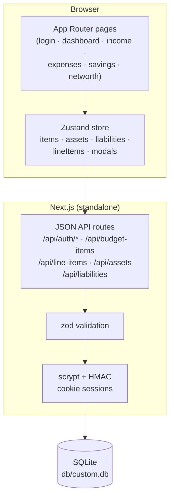
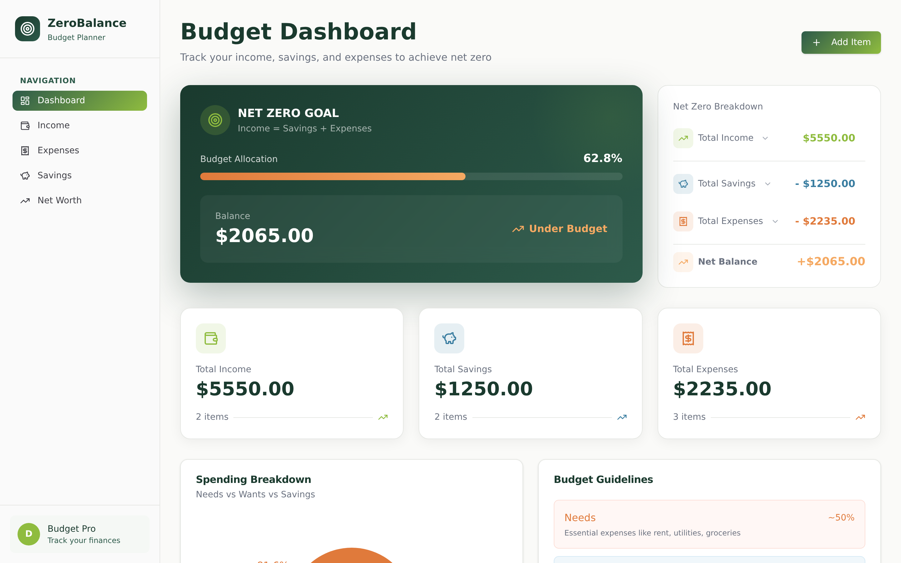
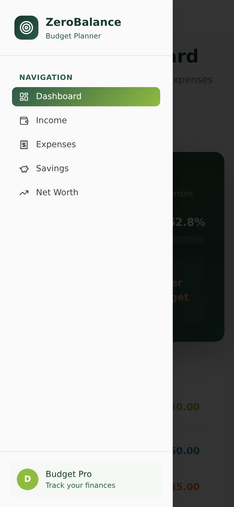
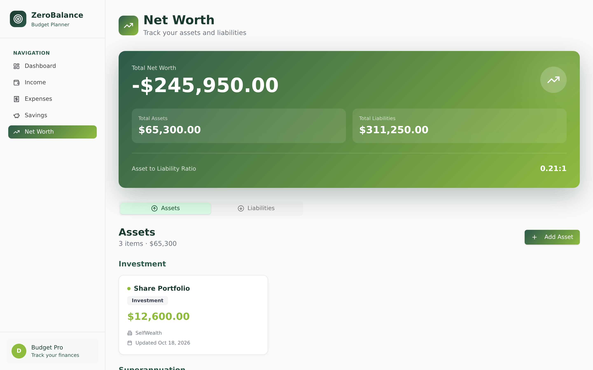
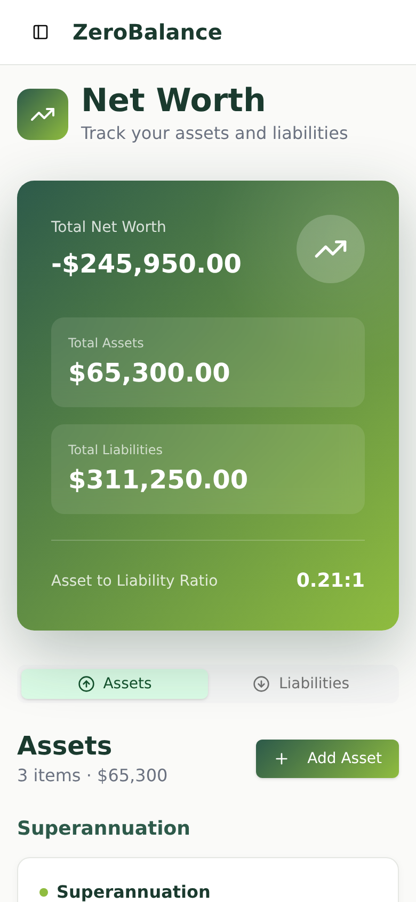
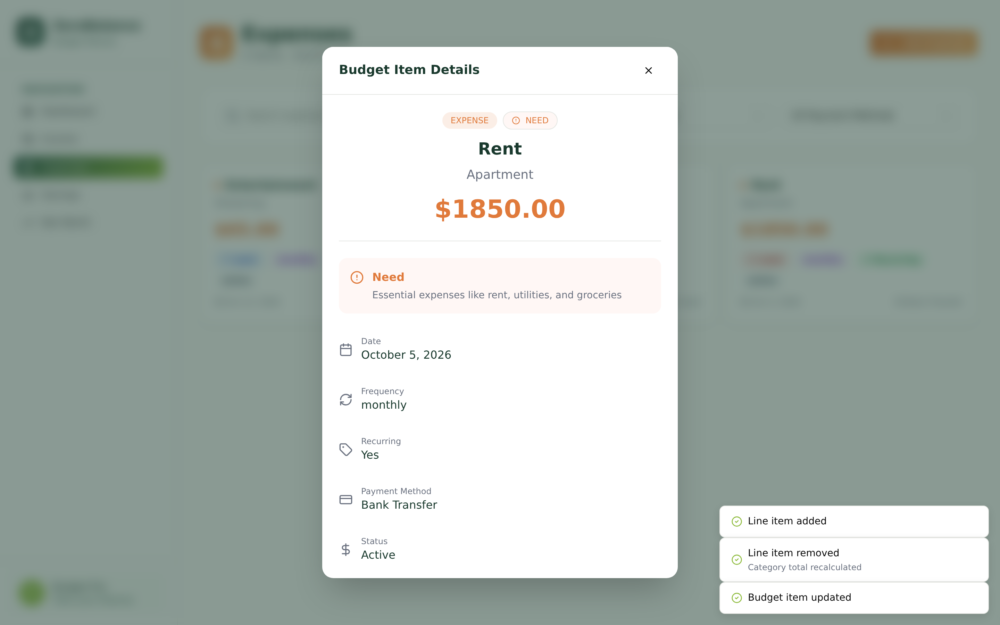

# ZeroBalance — Budget Planner


A production-grade budget planner built around one rule — **Income = Savings + Expenses** — and a self-hosted, superset clone of the reference ZeroBudget app (`zero-balance-4885a8f3.base44.app`), rebuilt as a single Next.js application with cookie-session auth, a Prisma/SQLite store, and a full three-tier test suite.

## Overview

ZeroBalance tracks income, savings, and expenses as budget items, computes your net position against the net-zero goal in real time, and breaks your balance sheet into assets and liabilities for net-worth tracking. The dashboard aggregates everything into allocation percentages, a needs/wants/savings donut, and 50/30/20 guideline rows; every expense category can be decomposed into line items through a built-in calculator that recalculates the category total server-side on every change. The clone keeps pixel-level visual parity with the reference while fixing its two mobile navigation bugs (see [Superset fixes](#superset-fixes-over-the-reference)).

## Key Features

| Feature | Description |
|---------|-------------|
| 🎯 **Net Zero Goal hero** | Forest-gradient dashboard card computing `Income − Savings − Expenses`, allocation %, and Under Budget / NET ZERO / Over Budget status |
| 📊 **Net Zero Breakdown** | A 3-level expandable drill-down (section → category → subcategory → item, accordion-style) with sign-prefixed rows (`$5,550.00` → plain format `- $1250.00`) and a sign-conditional Net Balance (lime/orange/blue) |
| 📈 **Spending Breakdown donut** | recharts pie in the reference's sector order [Savings, Want, Need] (`#8fbc3f` / `#3b7ea1` / `#e07a3b`) with piggy-bank / heart / circle-alert legend icons |
| 🧮 **Category Calculator** | Break any expense category into line items (name, amount, frequency, provider, policy #); each mutation recalculates and persists the parent item's amount server-side, with category-adaptive chrome ("Rent Calculator / Break down your rent…") |
| 💰 **Net Worth tracker** | Assets vs liabilities tabs grouped **by type** under capitalize headers, gradient summary card with the `0.21:1` / `∞:1` asset-to-liability ratio |
| 🔍 **Filterable item views** | Search + category + frequency (+ payment method on expenses) filters; per-classification/per-frequency badge maps, capitalized green Recurring badge; hover-revealed Edit/Calculate buttons on expense cards (plus a superset delete in the edit dialog) |
| 📱 **Working mobile navigation** | Hamburger + slide-in sheet at 288px with the current route highlighted (the reference's forest-gradient active style) — plus both reference bugs fixed (below) |
| 🔐 **Cookie-session auth** | scrypt password hashing + HMAC-signed sessions, per-IP rate limiting (10 attempts / 15 min), zod-validated API, four-state login card (sign-in / sign-up / forgot / verify-email) with the register flow gated behind a 6-digit email-verification code (honest self-hosted delivery — see the v21 plan) |

### Superset fixes over the reference

The live reference app has quirks and bugs, measured against the clone:

1. **Hamburger click-block** — the reference's empty toast container (`pointer-events: auto`, full-width, top 32px, z-100) covers the top half of the mobile hamburger button. The clone's toast viewport is `pointer-events: none` (the sonner pattern); toasts re-enable pointer events individually. Pinned by `tests/e2e/mobile-navigation.spec.ts`.
2. **Menu stays open after nav** — tapping a nav link in the reference's sheet changes the route but leaves the sheet + overlay trapping the user. The clone closes the sheet on every navigation. Pinned by the same spec.
3. **Root URL nav highlight** — the reference marks NO nav item active when you sit on `/` after login (its active check compares the pathname to `/dashboard`). The clone highlights Dashboard on the root route — the page you are actually viewing.
4. **Mobile horizontal overflow** — the reference's own pages scroll sideways on a 390px phone: the dashboard measures 395px and the net-worth page 464px (its fixed `text-5xl` net figure + fixed 2-col summary grid stretch `main` past the viewport). The clone fits exactly (390px) via `min-w-0` on `main` plus a responsive summary card (`text-2xl` on phones, `sm:grid-cols-2`). Pinned by `tests/e2e/mobile-layout.spec.ts` + the net-worth mobile spec.
5. **Dialogs ignore Escape AND outside-click** — the reference's modal overlays are plain `fixed` divs with no keyboard dismissal and no overlay-click dismissal (verified on its budget-item and line-item dialogs: Escape with focus inside and real clicks on the overlay corner both leave it up; only X/Cancel close it). The clone's Radix dialogs close on Escape and overlay click. Pinned by `tests/e2e/dialog-buttons.spec.ts`.
6. **Delete without confirmation** — the reference's card menu Delete destroys the item immediately (verified live — the same for its calculator line-item rows). The clone's delete paths confirm first (the edit dialog's inline confirm / the alert dialog).

The mobile layout itself (top bar stacked inside `main` at the reference's 61px geometry, no horizontal overflow) is pinned by `tests/e2e/mobile-layout.spec.ts`.

## Architecture

| Layer | Technology | Version | Purpose |
|-------|-----------|---------|---------|
| Web framework | Next.js (App Router) | ^16.1.1 | Routes, static prerender + standalone build |
| UI runtime | React | ^19.0.0 | Client components, hydrated static pages |
| Language | TypeScript (strict) | ^5 | End-to-end typing, `noEmit` typecheck gate |
| Styling | Tailwind CSS | 4 | CSS-first `@theme`, utility classes + inline CSS-var colors |
| Charts | recharts | ^3.10.1 | Spending Breakdown donut |
| State | Zustand | ^5.0.6 | Single client store (server data + modals), `useShallow` selectors |
| ORM | Prisma | 6.11.1 | Schema, migrations, typed client |
| Database | SQLite | — | `db/custom.db` at the repo root (zero-config) |
| Validation | zod | ^4.6.5 | Every API input, field-level 400s |
| Unit tests | Vitest | ^5.0.1 | Pure domain seams (money, dashboard math, validators) |
| E2E tests | Playwright | ^1.63.0 | Production standalone server, real Chromium |



## File Hierarchy

```
📂 zero-balance/
├── 📂 prisma/
│   └── 📄 schema.prisma           # User, BudgetItem, ExpenseLineItem, Asset, Liability
│   └── 📄 seed.ts                 # Idempotent demo seed (demo@zerobalance.app / Demo1234!)
├── 📂 src/
│   ├── 📂 app/                    # App Router: 7 routes + 23 API handlers (15 files)
│   │   ├── 📄 login/page.tsx      # Three-state auth card
│   │   └── 📄 [dashboard·income·expenses·savings·networth]/page.tsx
│   ├── 📂 components/
│   │   ├── 📂 budget/             # Views, dialogs, sidebar, store (the app)
│   │   └── 📂 ui/                 # shadcn-style primitives (dialog, select, toast…)
│   └── 📂 lib/                    # Domain seams: money, dashboard, validation,
│                                  #   auth, rate-limit, serializers, db-path
├── 📂 tests/
│   ├── 📄 *.test.ts               # Vitest unit suites (108 tests)
│   └── 📂 e2e/                    # Playwright specs (263 tests) + global setup
├── 📂 scripts/
│   ├── 📄 smoke-test.sh           # 35-step production API smoke test
│   └── 📄 capture-screenshots.mjs # docs/screenshots generator
├── 📄 docs/                       # Tailwind v4 report, SSH push runbook, DEPLOYMENT.md, remediation plan, session log
└── 📄 db/custom.db                # SQLite database (gitignored)
```

## Quick Start

Requires **Node.js ≥ 20** (or bun ≥ 1.2) and npm.

```bash
# 1. install
npm install

# 2. database (SQLite file at db/custom.db — created by the push)
npm run db:push

# 3. seed the demo workspace
npm run db:seed

# 4. dev server → http://localhost:3000
npm run dev
```

**Verify setup**

```bash
curl -s http://localhost:3000/api/health          # {"ok":true,...}
# then log in with the seeded demo account:
#   email: demo@zerobalance.app    password: Demo1234!
```

**Production build**

```bash
npm run build        # standalone output (pins DATABASE_URL for the build)
npm start            # boots .next/standalone/server.js
```

## Environment Variables

`.env` (see `.env.example`; `.env` is gitignored):

| Variable | Required | Description |
|----------|----------|-------------|
| `DATABASE_URL` | yes | `file:../db/custom.db` — **relative to `prisma/schema.prisma`**, not the CWD. `src/lib/db-path.ts` anchors the same rule at runtime so CLI and server agree. |
| `NEXT_PUBLIC_SITE_URL` | no | Canonical public origin for metadata, `sitemap.xml` and `robots.txt` (default `http://localhost:3000`). |
| `AUTH_SECRET` | prod | HMAC key for session cookies. Generate with `openssl rand -hex 32`. Falls back to an insecure dev constant when unset. |

> **Database-location gotcha:** Prisma resolves a relative `file:` URL from a shell-inherited `DATABASE_URL` against the **CWD**, but from a `.env`-loaded value against the **schema dir**. The npm scripts pin `DATABASE_URL` (runtime) and use `env -u` (Prisma CLI) so both always land at `<repo>/db/custom.db`. Don't run bare `prisma db push` from an arbitrary directory.

## Testing

```bash
npm test            # Vitest unit suite (108 tests) — pure domain seams
npm run test:e2e    # Playwright e2e (263 tests) — needs `npm run build` first
bash scripts/smoke-test.sh   # 35-step production API smoke (own server, port 3210)
npm run typecheck   # tsc --noEmit
npm run lint        # eslint (react-hooks v6 rules enforced)
```

- The e2e suite boots the **production standalone server** on `:3100` with its own `db/e2e.db`, deleted and re-seeded **every run** — specs assert the seed's exact arithmetic (e.g. `+$2065.00` net balance) and restore their fixtures after themselves. Close live browser sessions before running it (four agent-browser sessions + Playwright's Chromium exceed the sandbox's memory and crash the run — session-17/19 lesson).
- One worker: the specs share a single seeded SQLite file (`playwright.config.ts`).
- Auth is signed in once by the `setup` project and replayed via storageState — the auth endpoints are rate-limited (10/IP/15 min), so per-test logins would trip the limiter.
- Unit tests cover the money arithmetic (integer-cent sums — no IEEE-754 drift), dashboard aggregations, every zod schema (including empty-string optional dates and impossible calendar dates), the rate limiter, and the SQLite URL resolution contract.

## Design System

Measured from the reference's `:root` (computed styles as ground truth):

| Token | Hex | Usage |
|-------|-----|-------|
| `--forest-dark` | `#1a3a2e` | Headings, active nav text, hero gradient start |
| `--forest-medium` | `#2d5a4a` | Secondary green, active nav gradient start |
| `--lime-green` | `#8fbc3f` | Income accent, primary buttons, avatar |
| `--orange-dark` | `#e07a3b` | Expense accent, "Need" donut slice |
| `--blue-medium` | `#3b7ea1` | Savings accent, "Want" donut slice |
| `--neutral-warm` | `#fafaf8` | Page background |

- **Typography**: the system font stack (`ui-sans-serif, system-ui, …`) — no webfonts.
- **Money — two formatters (measured in the reference bundle)**: plain `"$" + toFixed(2)` without thousands separators on the dashboard / items views / calculator (`$5550.00`); `toLocaleString` grouping on net worth only (`$25,000.00`). Savings/expenses breakdown rows carry `- ` prefixes, Net Balance `+`. Add buttons carry per-surface 135deg gradients (forest→lime, lime→limeLight, blue→blue, orange→orangeLight).
- **Motion**: sheet slide-in 500ms / slide-out 300ms; `data-[state]`-driven; no reduced-motion needs beyond Radix defaults.
- Tailwind v4 specifics (bare-HSL theme, oklch drift, shadow scale) are pinned in `src/app/globals.css` — the full trap report is [`docs/Tailwind-V4-Validation-Report.md`](docs/Tailwind-V4-Validation-Report.md).

## Engineering References

| Document | Purpose |
|----------|---------|
| [`zero-balance_SKILL.md`](zero-balance_SKILL.md) | Distilled engineering skill — design system, architecture, anti-patterns, debugging guide, pre-ship checklist |
| [`docs/remediation-plan.md`](docs/remediation-plan.md) | Session-1/2 findings ledger (reference bugs, Tailwind v4 traps, app bugs) with fixes and regression pins |
| [`docs/remediation-plan-v2.md`](docs/remediation-plan-v2.md) | Session-3 deep parity audit — money format split, drill-down, badge maps, gradients, networth grouping (14 finding groups) |
| [`docs/remediation-plan-v3.md`](docs/remediation-plan-v3.md) | Session-5 parity iteration — mobile top-bar layout bug, filter card, classification tiles, line-item status enum, login states (6 finding groups) |
| [`docs/remediation-plan-v4.md`](docs/remediation-plan-v4.md) | Session-7 parity iteration — nav-link geometry, net-worth summary card + mobile overflow, filter-aware header counts (6 finding groups, 2 new reference bugs) |
| [`docs/remediation-plan-v5.md`](docs/remediation-plan-v5.md) | Session-9 parity iteration — reference-token alignment (neutrals, accent, input, rings), net-worth tab grid + green active state, dialog action buttons (outline Cancel + per-dialog gradient Saves), hover-variant v3 semantics (10 finding groups, 2 new reference bugs R5/R6) |
| [`docs/remediation-plan-v6.md`](docs/remediation-plan-v6.md) | Session-11 parity iteration — plain-text action menus, Save-button icons, asset/liability dialog grid spans + edit-disabled type, reference empty-state pattern (bare icons, no circles), always-visible calculator row actions, padding-outside-max-w content column (14 finding groups + reference bug R7) |
| [`docs/remediation-plan-v7.md`](docs/remediation-plan-v7.md) | Session-13 parity iteration — post-login root redirect, login-surface slate hex pins (lab/oklab drift) + text-sm footer links, logo-ring halo layer, 24px lucide-target + text-lg sidebar brand, 16px near-black mobile toggle icon with shrink-0, sheet border/overlay pins, the custom 404 page, and full head metadata (description/OG/Twitter/canonical/manifest/apple) (8 finding groups) |
| [`docs/remediation-plan-v8.md`](docs/remediation-plan-v8.md) | Session-15 parity iteration — dialog footers rebuilt as the reference's `flex gap-3 pt-4` full-row split (Cancel/Save at flex-1 ≈ 306px each), every remaining badge/nav/Calculate named-palette class hex-pinned (frequency purple/gray/blue/indigo/pink, classification red/blue/green, Recurring green, status slate, zinc-700 nav, orange Calculate) so computed styles render plain rgb instead of v4 lab(), and the stray session-1 `prisma/db/custom.db` binary untracked (2 finding groups + hygiene; Recurring-badge conditional verified live both sides) |
| [`docs/remediation-plan-v9.md`](docs/remediation-plan-v9.md) | Session-17 parity iteration — the donut re-sorted to the reference's value-DESC convention (+ `labelLine={false}`), the dialog X-close rebuilt as the reference's 36×36 in-header button (sticky header 69px), the form labels restored to the inline shadcn-v1 line box (12px label→input gap — v4's space-y margin-block-end is layout-ignored on inline first children, pinned in globals.css), 52px classification tiles, the radio/switch #171717 primitive family, `rounded-full` → `rounded-[9999px]` (24 sites — v4 emits calc(infinity)), and the login card's per-state control geometry (14px button text; 44px sign-up/forgot controls vs 48px sign-in) (7 finding groups) |
| [`docs/remediation-plan-v10.md`](docs/remediation-plan-v10.md) | Session-19 parity iteration — the mobile sheet's active-nav highlighting restored (the reference's sheet renders the current route in the full active style — white + the 135deg forest-medium→lime gradient + fw 500; the clone had suppressed it since session 1 on an unmeasured assumption) — plus the pass's clean sweep: Select popover open state, card action-menu open state, breakdown drill-down expanded rows, guidelines leaves, live focus-visible rings, dialog scroll mechanics, date inputs, and empty-submit behavior all verified identical; the reference's no-toast-on-save behavior documented (the clone's success toasts are superset UX) (1 finding group) |
| [`docs/remediation-plan-v11.md`](docs/remediation-plan-v11.md) | Session-21 parity iteration — the empty-state headings restored to the reference's 20px (`text-xl`), the `.zb-btn-add` gradient-button family re-pinned (v3 bare-shadow ambient on every size, v3 shadow-sm on the outline variant, the shadcn focus-visible ring — white inner + 1px #0a0a0a + transparent outline — replacing the browser default), the Add-button Plus icons 20px→16px (7 sites), and the session-1 hover opacity-0.9 fade removed (the reference has no hover change) — plus the pass's clean sweep: tablet breakpoints 767/768/1024 (rail switch + content offset), rail hover, hero status badge, filter card live behavior + badge census, dialog/sheet/stat-card shadows (read in full), and the no-logout-UI parity all verified identical (4 finding groups) |
| [`docs/remediation-plan-v12.md`](docs/remediation-plan-v12.md) | Session-23 parity iteration — the login ERROR state rebuilt as the reference's red-tinted bordered banner (red-50/70% wash, red-200 border, 12px radius, 16px padding, centered red-700 14px/400 — the shadcn FormMessage pattern; the same slot serves sign-in 401s and sign-up mismatches), the per-route tab titles restored ("Income | ZeroBudget" etc. via route-segment metadata + the root layout's pipe template — a client-side title effect was tried first and REVERTED: React Float re-emits the static <title> after hydration and resets it ~24ms later), the login root promoted to a <main> landmark (tag swap), and the forgot-password flow rebuilt as the reference's confirmation-state layout with honest copy (no mail transport — the toast it replaces pretended nothing either, but the state matches the reference's card structure) (4 finding groups) |
| [`docs/remediation-plan-v13.md`](docs/remediation-plan-v13.md) | Session-25 parity iteration — the register duplicate-email 409 text matched to the reference ("A user with this email already exists"), the sign-up state's password placeholders restored ("Min. 8 characters" / "Re-enter password" — sign-in keeps dots), and the login inputs' FOCUS ring pinned as the reference's two-layer shadcn ring (white 0 0 0 2px + slate-400 0 0 0 4px — v4's color-only ring utility emits no shadow at all) — plus the pass's clean sweep: register banner chrome, login 401 text, item-card date formats, hero progress-bar chrome, the OR divider, the Google button, cursor styles, authed `/login` behavior, the reference's Google-OAuth divergence, and the code audit (npm audit = dev-only unpatchable braces advisory; secret scan clean) all verified/documented (3 finding groups) |
| [`docs/remediation-plan-v14.md`](docs/remediation-plan-v14.md) | Session-27 parity iteration — the donut hover TOOLTIP pinned to the reference (value "$X.XX" via a formatter + the full default-tooltip chrome: #e5e7e3 border, radius 8, 0 4px 12px shadow, black item row — recharts 3 drifts on all four axes), the net-worth tab icons restored (16px lucide circle-arrow-up/down, mr-2, currentColor — active green-900 / inactive gray), and the net-worth page header's 48×48 gradient icon chip (forest→lime, radius 12, white 24px trending-up — measured at BOTH viewports; the items-view chips were pinned in v4, the net-worth page's never was) — found via a VLM three-page screenshot sweep with every flagged diff DOM-verified — plus the pass's clean sweep: net-worth tablist keyboard flow, dialog initial focus (ref: no focus move — the clone's Radix trap is the a11y superset), invalid-input validation (silent both), guideline/accordion hovers, user-select, and the mobile-nav stack re-verified end-to-end (4 finding groups incl. the tooltip chrome) |
| [`docs/remediation-plan-v15.md`](docs/remediation-plan-v15.md) | Session-29 parity iteration — the FULL-PAGE LOADING STATE rebuilt to the reference (the last unmeasured surface class): a DOM-replacing `fixed inset-0` white-backed overlay + the reference's slate spinner (32×32, 4px borders — slate-200 track + slate-800 top spoke, 9999px radius, spin 1s) with NO shell mounted around it, and `boot()` flipping `booted` only after the data lands (the spinner covers the fetch, not just the session probe — the old code flipped it after the session probe and the data popped into empty views) — pinned by 4 new e2e specs using route-delayed API interception; also swept first-time: the Select keyboard flows (the ref is internally inconsistent — its filter selects advance the highlight on ArrowDown-open while its dialog selects highlight the current value; the clone's uniform Radix matches the dialog/a11y pattern), a VLM income/savings/mobile-dashboard sweep (every flag DOM-refuted as data-driven), and the mobile-nav R1–R4 + data-drift re-verification (1 finding group) |
| [`docs/remediation-plan-v16.md`](docs/remediation-plan-v16.md) | Session-31 parity iteration — the boot DATA-failure state measured for the first time: the reference STAYS in-app rendering a silent zero-state when its entity API dies (full shell, hero 0.0% / $0.00 / "✓ NET ZERO", items views "0 items · $0.00" + their standard empty states, NO error surface — a transient network failure looks like an empty budget) while the clone bumped the user to `/login` (boot()'s single catch conflated a data failure with a logged-out session); fixed with a nested try in `boot()` (the user stays, a `bootError` flag drives a one-shot honest error toast — the same superset class as the mutation-failure toasts) and pinned by 3 new e2e specs (route-aborted data APIs + a 401-probe regression pin); also swept first-time: the reference's mutation failure (a SILENT no-op — dialog stays open, no feedback; the clone's dialog + error toast superset verified live) and its no-refetch client-nav under a dead API (in-memory, matching the clone) (1 finding group) |
| [`docs/remediation-plan-v17.md`](docs/remediation-plan-v17.md) | Session-33 parity iteration — the CALCULATOR LINE-ITEM ERROR TIER measured for the first time (the parent-recalc response family the session-32 log flagged next): with the line-items API dead, the reference is SILENT on every path — its calculator load renders the empty-state ("Total Calculated $0.00 / Based on 0 items / No line items yet"), its create leaves the sub-dialog open with no feedback and no optimistic update, its delete leaves the row with no feedback; the clone's mutation-failure superset verified live (create: dialog open + "Could not save the line item" toast; delete: row stays + "Could not remove the line item" toast) but its calculator LOAD failure was swallowed as an unhandled promise rejection (`void loadLineItems(item.id)`) with no honest toast — fixed with a caught effect + the "Could not load the line items" error toast (per-open semantics), rendering unchanged (the reference's empty-state parity via the `?? []` fallback); pinned by 3 new e2e specs (load/create/delete — the mutation pins guard the previously untested catch blocks) (1 finding group) |
| [`docs/remediation-plan-v18.md`](docs/remediation-plan-v18.md) | Session-35 parity iteration — the NET-WORTH ASSET/LIABILITY ERROR TIER measured for the first time (the last unpinned dialog family the session-34 log suggested): the reference is SILENT on both paths with its entity API dead (asset delete → card stays, no confirmation, no feedback; asset save → the dialog stays open, no feedback); the clone's save-failure superset verified live and PINNED ("Could not save the asset" / "Could not save the liability"), while the delete paths swallowed the rejection in THREE files (`void deleteAsset()` / `void deleteLiability()` in net-worth-view, and — found by the post-fix grep sweep — `void deleteItem()` in item-card, the card-menu path the v16 dialog audit missed) — all fixed with caught confirm-bar handlers + the "Could not delete the asset/liability/item" toasts (per-click semantics, surfaces unchanged: the card + confirm bar stay); 5 new e2e specs (asset/liability save/delete under route-aborted APIs + the item-card delete); G2: the register duplicate-email spec's flake root-caused as the Next.js ROUTE ANNOUNCER also rendering role=alert (the old waitForSelector matched the empty announcer, not the 409 banner) — hardened with a text-filtered retrying locator; mobile-nav R1–R4 re-verified + data drift clean (twelfth check) — 96/134/30 green |
| [`docs/remediation-plan-v19.md`](docs/remediation-plan-v19.md) | Session-37 parity iteration — the **VLM VISUAL SWEEP** (the first full-page visual-AI comparison layer, the session-36 log's top suggestion): 12 auth-state pairs + 5 app views + 3 dialogs compared through `z-ai vision` with a mechanical pixel-diff layer — the auth surfaces IDENTICAL ×6 (the v12/v13 text pins held; the logo assets byte-identical by MD5), the app views LAYOUT_IDENTICAL ×5, the dialogs LAYOUT_IDENTICAL except ONE real drift: the item dialog's RECURRING-TOGGLE ROW (the reference runs the switch LEFT with the label right, NO calendar icon, borderless, on a green-tinted rgb(245,248,245) surface — the clone ran icon+label left, switch right, 1px border, transparent) — found by the VLM and DOM-verified on four axes (also DOM-refuted: two VLM hallucinations — the "faded logo" (MD5-identical assets) and the "taller button" (294×44 both)), fixed to the reference's exact arrangement and pinned by a new e2e spec; the calculator's flagged "extra line" refuted as a matching data-conditional (the reference shows the same "• Will update category total" on a non-zero item); tablet breakpoints 767/768/1024 re-measured (visual parity holds — heading x=288 both); mobile-nav R1–R4 re-verified + data drift clean (thirteenth check) — 96/135/30 green |
| [`docs/remediation-plan-v20.md`](docs/remediation-plan-v20.md) | Session-39 parity iteration — the **mobile-app-view + populated-edit-dialog VLM sweep** (the session-38 log's two top suggestions): 5 mobile views at 390×844 + the populated Edit dialog + the breakdown drill-down compared pairwise — the mobile dashboard IDENTICAL, the networth flags all documented superset fix #4 manifestations (plus one tab-tint hallucination refuted: identical rgb(220,252,231) both), and TWO real drifts found and fixed: the ITEMS-VIEW HEADER ROW (base `items-start` missing → the Add button stretched full-width 358px on mobile vs the reference's auto-width 147; `mb-6` vs the reference's `mb-8` → a 24 vs 32px header→filter gap at BOTH viewports — the dashboard's row already carried the correct pattern) and the CLASSIFICATION TILES (the reference's tiles carry 16px lucide icons — circle-alert #e07a3b / heart #3b7ea1 / piggy-bank #8fbc3f — between the radio and the text in BOTH Add and Edit dialog states; the v19 empty-dialog sweep had missed them); both fixed TDD-first and live-re-measured exact; mobile-nav R1–R4 + data drift (fourteenth check) clean; the census probe's base64→atob UTF-8 mangling root-caused (the v19 "mid-pass fix") and fixed transport-safe — 96/137/30 green |
| [`docs/remediation-plan-v21.md`](docs/remediation-plan-v21.md) | Session-41 parity iteration — **SEO + the register verification gate**: the sitemap.xml/robots.txt the reference serves added via Next.js MetadataRoute routes (its five-URL/priority structure mirrored with the clone's routes; `/login` excluded like the reference); the calculator's line-item row actions re-measured HOVER-REVEALED on the live reference (its `opacity-0 group-hover:opacity-100` chrome changed since the v6 pin — the same class as v19's recurring-row drift) and matched, with the `@variant group-hover` pin keeping the reveal alive on hover:none devices; and the REGISTER POST-SUCCESS flow measured for the first time (the reference gates registration behind a "Verify your email" state — 6-digit code inputs, a 5-attempt countdown, Resend semantics, unverified-login rejection) and rebuilt as the honest superset: the full state chrome + `/api/auth/verify-email` + `/api/auth/resend` + a 403 unverified-login rejection + the seeded demo user pre-verified; swept clean: the mobile sheet-open pair, the net-worth populated edit-asset pair (the X-close thrice-DOM-refuted), a keyboard-focus spot check — 108/142/35 green |
| [`docs/remediation-plan-v22.md`](docs/remediation-plan-v22.md) | Session-43 parity iteration — the line-item sub-dialog's THIRD dialog family measured for the first time (the populated Edit state, both viewports): the reference caps its panel at **85vh** (680px desktop / 717px mobile) with form gaps `space-y-5` (20px) — the clone rode the generic budget-item family (90vh + 24px gaps); fixed to the measured family (desktop 672×680, mobile 358×717, form 1002px, gaps 20px — the calculator family stays 85vh/overflow-hidden, the budget-item family stays 90vh/space-y-6, both pinned) — plus the verify-email spec's parked-pointer race root-caused (the Create-account click leaves the pointer on the swapped-in Verify button; its 200ms hover transition read mid-flight — the app was correct, the spec needed the documented park + settle discipline); swept clean: the mobile calculator VLM pair (the row-action "missing" flag = a screenshot mouse-position artifact, DOM-identical both states; the X-close claim refuted a FOURTH time), keyboard Tab sweeps on the dashboard + income views (order + focus chrome identical), mobile-nav R1–R4, the SEO pair live on both sites, data drift (sixteenth check) — 108/143/35 green |
| [`docs/remediation-plan-v23.md`](docs/remediation-plan-v23.md) | Session-45 parity iteration — a clean two-site verification pass whose two finding groups are TEST-PINS of newly measured surfaces: the mobile sheet's KEYBOARD semantics measured live for the first time (initial focus lands on a sheet container, real Tab presses cycle the five links at identical positions and WRAP in a focus loop, the visible indicator is the blue #3b82f6 2px sidebar-ring layer, Escape closes — both sites identical; pinned by the mobile-navigation spec's new G1 test) and the register verify-email state's MOBILE chrome measured for the first time at 390×844 (the responsive mobile scale: 56px circle / 28px shield icon / 20px h2 — vs the desktop 64/32/24; inputs 6×40×44 gap 6; button 294×44 #0f172a; pinned by the verify-email spec's new mobile G2 describe, register budget 5→6 calls); swept clean: the budget-item dialog's mobile VLM pair (the radio "thicker border" claim DOM-refuted — the 5th dialog-scale VLM misread), the custom 404 at mobile (identical), the v22 sub-dialog fix re-verified at both viewports, mobile-nav R1–R4 (17th check), the SEO pair, data drift (17th check — a false alarm from the shared parity browser resolved), and the v22 changeset audit; probe lessons: agent-browser "sessions" resolve to ONE browser (always open+settle before evals), the parked-pointer hover artifact now applies to probes too, and one transient first geometry read after a state swap (re-measure + class-attribute tie-break) — 108/145/35 green (2 new e2e) |
| [`docs/remediation-plan-v24.md`](docs/remediation-plan-v24.md) | Session-47 parity iteration — two REAL app fixes found by pairing the register SIGN-UP state at mobile for the first time (VLM said IDENTICAL; the DOM found both): (G1) the reference runs THREE responsive families across its auth forms — sign-in `h-11 sm:h-12` + `text-base md:text-sm`, sign-up `h-10 sm:h-11` + `text-sm sm:text-base md:text-sm` (40px/14px at mobile), forgot `h-10 sm:h-11` + `text-base md:text-sm` (40px/16px) — the clone rendered the flat 44px sign-in family on all three (4px taller inputs/buttons + 2px larger sign-up font at mobile; desktop coincides, which is why every prior pin passed); fixed with per-mode height/font branches in `login-card.tsx`. (G2) the v4 `space-y-1.5` trap — the v9 globals.css v3-pin stopped at `space-y-2` (the dialogs): v4's margin-block-end on the INLINE auth label is absorbed by the line box, collapsing the label→input gap to 4px where the reference (v3 margin-top on the input's relative wrapper) renders 10px at every viewport — the pin extended to `space-y-1.5` (6px v3 form). Swept clean: the sheet's ARROW-key semantics (inert on both), the forgot state's desktop chrome (identical), the v23 sheet-keyboard fix re-verified live, the v9 dialog label gap (12px both), mobile-nav R1–R4 (18th), the SEO pair, data drift (18th) — 108/150/35 green (5 new e2e) |
| [`docs/remediation-plan-v25.md`](docs/remediation-plan-v25.md) | Session-49 parity iteration — three DOM-verified fixes from the FIRST keyboard-focus-ring sweep of the auth + 404 surfaces (REAL Tab presses, pointer parked): (G1) the auth submit buttons' focus-visible ring — the reference renders zinc-950 `#09090b` (its shadcn `ring-ring`, a white 2px offset + the v3 ambient) where the clone rendered the INPUTS' slate-400 `#94a3b8` (two distinct reference families the clone had collapsed into one; the reference's dialog buttons run a third — the 1px `#0a0a0a` v19 pin, untouched); fixed on both submit lines in `login-card.tsx`. (G2) the 404 "Go Home" button — the reference runs plain `focus:` (engages on ANY focus) with slate-500 `#64748b`; the clone had keyboard-gated slate-400; fixed to the reference's family verbatim. (G3) the BODY BACKGROUND layer — the reference styles NO body bg (the browser's white canvas) and paints its warm `#fafaf8` paper on the app-shell wrapper; the clone had the paper on the body (the v7-era manifest read — a PWA splash color): visually invisible (the login gradient/shell/404 root cover the body on every page — the regenerated screenshots are byte-identical) but a real computed-style + layer-structure drift, now corrected and pinned. Also swept clean: the auth forms at the sm band 672×800 (the sign-up font's 16px middle step — exact match, the v24 ladder verified at the third viewport), the login page's full focus walk (the Google/swap buttons' browser-default outlines match; the reference's stop #7 is the Base44 platform badge, not app chrome), the v24 fixes re-verified live at both viewports, mobile-nav R1–R4 (19th), the SEO pair, data drift (19th) — 108/154/35 green (4 new e2e; lesson 43 — programmatic `focus()` in agent-browser evals never engages `:focus`/`:focus-visible` on either site: REAL Tab presses are the reliable probe mechanism) |
| [`docs/remediation-plan-v26.md`](docs/remediation-plan-v26.md) | Session-51 parity iteration — two DOM-verified fixes behind the session-51 log's suggested surfaces (the dialog buttons' Tab-vs-click mouse-focus pair + the verify-email inputs' first aria/landmark audit): (G1) the body's `antialiased` class — the reference REMOVED it after v25 (its body is now fully classless, `-webkit-font-smoothing: auto`, measured across /login, /, and the 404 with fresh opens); the clone still carried `antialiased`; fixed to the reference's classless body (rendering identical on Linux Chromium — A/B pixel-verified; on macOS the reference's subpixel text is the target). (G2) the verify-email code inputs' autocomplete — the reference runs `one-time-code` on the FIRST box only and `off` on the other five (the standard OTP convention); the clone had it on all six; fixed with the conditional prop. The dialog-button pair found NO drift (both sites' dialog buttons run the identical `focus-visible:ring-1 ring-ring` family — a mouse click shows no ring on either; the v19 `focusVisible:true` methodology captured the right family). The verify-state audit kept the clone's `aria-label` boxes + arrow-key navigation as documented supersets (the reference's inputs are unnamed and arrow-inert). Also swept clean: mobile-nav R1–R4 (20th — Tailwind v4 pins hold), data drift (20th), the SEO pair, the v24 auth census, the v25 fixes re-verified live, the VLM login pair (IDENTICAL) — 108/155/35 green (1 new e2e; the reference's register endpoint started demanding "Security verification" after ~2 synthetic registrations — a platform anti-automation gate, documented) |
| [`docs/remediation-plan-v27.md`](docs/remediation-plan-v27.md) | Session-53 parity iteration — ONE DOM-verified fix from the dialog X-close button's first keyboard/hover-family measurement (an extension of the session-53 suggested-surface sweep): the reference's X runs the shadcn ghost-icon base — `focus-visible:outline-none focus-visible:ring-1 focus-visible:ring-ring` (a **1px** #0a0a0a ring on REAL Tab, the same family as the dialog Cancel/Save buttons) + `hover:bg-accent hover:text-accent-foreground` (the icon's currentColor shifts #0a0a0a → #171717 on hover); the clone's hand-written `DialogCloseButton` had drifted to `focus:outline-none focus-visible:ring-2` (a 2px ring) with no hover text — fixed with the one class string in `dialog.tsx`, covering all four dialogs. The session-53 suggestions ALL swept clean (first measurements): prefers-reduced-motion (both sites run the full 500ms sheet slide-in + the 1s spinner under reduce — zero reduced-motion rules on either), print/overscroll (white body, `auto` overscroll, zero print rules), scrollbar styling (native `auto` scrollbars at the dialog's 90vh `overflow-y-auto` on both). Also swept clean: dark mode (both stay light — no `prefers-color-scheme` rules), the app-surface real-Tab focus rings (rail links' blue 2px + Add Item's ambient family + the stat cards' NO-ring — three distinct families all matching), the filter triggers + search inputs (byte-identical classes), mobile-nav R1–R4 (21st — Tailwind v4 pins hold), data drift (21st), the SEO pair, the v26 fixes re-verified live — 108/155/35 green (1 e2e extended; one probe-methodology note: the clone's Radix dialog TRAPS focus while the reference's plain-div dialogs do not, so the walk-to-X stop counts differ — a keydown-dispatched Tab inside one eval reaches the X on the clone) |
| [`docs/remediation-plan-v28.md`](docs/remediation-plan-v28.md) | Session-55 parity iteration — **THREE fixes, headlined by a whole missing surface**: (G3, the headline) the reference's card-body click opens a read-only **"Budget Item Details" sheet** — bottom-anchored full-width at mobile (`rounded-t-3xl`, 85vh), centered 512px `max-w-lg` at desktop, forest 50% + blur(8px) scrim, sticky header + the v27 X-close family, a centered summary (type/classification pill badges, `text-2xl` name, `text-4xl` type-colored amount), the tinted classification block, icon-led fact rows (Date/Frequency/Recurring/Payment Method?/Status + a taller Notes? variant), and the Created/Last Updated footer — measured across all three types and both viewports, then built as `item-details-dialog.tsx` + the store's sixth modal slot + the card's guarded onClick (inner buttons still act). (G1) the card badges' hover family — every reference badge tints to `rgba(245,245,245,0.8)` on a REAL CDP hover (`hover:bg-secondary/80` + 150ms); the clone's were static — fixed via `.zb-badge-hover` in globals.css pinning the exact computed rgba (the direct TW4 utility computes as oklab `lab(96.5375 0 0 / 0.8)` — the v7 G6 drift class). (G2) the expense-card footer Edit/Calculate buttons' keyboard family — the reference runs `focus-visible:ring-1` (+ the Edit's `hover:text-accent-foreground`); the clone's hand-written strings had none (the UA default outline rendered on REAL Tab) — fixed on both class strings. Swept clean (the session-55 suggestions): the one-pass button-variant census (Add/Select/ghost-icon all matching), the avatar chip (non-interactive on both), the toast close buttons (the reference renders NO toasts at all — viewport heights sampled 200ms/900ms/3.4s after save), mobile-nav R1–R4 (22nd — Tailwind v4 pins hold, both sites), data drift (22nd, after an explicit add-then-delete probe cycle restored the census), the SEO pair — 108/158/35 green (3 new e2e; new `16-item-details.png` screenshot; probe lessons: synthetic mouseenter never engages `:hover` — REAL `agent-browser mouse move` does; the reference's dialogs don't close on Escape; the reference's number-input keeps an EMPTY value — "0.00" is its placeholder) |
| [`docs/remediation-plan-v29.md`](docs/remediation-plan-v29.md) | Session-57 parity iteration — ONE DOM-verified fix from the net-worth view's FIRST interactive-family census (the session-57 suggested surface, never class-diffed): the asset/liability card TYPE labels — the reference's are Badge-base DIVs (rest bg `rgb(243,244,246)` / text `rgb(55,65,81)` + the REAL-hover tint `rgba(245,245,245,0.8)` over 150ms, the v28 G1 family on an unmeasured surface); the clone's static spans computed TW4 oklab (`lab(96.1596 …)`) with no hover family — fixed on both label strings via the hex pins (`bg-[#f3f4f6] text-[#374151]`) + the existing `.zb-badge-hover` pin. The census ALSO swept clean (first measurements): the tab triggers (computed byte-identical — the clone's hex-pin superset), the tablist, the Add Asset/Liability gradient buttons, the card containers (cursor `auto` on both — the reference's asset card click opens NOTHING, unlike its budget items), the action dropdown menus (panel + items byte-identical), the dashboard's breakdown-row hover (INERT on both sites — each site's inline `background-color` style overrides its own `hover:bg-gray-100` class). The OTHER session-57 suggestions all verified: the details sheet's keyboard semantics (the reference has NO focus/trap/role/Escape — its Tab walk tours the whole underlying page; the clone's Radix initial-focus→X + trap + Escape is the documented superset, and Chrome renders the pinned X ring on open), the VLM details pair (both DIFFERENT flags DOM-explained: the X ring = the superset, the fact rows = data), the ellipsis-Edit vs footer-Edit entry points (both open the SAME 14-field "Edit Budget Item" dialog — no finding). The regenerated mobile net-worth VLM pair's three flags were all DOM-arbitrated as no-change (the 1-col stacking = the v4 data-fit superset RE-VERIFIED by a live 2-col DOM experiment — the seeded $65,300/$311,250 glyphs need 152/169px vs the 107px cells; the trend icon inset is 48px on BOTH; the tab icons are the v14 circle-arrow pair). Also clean: mobile-nav R1–R4 (23rd — Tailwind v4 pins hold, both sites), data drift (23rd — reference only read, no probe items), the SEO pair — 108/158/35 green (the networth spec's label assertions extended; two sub-pixel-different net-worth screenshots) |
| [`docs/remediation-plan-v30.md`](docs/remediation-plan-v30.md) | Session-59 parity iteration — **ZERO production-code drift found; the iteration PINS the newly-measured semantics instead** (the honest outcome of a mature parity state). Every session-59 suggested surface swept clean with first-time REAL-hover/keyboard measurements: the dashboard's guideline rows (rest byte-identical `rgb(255,247,245)`/`rgb(252,221,213)` + NO hover family on either site — the inline tints are static on both), the quick-action card buttons (classes + rest + hover rendered-parity — v4's `scale: 1.1` property vs the reference's `transform: matrix(1.1,…)` both render the 40→44px icon; the `hover:shadow-lg` visible layer pair byte-identical behind v4's extra TRANSPARENT lead layers), the savings view's card family (byte-identical card/badges/footer + the details sheet opens on click, cursor pointer on both), the net-worth tablist's arrow-key semantics (the reference IS Radix — the identical RovingFocusGroup attribute set down to `data-radix-collection-item`; ArrowRight → focus move + automatic activation + roving-tabindex update, identical), and the details sheet's keyboard semantics at MOBILE (geometry byte-identical 0/127/390/717 = 85vh; the reference's no-trap bug confirmed at the bottom-sheet breakpoint — its Tab walk tours the underlying page; the clone's trap holds). The SEO pair DEEPENED to the full head-metadata census (description/OG/Twitter byte-identical; the reference's `/manifest.json` endpoint serves EMPTY — the clone's webmanifest is the superset). TWO pin tests added (G1: the details sheet's keyboard semantics — initial focus on the X, Tab containment, Escape — at desktop AND mobile + the mobile bottom-sheet geometry; G2: the tablist's roving arrow-key contract) — TDD with pin-sanity mutations. Also clean: mobile-nav R1–R4 (24th — Tailwind v4 pins hold, both sites), data drift (24th — reference read-only), the VLM dashboard + mobile-details pairs (both IDENTICAL, "none") — 108/161/35 green (3 new e2e) |
| [`docs/remediation-plan-v31.md`](docs/remediation-plan-v31.md) | Session-61 parity iteration — the **donut's keyboard semantics** (the recharts 3↔2.15 drift trio) + the **classification tiles' fresh roving state**, both measured live on both sites and fixed TDD-first. G1: recharts 3's `accessibilityLayer` defaults ON — the chart surface stamped `tabIndex="0"` + `role="application"` (an EXTRA tab stop rendering the browser's unpinned 5px auto ring; the reference's surface is inert — no attribute, no role) and the tooltip's default content carried `role="status"` + `aria-live="assertive"` (the reference's tooltip renders neither) — both killed by `<PieChart accessibilityLayer={false}>`; AND recharts 3 REMOVED 2.15's pie keyboard roving (`attachKeyboardHandlers`: ArrowLeft `++`wrap forward / ArrowRight `--`wrap BACKWARD — the first ArrowRight from a fresh pie focuses the LAST sector / Escape blurs + resets / alt-arrows ignored / no preventDefault) — replicated exactly in `usePieKeyboardParity` (an `onkeydown` DOM property on the donut wrapper, delegation via bubbling; the pie layer `g.recharts-pie` stays the shared tab stop at `rootTabIndex: 0` on both versions). G2: the reference's older Radix ties the fresh roving tabindex to the CHECKED state (its fresh dialog renders the radiogroup container 0 + the checked tile's radio 0 — two stops); Radix 1.4.8's fresh RovingFocusGroup renders all radios at −1 — fixed with `tabIndex={selected ? 0 : -1}` on the tiles' `RadioGroupItem` (equal to the roving tabindex in every reachable state — checking always follows focus). NO findings: the filter selects' open-state arrow semantics (both sites Radix `listbox/option` roving with `data-highlighted`, no wrap — identical) and the form dialogs' full Tab order (the strict 14-field census byte-identical; the reference's 1×1 native-select shadows are not stops on either site). A REAL Tab into a Radix roving group lands on the CHECKED item — the container's entry focus forwards instantly (measured on both; never read activeElement as the container). Also clean: mobile-nav R1–R4 (25th — Tailwind v4 pins hold, both sites), data drift (25th — reference read-only), the SEO pair (full head census byte-identical + the superset webmanifest), the VLM dashboard + add-dialog pairs (all flags DOM-explained: superset #3, seeded data, the Radix X-focus ring) — 108/164/35 green (3 new e2e, TDD with pin-sanity mutations) |
| [`docs/remediation-plan-v32.md`](docs/remediation-plan-v32.md) | Session-63 parity iteration — the **calculator row actions' focus-visible ring family** (the only production-code drift, from the session-63 suggested-surface sweep) + the **breakdown rows' aria-expanded superset pinned**. G1: the reference's 32px line-item row actions (Edit/Delete) carry the shadcn focus family — REAL-Tab-measured: the 1px `#0a0a0a` ring shadow (`rgb(255,255,255) 0 0 0 0, rgb(10,10,10) 0 0 0 1px, …` with the white lead layer) + v3's outline-none form (`solid 2px rgba(0,0,0,0)` + offset 2) — while the clone's raw `h-8 w-8 … hover:bg-accent` buttons rendered the browser-default `outline: auto`. Fixed with `focus-visible:ring-1 focus-visible:ring-ring` inline + a NEW globals.css pin `.zb-row-action:focus-visible` (Tailwind v4's `outline-none` utility emits `outline-style: none` ONLY — v3's `outline: 2px solid transparent; outline-offset: 2px` form must be pinned in CSS; the same trap family as the shadow-scale shift and the hover media-gate). The populated-calculator Tab census itself is byte-identical on both sites (4 stops: X 36 / Add Item 110 / Edit 32 / Delete 32; the row actions are focusable inside their opacity-0 hover-reveal container — the reveal is hover-ONLY, never focus; the reference's dialog EXITS to the page after the last stop vs the clone's Radix wrap = the documented trap superset). S1: the breakdown section + category rows' `aria-expanded` (accurate state; the reference's rows have none) — measured, KEPT as a deliberate a11y superset (the aria-label family), and pinned by the breakdown spec so a future sweep doesn't 'fix' it away. NO findings: the net-worth dropdown menus' keyboard contract (byte-identical: click-open container focus / Enter-open first item / arrow roving with data-highlighted / CLAMPED at the ends / Home-End / NO typeahead / Escape returns focus to the trigger) and the breakdown accordion's arrow semantics (inert on both, Enter expands both, Escape collapses on neither; computed chrome identical). Also documented: the reference's calculator row delete is IMMEDIATE — the clone's inline confirm is the "unconfirmed deletes fixed" superset. Also clean: mobile-nav R1–R4 (26th — Tailwind v4 pins hold, both sites; a robust structure-based R2 sheet detector replaced the white-bg matcher that missed the reference's sheet), data drift (26th — reference read-only, verified before + after the probe cycles), the SEO pair (head census byte-identical), the VLM dashboard + calculator pairs (both flags DOM-explained: superset #3, the Radix X-focus ring) — 108/165/35 green (1 new e2e + the S1 pins, TDD with pin-sanity mutations) |
| [`docs/remediation-plan-v33.md`](docs/remediation-plan-v33.md) | Session-65 parity iteration — the **verify-email code inputs' focus family** (the only production-code drift, from the session-67 suggested-surface sweep) + the **toast announcer pinned**. G1: the reference's focused 40×44 code inputs render the 2px zinc-950 ring (`box-shadow: rgb(255,255,255) 0 0 0 0, rgb(9,9,11) 0 0 0 2px`) with NO border tint (the border stays #e4e4e7 — the ring alone signals focus) and the reference AUTO-FOCUSES the first box when the verify state lands — while the clone rendered an invented slate-400 border tint and no ring, and no auto-focus. Fixed with the register-input precedent idiom `focus:shadow-[0_0_0_0_#fff,0_0_0_2px_#09090b] focus:outline-none` + `autoFocus={i === 0}` (the reference's own register inputs carry the SLATE family — its code inputs carry the ZINC family; each surface measured separately). S1: the toast's announcement semantics measured and pinned — the clone's live toast announces via Radix's hidden `role="status" aria-live="assertive"` portal (`Notification Line item added`) within its 1-second mount window, while the reference's toast viewports are semantic-less `pointer-events: auto` divs (the standing R1 burger-blocker root cause) and its live toasts never fire on item/line-item saves or deletes (measured). NO findings: the line-item sub-dialog's focus traversal (13-stop census + REAL-Tab walk byte-identical INCLUDING the native date segments — each `<input type="date">` is a 4-stop walk; the two deltas are the documented Radix supersets), the sub-dialog's select triggers' focus chrome (the 1px ring IS present as the FOURTH box-shadow layer — v4's composition buries it behind three transparent placeholders; a truncated read fabricated a missing-ring finding), the register inputs + verify submit + Resend + Back (all pinned or raw-default-matched), the bundle pass (the clone's dashboard: 12 chunks 1,104KB raw/338KB gz vs the reference's 1,060KB/317KB one-bundle + a 214KB dev-only badge.js — wire-weight parity with a route-split superset). Also clean: mobile-nav R1–R4 (27th — Tailwind v4 pins hold, both sites), data drift (27th), the SEO pair, the VLM dashboard + verify pairs (both flags DOM-explained: superset #3, the dev-code hint box) — 108/166/35 green (1 new e2e + the S1 pin, TDD with pin-sanity mutations) |
| [`docs/remediation-plan-v34.md`](docs/remediation-plan-v34.md) | Session-67 parity iteration — **zero production-code drift: the session-69 suggested surfaces measured for the first time and PINNED** (the forgot-password focus walk + the calculator frequency Select's listbox keyboard contract) + a README doc-count fix. S1 (pin): the forgot state renders exactly THREE focusable app stops in order (Back to sign in → Email → Send reset link), NO auto-focus on landing (unlike the verify state's first-box auto-focus), the email input's focused chrome = the v13 slate family (white 2px + slate 4px + the tinted #94a3b8 border), the submit = the v25 zinc family (white 2px + zinc 4px + ambient — focus-VISIBLE-gated, a REAL Tab measures it), and the Back button stays raw (browser-default outline) — all byte-identical on both sites, now pinned so an auth-card refactor can't swap the families. S2 (pin): the frequency listbox's full keyboard contract — fresh-open focuses the SELECTED option rendering the accent highlight (`rgb(245,245,245)`/`rgb(23,23,23)`, `:focus`-driven), ArrowDown/Up rove, CLAMPED at both ends (no wrap), Home/End jump, NO typeahead (both sites), Escape closes the POPUP ONLY (focus → trigger, the sub-dialog stays), Enter selects (trigger updates) — pinned end-to-end with Playwright's real page focus. D1: the README's structure/commands sections still said 165 e2e after v33's 166 — fixed to the new 168. S3 (audit, NO finding): the API error tiers consistent (401/400/404/429/403/409), the client layered (network → non-JSON → envelope), every Prisma query userId-scoped, money math pinned. Probe lessons: the **unfocused-headless-window `:focus` artifact** (a `document.hasFocus()` gate is mandatory before any `:focus`-computed read — the first fresh-open comparison fabricated a missing-highlight finding: the reference read ran after real key presses, the clone read after JS clicks; Playwright is immune), `[tabindex=-1]` must be quoted in CSS selectors, and the display pipeline eats `[h` sequences too. Also clean: mobile-nav R1–R4 (28th — Tailwind v4 pins hold, both sites), data drift (28th), the SEO pair, the VLM dashboard + forgot pairs (dashboard one flag DOM-explained = superset #3; forgot IDENTICAL, zero flags) — 108/168/35 green (2 new e2e, TDD with pin-sanity mutations) |
| [`docs/remediation-plan-v35.md`](docs/remediation-plan-v35.md) | Session-70 parity iteration — the **item-card action menus' open-state focus chrome** (the session-70 suggested-surface sweep): TWO production-code drifts found by first-time REAL-key measurement and fixed. G1: the action-menu DELETE item's FOCUSED text color — the reference's `focus:text-accent-foreground` outspecifies its `text-red-600` when focused (the highlighted Delete renders `rgb(23,23,23)` dark text over the accent bg, red only at REST), while the clone's v5-era `focus:text-[#dc2626]` migration kept it RED when focused; fixed by removing the override on all three Delete items (income/savings card + both net-worth cards — the base DropdownMenuItem cascade then matches the reference exactly). G2: the menu TRIGGERS (the 36×36 hover-revealed kebabs) lacked the reference's shadcn `focus-visible:outline-none focus-visible:ring-1 focus-visible:ring-ring` family entirely (REAL-Tab into them rendered `box-shadow: none` vs the reference's 1px #0a0a0a three-layer ring) — the clone's DropdownMenuTrigger is the RAW Radix primitive, not the shadcn Button; fixed by adding the ring family inline on all three triggers. The rest of the menu contract measured byte-identical (fresh-open: click → the menu CONTAINER, Enter → the FIRST item; arrows rove with the accent highlight; ArrowUp from the container lands on the LAST item — the standard Radix convention; Home/End jump; Tab trapped; Escape → trigger; items 118×32; the trigger's rest opacity-0 hover-reveal on both). S2 (pin): the dashboard quick-action Add Item's focus-visible composite — the FOUR-layer box-shadow (white 0px lead + 1px #0a0a0a ring + the gradient family's two ambient layers) byte-identical on both sites, first-time measured, pinned at the dashboard instance (the `.zb-btn-add:focus-visible` v11 pin emits it; the dialog instances were pinned, the header instance never was). S3 (pin): the `?from_url` deep-link contract — the reference's login HONORS the param (measured live: `/login?from_url=/income` lands on `/income`); the clone byte-matches; pinned (+1 e2e). The 404's link-vs-button semantics documented as a SUPERSET (the reference's Go Home is a BUTTON that client-navigates; the clone's is a real `Link href="/"` — middle-click/crawler-followable, click behavior identical; the title derivation byte-identical). Probe lessons: compare the SAME open path across sites (click-open vs Enter-open land focus differently on BOTH — a cross-path comparison fabricated a phantom finding), a sed on a class substring can strip more than intended (the mutation-B strip also removed the expense-card buttons' ring — caught by the full-chain re-run), the genuine ArrowUp-from-container contract is LAST-item (an Enter-open-then-ArrowUp reads a clamped first-item and contaminated the first S1 draft). Also clean: mobile-nav R1–R4 (29th — Tailwind v4 pins hold, both sites), data drift (29th), the SEO pair, the VLM dashboard + menu-open pairs (dashboard flags DOM-explained = superset #3 + demo data; menu-open IDENTICAL, zero flags — the G1 red-vs-dark text is below VLM resolution, the DOM measurement is the authority) — 108/171/35 green (3 new e2e, TDD with pin-sanity mutations) |
| [`docs/remediation-plan-v36.md`](docs/remediation-plan-v36.md) | Session-71 parity iteration — the **session-71 suggested-surface sweep: the item-card menu's HOVER-highlight family (first-time REAL-hover measurement — `agent-browser hover`, not synthetic events), the filter Selects' listbox keyboard contract (the /income instances; v34 covered the sub-dialog only), and the items-view Tab-order census (first-time PAGE-level walk; v33 covered the sub-dialog) — all three byte-identical on both sites and now test-pinned. Surface A (hover): hovering a menu item moves DOM focus to it (Radix's pointer-driven roving) and renders the SAME accent family as keyboard focus (bg rgb(245,245,245) + text rgb(23,23,23) — the hovered Delete is NOT red, the v35 G1 cascade extended to the hover path); pointer-off returns focus to the container and both items to rest; the menu survives the leave — pinned (S1) with the mutation sanity (re-adding `focus:text-[#dc2626]` FAILS the pin). Surface B (filter listbox): fresh-open via click AND Enter both land focus on the SELECTED option with the accent highlight; arrows rove CLAMPED at both ends; Home/End jump; Escape closes the popup ONLY (focus → trigger, the page unaffected); Enter selects + updates the trigger text — pinned (S2) at the category filter with the fixture-restore discipline (mutation sanity: stripping the SelectItem's `focus:bg-accent` FAILS the pin). Surface C (Tab walk): the sequence is exactly the five nav links → Add Income → the search input → the category combobox → the frequency combobox → the card kebabs (one per card, DOM order) — the same order the reference walks minus its Base44 platform badge ("Edit with Base44" + its Close button — platform chrome, correctly not replicated, flagged by the VLM too) — pinned (S3). THREE supersets documented from the walk: **#7 — the kebab trigger's keyboard reveal**: the reference's 36×36 trigger stays INVISIBLE (opacity 0) when keyboard-focused AND when its menu is keyboard-opened (a keyboard user loses visual focus entirely at that stop); the clone's day-one `focus-visible:opacity-100` + `data-[state=open]:opacity-100` keep it visible — pinned by the S3 walk's stop assertion. Plus: the clone's filter comboboxes/search input carry invisible aria-labels (day-one), and the reference persists `aria-controls` on its CLOSED trigger (a Radix-minor-version detail — both carry the matching attribute while OPEN). Probe lessons: synthetic mouse events do NOT move Radix's hover highlight (only a REAL pointer move does — the first probe fabricated "the reference ignores hover"), a blur does not reset the sequential-focus position (walk past the wrap), Radix Select's post-open focus landing is ASYNC (interleave a `toBeFocused()` between presses). Also clean: mobile-nav R1–R4 (30th — **Tailwind v4 pins hold, the mobile menu works**), data drift (30th — reference read-only, verified before + after), the SEO pair, the VLM dashboard + filter-open pairs (all flags DOM-explained: superset #3 + demo data + the platform badge) — 108/174/35 green (3 new e2e, TDD with pin-sanity mutations) |
| [`docs/remediation-plan-v37.md`](docs/remediation-plan-v37.md) | Session-72 parity iteration — the **session-72 suggested-surface sweep: the filter Select TRIGGERS' focus-visible family (first-time measurement of the closed trigger's keyboard chrome — the v36 census walked PAST the stops, never asserting them), the search input's focus + typing contract, and the /expenses payment-method filter (the third Select — never measured live). Surface A (trigger ring): a REAL Tab onto the closed category-filter trigger engages `:focus-visible` and renders the 1px #0a0a0a ring layered over the ambient shadow — border untinted, geometry unchanged (216×36) — pinned (S1) with the mutation sanity (stripping the SelectTrigger's `focus:ring-1 focus:ring-ring` FAILS the pin). O1 documented (not drift): the full box-shadow STRINGS differ in their invisible lead layers — the reference's v3 three-slot construct (white ring-offset lead) vs the clone's v4 five-slot construct (four transparent leads); every lead is a 0px-spread shadow, invisible by construction; the VISIBLE layers are byte-identical (the v11 shadow-scale precedent). Surface B (search): the REAL-Tab focus family (the same ring + ambient, border untinted, 447×36) + the REAL-key typing contract — an exact-name match narrows the list + recomputes the header, a no-match string swaps to the EMPTY state (the h3 "No income items yet"), clearing restores the cards — pinned (S2) (mutation sanity: stripping the Input's `focus-visible:ring-1 focus-visible:ring-ring` FAILS the pin). Surface C (payment-method filter): the third Select's trigger chrome (216×36) + its DYNAMIC option derivation + the Credit Card round-trip (2 cards, "2 items · $385.00") + the reset — pinned (S3) (mutation sanity: emptying the `paymentMethods` derivation FAILS the pin). The reference's own PM list carries only its All option (its demo items hold no paymentMethod values — data-level; its edit dialog carries the "payment method" field, verified read-only). Probe lessons: the reference's card titles are h4 (its empty-state heading h3 — an h3-only census fabricated "no cards" readings), `agent-browser keyboard press Backspace` does not register in the reference's focused search input (clear via the native setter + input Event), Playwright's `fill("")` is unaffected. Also clean: mobile-nav R1–R4 (31st — **Tailwind v4 pins hold, the mobile menu works**), data drift (31st — reference read-only, verified before + after), the SEO pair (the reference's sitemap capitalizes its app-route URLs `/Income` `/Savings` — documented; the clone mirrors its own lowercase routes), one VLM pair (/expenses + PM filter open — all five flags data-explained) — 108/177/35 green (3 new e2e, TDD with pin-sanity mutations) |
| [`docs/remediation-plan-v38.md`](docs/remediation-plan-v38.md) | The a11y tooling pass + two first-time surfaces — **the axe-core a11y gate shipped** (`@axe-core/playwright` devDependency, `tests/e2e/a11y.spec.ts`): every app route scanned (6 authed + the 404 + the login) under two gates — GATE 1 (structural: no axe rule other than color-contrast may fire) + GATE 2 (provenance: every contrast-flagged color must be one of the reference's own 7 measured palette colors) + the login's zero-violation gate. **The superset measurement behind it**: the reference FAILS `button-name` (critical — its unlabeled Select triggers + card kebabs) and `svg-img-alt` (its recharts donut sectors) while the clone PASSES both (the aria-label superset + the v31 inert donut); the clone's only failures are the reference's own parity-pinned contrast colors (1:1 node enumeration, both sites, byte-identical colors). The session-72 tooling pass's other half: `scripts/parity-probes/hasfocus-gate.sh` — the v34 `document.hasFocus()` discipline as a shared, fail-loud probe helper. Also pinned: the /expenses frequency filter's STATIC 7-option census (byte-identical to the reference's — All + One-time/Weekly/Bi-weekly/Monthly/Quarterly/Annually) + the Weekly round-trip ("1 items · $320.00") + the reset (S1, mutation-verified); the /savings filter-card instance (the white rounded-2xl card, the 447×36 search, the two 216×36 comboboxes, the 4-col grid — byte-identical to the reference's) + the category round-trip (Emergency Fund → "1 items · $800.00" → reset, S2, mutation-verified). Standing checks clean (32nd): mobile-nav R1–R4 both sites (**Tailwind v4 pins hold, the mobile menu works**), data drift (reference read-only, before + after), the SEO pair, one VLM pair (/savings — all four flags data-explained) — 108/187/35 green (10 new e2e, TDD with pin-sanity mutations) |
| [`docs/remediation-plan-v39.md`](docs/remediation-plan-v39.md) | **The a11y gate's MOBILE extension — the 390×844 sheet-state scan** (`tests/e2e/a11y.spec.ts`, a new `test.use({ viewport: 390×844, isMobile, hasTouch })` describe): the six authed routes scanned sheet-closed under the same two gates (GATE 1 structural + GATE 2 the 7-color palette provenance) + the sheet-OPEN state's structural pins + the logged-out mobile login's zero-violation gate. **The measurement behind it** (a11y-scan-v39.mjs, both sites): the reference at mobile fails `button-name` (critical) on the four item views and `svg-img-alt` on the two dashboard routes — the same families as desktop — while the clone passes both everywhere; its only failures are color-contrast, every flagged color enumerated in the reference's own palette (the mobile node counts differ from desktop only by the demo card counts). **The headline structural superset**: the reference's mobile sheet is a plain `fixed` div — NO dialog role, NO `aria-labelledby`, NO `<nav>` landmark, NO accessible title — while the clone's sheet is `role=dialog` + `aria-labelledby` → the sr-only "Navigation" DialogTitle + `<nav aria-label="Primary">` + the five links + the named burger (sr-only "Toggle Sidebar"). Two pin-sanity mutations verified to FAIL (the stripped burger label → `button-name` fires on all six mobile routes — a desktop-only gate can never catch it; the removed DialogTitle → the `aria-labelledby` pin fails). Standing checks clean (33rd): mobile-nav R1–R4 both sites (**Tailwind v4 pins hold, the mobile menu works**), data drift (reference read-only, before + after), the SEO pair, one VLM pair (the mobile sheet-open state — both flags explained: the active-highlight superset #3 + the avatar letter). — 108/195/35 green (8 new e2e, zero production-code changes, TDD with pin-sanity mutations) |
| [`docs/remediation-plan-v40.md`](docs/remediation-plan-v40.md) | **The dashboard's Tab-order focus walk — the session-78 queue's LAST unmeasured surface** (`tests/e2e/dashboard.spec.ts`): the 16 REAL-Tab stops with tag + role + accessible name + tabindex (the five nav links → the Add Item header button → the three NetZero-breakdown stat-row buttons → the three interactive stat cards → the donut's `g.recharts-pie` tabindex=0 stop → the three quick-action cards → the body wrap) + the geometry bands (nav x=20 w=215 pitch 40; Add Item [1121,127,36]; the stat-row buttons x=961 w=254; the stat cards [288/616/944, 304×210]) + **the interactive stat-card SUPERSET activation** (Enter on the focused Total Income card routes to /income, Space on Total Savings routes to /savings). **The measurement behind it** (tabwalk-v36.sh + focus-census-v40.mjs + stat-card-chain-v40.mjs, both sites): the reference's 14-stop cycle is the same walk MINUS the three stat-card stops PLUS its Base44 "Close badge" (platform chrome) — **its big 304×210 stat cards are INERT divs** (no role, no tabindex, no handler — dead UI; only the text-ancestor chain probe separates them from the stat rows, which ARE buttons on both sites). The donut stop matches structurally (g.recharts-pie tabindex=0 both sites, the sector roving tabindex=-1, the inert surface — the v31 replication confirmed at the walk level; the reference's g carries the label texts inside, the clone's in a separate recharts-3 layer — library internals, VLM-clean). Two pin-sanity mutations verified to FAIL (the stripped role+tabIndex → the stat-card stops drop out of the walk; the removed key handler → the activation pin fails — the mutation literally reproduces the reference's dead-UI behavior and the test catches it). Standing checks clean (34th): mobile-nav R1–R4 both sites (**Tailwind v4 pins hold, the mobile menu works**), data drift (reference read-only, before + after), the SEO pair, one VLM pair (the desktop dashboard — all three flags explained: the active-highlight superset #3, the allocation-bar length = demo data, the avatar letter). — 108/196/35 green (1 new e2e, zero production-code changes, TDD with pin-sanity mutations) |

| [`docs/remediation-plan-v41.md`](docs/remediation-plan-v41.md) | **The net-worth summary card's viewport census + the vertical-rhythm fix — the savings-class viewports queue (the FIRST production-code change since v38)**. The surface (the session-86/87 queue's first item — the unmeasured MID viewport class): the summary card measured live on BOTH sites at 390×844, 640×960 AND 1280×800 (`nw-summary-v41.mjs` + `nw-yoffset-v41.mjs` + `nw-below-v41.mjs`). **At 640 (the mid viewport): FULL geometry parity** — the 608×333 card (p-8, radius 16, the forest→lime gradient, the `rgba(26,58,46,0.3) 0 20 60` shadow), the 48px/700 figure (`sm:text-5xl`), the 64×64 white/20% gradient chip at x=528 (9999px radius, the 32px icon), the 264×2 stats grid (16px gap, 84px cells), the 18px ratio, the 48@x=16 header chip, the 256/0.1 overlay, sw=vw. **THE v41 PARITY FIX (F1)**: the net-worth page's section rhythm ran `mb-6` (24px) where the reference runs `mb-8` (32px) at BOTH gaps (the header row→card and the card→tablist — 8px offsets at every viewport; the stack above/below matches byte-for-byte, the y-offset probe isolated the two margins) — the items-view pages carry `mb-8` since v20 G1; the net-worth view was the one page left at the pre-v20 rhythm (`items-rhythm-v41.mjs` ran the no-drift control on /income: identical both sites). **The MOBILE superset pair (390)**: the reference's card is **432px wide at the 390 viewport** (74px page overflow, sw=464, its chip 26px offscreen at x=352, its stats grid a fixed 2-col, its figure a fixed 48px); the clone's fits (358 card, the 24px `text-2xl` figure — superset fix #6, the 1-col grid, the chip fully inside, sw=390) with byte-identical card chrome. F2: the 640 census e2e (the full band census + **the two rhythm pins** — `card.y − chipRow.bottom === 32`, `tablist.y − card.bottom === 32`); F3: the 390 superset census e2e; F4: **the a11y sheet-open structural pins extended to the remaining five routes** (`/dashboard` `/income` `/expenses` `/savings` `/networth` — the v39 sheet-open test covered `/` only; the same dialog-role/labelledby/nav-landmark/five-links/Escape-close contract, the full axe scan stays on `/` since the sheet's DOM contribution is route-independent). FOUR pin-sanity mutations verified to FAIL: the reverted `mb-8` → the rhythm pin fails (24 ≠ 32); the stripped `sm:text-5xl` → the 48px pin fails; the fixed 2-col grid → the 1-col pin fails; the stripped DialogTitle → all five route tests fail. Standing checks clean (35th): mobile-nav R1–R4 both sites (**Tailwind v4 pins hold, the mobile menu works**), data drift (reference read-only, before + after), the SEO pair. — 108/203/35 green (7 new e2e, 2-line production fix, TDD) |
| [`docs/remediation-plan-v44.md`](docs/remediation-plan-v44.md) | **The drill-down expansion ANIMATION + the chevron GLYPH swap + the 390/1280 census + the donut-legend census — the session-95/96/97 queue**. The surface: the drill-down's expanded state at the REMAINING viewports (390 mobile / 1280 desktop) + the donut legend's geometry/interaction, measured live on BOTH sites (`exp-vp-v44.mjs` + `legend-v44.mjs` + `collapse-ref-v44.mjs` + `band-mount-v44.mjs`) — **TWO v44 parity fixes (the first production-code change since v43)**: (F1) **the expansion ANIMATES on the reference** (~200ms height+opacity tween, both levels, both directions — mid-collapse its band reads inline height: 25.5455px, a per-frame JS tween; the section band unmounts after the collapse animation) **while the clone mounted/unmounted instantly** — fixed with the `Collapse` wrapper (the grid 0fr↔1fr technique + `@starting-style` entry + the onTransitionEnd delayed unmount; the collapsed DOM returns to the pre-fix node tree — the accordion count-0 pins hold); (F4) **the chevrons SWAP GLYPHS** — `lucide-chevron-down` collapsed ↔ `lucide-chevron-up` expanded, both levels, rotate: none at every state (**a computed-style census cannot see a glyph swap — read the svg's class**; the standing VLM pair flagged it, the DOM verified it — the v43 "static chevron" finding was correct but incomplete). Pins: the 390 census (the chrome byte-identical, the mobile indentation, **the clone's sw 390 fully expanded — the superset**; the reference reads 395, its own overflow), the 1280 census (the 304px narrow column, the **section label's 2-line wrap** — labelH 40 on BOTH sites, the v42 56px row explained), the donut legend census (the geometry byte-identical: h 64/pad 12/radius 8/the label-amount-pct fonts/the 16×16 dot/gap 12/mt 24 — **and the hover INERT on both sites**: the queue's legend-interaction item resolved, no interaction states exist). FIVE pin-sanity mutations verified to FAIL (the zeroed duration, the removed @starting-style, the legend p-3→p-4, the sub-row py-1→py-2, the reverted glyph swap). Standing checks clean (38th): mobile-nav R1–R4 both sites (**Tailwind v4 pins hold, the mobile menu works**), data drift (reference read-only, before + after), the SEO pair, the VLM pair (the F4 glyph flag was REAL — the VLM screening earns its keep). — 108/214/35 green (5 new e2e, TDD) |
| [`docs/remediation-plan-v45.md`](docs/remediation-plan-v45.md) | **The shadow-scale sweep + the items-view card grid census + the calculator row hover — a PIN-ONLY iteration (no production-code change; the measured chrome was already at parity, the seven new pins lock it)**. The v45 discovery: a SYSTEMIC v3↔v4 divergence in the computed box-shadow composition — every live `shadow-*` utility's VISIBLE layers match on BOTH sites (the `--shadow-sm` theme pin is load-bearing for the small end: v4 RENAMED the scale, its native shadow-sm = v3's "shadow"; md/lg/xl/2xl kept v3's numerics) while the LEAD layers diverge by construction (v4's 5-slot composition emits 4 transparent leads vs v3's 2 — invisible, the accepted v10/v25 class). The md/lg/sm/2xl sites are now PINNED (the calculator row's hover shadow-md, the quick-action card's hover shadow-lg, the action buttons' rest shadow-md, the slate/Google buttons' shadow-sm, the login panel's shadow-2xl) — a future Tailwind upgrade that changes the scale numerics fails the suite. Pins: the items-view card census at 1280 (the grid 960 = the rail 256 + the content column 1024 − the p-8 64 — the SAME arithmetic on both sites, 3 cols × 309.328, gap 16; the card chrome; **the REAL hover INERT on both sites** — the inline boxShadow beats the hover:shadow-lg utility, the v29 family — while the expense action row REVEALS), the calculator row census + REAL hover (the panel 768@1280/608@640, the row 720/560 — byte-identical; the hover's visible shadow-md layers + the action reveal), the category-level band animation pin (the v44 F1 extension — in-flight frames at the nested level). FIVE pin-sanity mutations verified to FAIL (the card inline 0.04→0.08; the grid gap-4→gap-6; the row hover:shadow-md removed; the quick-action hover:shadow-lg removed; the slate shadow-sm removed). Standing checks clean (39th) + the VLM pair on the new surface: **IDENTICAL, zero flags**. — 108/221/35 green (7 new e2e, pin-only TDD) |
| [`docs/remediation-plan-v46.md`](docs/remediation-plan-v46.md) | **The net-worth card census + THE VALUE→FACTS SPACING FIX + the confirm-bar white-pill regression pin — the session-101 queue's first and third candidates**. The surface: the net-worth ASSET/LIABILITY cards at 1280 (the grid pitch, the card chrome, the hover state, the kebab reveal), measured live on BOTH sites (`nw-card-v46.mjs` + the REAL-hover driver steps) — the grid `md:grid-cols-2 lg:grid-cols-3 gap-4` 960 wide / 3 cols × 309.328 / gap 16 (the SAME family on both sites), the card chrome byte-identical (309/pad 20/radius 12/border 1px rgb(229,231,227)/rest shadow `rgba(0,0,0,0.04) 0px 2px 8px 0px`/transition all 0.2s; the title row gap 8/dot 8×8 rgb(143,188,63)/16-600; the type badge; the facts 12px rgb(107,114,128); the kebab 36×36 opacity 0), **the card's REAL hover INERT on BOTH sites** (the inline boxShadow beats the hover:shadow-lg utility, the v29 family) while the kebab REVEALS. **THE v46 PARITY FIX (F1): the value→facts spacing** — the reference wraps its value in `mb-4` (16px) while the clone's bare `mb-2` P rendered 8px (the card h 186 vs the reference's 194; the item-card's own `mb-4` wrap the in-repo precedent — the net-worth cards were the one oversight): `mb-2`→`mb-4` on both cards' value P. **F3: the confirm-bar white-pill pin** (the clone's superset chrome — the reference's net-worth DELETE is DIRECT, no confirm bars, the v18 superset-fix family): the bar chrome + the Cancel pill's shadow-sm VISIBLE layer `rgba(0,0,0,0.05) 0px 1px 2px 0px` (the `--shadow-sm` theme pin's regression net, the v45 net's fifth site). FOUR pin-sanity mutations verified to FAIL (the reverted mb-4; the pill's shadow-sm removed; the card inline 0.04→0.08; the kebab's group-hover reveal removed). Standing checks clean (40th) + the VLM pair on the /networth surface: **IDENTICAL, zero flags**. — 108/223/35 green (2 new e2e, 2-line production fix, TDD) |
| [`docs/remediation-plan-v47.md`](docs/remediation-plan-v47.md) | **The dialog-input focus composite + the net-worth card MOBILE census + the mobile sheet's shadow-lg — a PIN-ONLY iteration** (3 new e2e, TDD with four pin-sanity mutations; NO production-code change — the measured chrome was already at parity on every VISIBLE layer, the pins lock it). The surface (the session-101 queue's second item + the v46 follow-up + the session-104 sheet item): the dialog inputs' focus-state shadow composition — the REST shadow-sm visible layer + under a REAL focus the 1px `rgb(10,10,10)` ring with the rest shadow persisting beneath it (the reference's 3-layer v3 composite vs the clone's 5-layer v4 construction — the same two VISIBLE layers, the leads paint nothing, the accepted v10/v25/v45 class); the net-worth card's MOBILE census at 390 — the card internal rhythm at BYTE-PARITY post-v46-fix (358×**194**, the value mb **16**, the facts 12px rgb(107,114,128) — the fix's rhythm survives the mobile reflow; the reference's own card is 194 tall inside its 432-wide OVERFLOWING grid, its documented bug); the mobile sheet's shadow-lg census — both v3 pair layers (`rgba(0,0,0,0.1) 0px 10px 15px -3px` + `0px 4px 6px -4px`) + the bg/geometry/overlay re-verified (the shadow-scale regression net's SIXTH site). FOUR pin-sanity mutations verified to FAIL (the input's ring-1 removed; the input's shadow-sm removed; the value mb-4 reverted; the sheet's shadow-lg removed — each needs the standalone REBUILD first, the e2e-runs-against-the-build lesson). Standing checks clean (41st) + the VLM pair on the mobile /income surface at 390: 3 flags, all DOM-verified as data/platform classes (the richer seed's 4th Recurring badge wrapping in the byte-identical flex-wrap container + the reference's own Base44 FAB). — 108/226/35 green (3 new e2e, pin-only, TDD) |
| [`docs/remediation-plan-v48.md`](docs/remediation-plan-v48.md) | **The item-details sheet's shadow-2xl + the dialog-input focus composite at 390 + the empty-state full census — a PIN-ONLY iteration** (3 new e2e, TDD with four pin-sanity mutations; NO production-code change; the v45-family's fourth pin-only iteration). The surface (the session-108 queue #1 + #4 + #3): the details panel's shadow census at 1280 — the 512×680 (85vh-capped) panel at radius 16 with the v3 shadow-2xl VISIBLE layer `rgba(0,0,0,0.25) 0px 25px 50px -12px` (the reference's 3-slot vs the clone's 5-slot — the accepted lead-divergence class; the shadow-scale net's SEVENTH site) + the forest-scrim overlay rgba(26,58,46,0.5)/z 50/blur(8px) + the 36×36 sr-only-named X; the dialog input's focus composite at 390 — the v47 F1's MOBILE follow-up: the input w 310 on BOTH sites with the same visible layers (the rest shadow-sm + under REAL focus the 1px ring with the rest shadow persisting, the border unchanged, the 5-slot counts) — the family is viewport-independent; the empty-state FULL census via filter-to-zero at 390 — the bare block at BYTE-PARITY (the 358×328 `py-16 text-center` container, the 64px icon at opacity 0.2/mb 16, the H3 20px/600/forest/mb 8, the P 16px/gray/mb 24, the 36px gradient Add button + v3's BARE two-layer shadow). FOUR pin-sanity mutations verified to FAIL (the panel's shadow-2xl removed; the input's ring-1 removed — shared class, also v47's F1; the icon mb-4 reverted — the container h 328→320; the `.zb-btn-add` shadow removed). Standing checks clean (42nd) + the VLM pair on /savings at 1280: 4 flags, all DOM-verified as data classes (the richer seed's 2-card grid + the Recurring/payment-method rows + the user's avatar initial; the badge chrome byte-identical — need's red chip = the clone's same map). — 108/229/35 green (3 new e2e, pin-only, TDD) |
| [`docs/remediation-plan-v49.md`](docs/remediation-plan-v49.md) | **The login panel's mobile-only &nbsp; spacer (THE FIX — the first production-code change since v46) + the donut legend's mobile reflow + the calculator dialog's 640 chrome (two pin-only surfaces)** (3 new e2e, TDD with six pin-sanity mutations). THE v49 FIX (F1): the reference's login wrapper carries a SECOND child at mobile — `<div class="mt-8 text-center text-xs text-slate-400 sm:hidden"><p>&nbsp;</p></div>` (h 16, mt 32, #94a3b8) below the panel — lifting its card stack 24px above the geometric center at 390 (the panel y 57; the pre-fix clone centered alone at y 81, its wrapper's ONLY child the panel). The v12/v13 login pins were desktop-measured where `sm:hidden` hides the spacer — first-time measurement at 390 caught it (verified on the reference's sign-in AND sign-up states; the 640 contract re-verified live: display none, the panel re-centers to y 111). The fix pins the color as the `text-[#94a3b8]` hex (the v4 named-slate oklab trap — the v7 login-family rule; the &nbsp; never renders it). F2 — the donut legend's MOBILE reflow at 390 (the v44 F3 measured both viewports but pinned only 1280): the container flex/column/gap 12/mt 24, the row 64/radius 8/pad 12/rgb(245,248,245), the dot 16/radius 4/classification color, the leaves 16-500-forest / 16-700-classified / 12-400-gray, the right-aligned values + the 16px icon — byte-identical (the reference's row w 313 rides its own 395 docSW overflow — the documented superset-fix-#4; the clone's 308 fits at 390). F3 — the calculator panel's CHROME census at 640 (the read-only open flow: hover → Calculate → census → Close): w 608/x 16/radius 16/maxW 768px/maxH 816px (85vh)/bg white/overflow hidden, the 2xl VISIBLE layer `rgba(0,0,0,0.25) 0px 25px 50px -12px` (the clone's `.zb-modal-panel` emits the visible layer directly — no leads, the accepted lead-divergence class), the 36×36 close, the header border-b 1px rgb(229,231,227), the centering invariant, sw 640. SIX pin-sanity mutations verified to FAIL (the spacer removed [the TDD RED run]; mt-8→mt-4 [wrapper 730→722]; sm:hidden removed [the 640 sub-check]; the legend row p-3→p-2 [pad 12→8, h 64→56]; the zb-modal-panel shadow removed; the calculator's 85vh→90vh [maxH 816→864] — each with the standalone REBUILD). Standing checks clean (43rd — the sheet-trap re-verified with the precise overlay census) + the VLM pair on the LOGIN page at 390 (THE FIXED SURFACE): **IDENTICAL** — the only flag the reference's own "Edit with Base44" FAB. — 108/232/35 green (3 new e2e, 1 production fix, TDD) |
| [`docs/remediation-plan-v50.md`](docs/remediation-plan-v50.md) | **The auth states' panel heights (THE FIX — the second production-code change since v46) + the networth tablist's 640 chrome + the dashboard hero's 390 reflow (two pin-only surfaces)** (4 new e2e, TDD with five pin-sanity mutations). THE v50 FIX (F1, `tests/e2e/login-parity.spec.ts`): the clone's sign-up and forgot panels were 16px SHORT at every viewport (406 vs the reference's 422; 294 vs 310) — the v4 space-y trap-log rule 4 violation: the back button's OWN `-mb-2` (the reference's idiom) OVERRIDES v4's zero-specificity `:where(& > :not(:last-child))` margin-block-end where the reference's v3 build STACKS them (the collapsed 16 + (-8) = the 8px net gap — the pre-fix heading overlapped the button by 8px). The fix: the scoped `.zb-auth-mode` restore (the SPACE-Y V3 SEMANTICS family's third member, v9 G3 / v24 G2) — the container DROPS the space-y class (no zeroing rule: a `> :not(:last-child)` zero at 0-2-0 specificity would beat the -mb-2 utility's 0-1-0 and kill the 8px collapse — the first attempt's measured 430) + the forgot's `.zb-sm6` sm tier (the reference's `sm:space-y-6`, 24px at >=640 — read from the reference's own DOM class). The pins: the sign-up 422/wrapper 470/y 187 + the forgot 310/358/y 243 + the button→heading net gap 8 + the 640 sm-tier sub-check. F2 — the networth tablist's CHROME census at 640: byte-parity (the list 448/36/grid 220px 220px/#f5f5f5/8px/4px; the triggers 220×28/6px/14px/500; the active green pair with the shadow-sm VISIBLE pair 0.1 1px 3px / 0.1 1px 2px -1px — the clone's 4 transparent leads vs the reference's 2, the accepted lead-divergence class; the inactive #737373 pair; the 16×16 currentColor icons). F3 — the dashboard hero's MOBILE reflow at 390: byte-parity (the 1-col/gap-24 grid; the goal card 358×316@y 253 + the breakdown 358×324@y 593 — the 24px rhythm; the icon circle 48/rgba(143,188,63,0.2) + the 24px target icon; the H3 18/700/white/lh 28; the sublabel/allocation/pct families; the track 12px/0.1/9999px; the fill's 90deg orange status gradient; the balance box 12px/24px/0.05/blur(10px); the figure 30/700/white; the chip's flex gap-8 row with the 16/600 rgb(245,169,98) pair — BOTH sites' 20px svgs squish identically under the row's flex-shrink, a byte-shared data-pressure artifact; the reference's card 363 rides its own 395 overflow, the clone's 358 fits). FIVE pin-sanity mutations verified to FAIL (the zb-auth-mode removed [the TDD RED]; the -mb-2 removed [wrapper 478 = +8]; the zb-sm6 removed [mt 24→16]; the active-tab bg removed [F2]; the hero track's h-3→h-2 [F3]) — each with the standalone REBUILD. Standing checks clean (44th — the sheet-trap re-verified with the precise overlay census) + the VLM pair on the login SIGN-UP state at 390 (THE FIXED SURFACE): the 4 flagged diffs all DOM-verified as noise (the panel y 187 / h 422 / the button 294@x 48 IDENTICAL on both sites — the v43 misattribution lesson's fifth application). — 108/236/35 green (4 new e2e, 1 production fix, TDD) |
| [`docs/remediation-plan-v51.md`](docs/remediation-plan-v51.md) | **The verify-email mode container's missing `.zb-auth-mode` conversion (THE FIX — the third production-code change since v46, completing the v50 F1's claimed-but-never-applied third site) + four 390 pin surfaces (the stats row, the savings goal card, the Budget Guidelines card, the quick-actions row)** (5 new e2e, TDD with five pin-sanity mutations). THE v51 FIX (F1, `tests/e2e/verify-email.spec.ts`): the v50 plan/commit/docs all claimed the verify-email branch's container was converted — the diff landed the comment but NOT the line-608 class swap; the verify panel was 16px short (492 vs 508) with the junction net gap -8 (the centered inner stack overlapping the back button by 8px — the same v4 space-y × `-mb-2` override). The one-class fix (`space-y-4` → `zb-auth-mode`, no sm tier); the pins: the panel 508/wrapper 556/y 144 + the net gap 8 (the panel height is email-length-dependent — a fixed 21-char address keeps the pins deterministic). F2 — the stats row at 390: byte-parity (the 1-col/24px-gap grid; the three 210-tall cards @ y 949/1183/1417 — the rhythm byte-identical on both sites; the radius-16/pad-24 card; the 48px icon circle; the 30/700/mb-16 amount). F3 — the savings view at 390: byte-parity (the goal card radius 12/pad 20/the rgba(0,0,0,0.04) shadow; the H4 16/600; the amount 24/700 in the savings blue; the 8×8 dot; the H1 30/700 + the filter card + the search 308×36 — the card height is a data class, never pinned: the richer seed's 4-chip wrap). F4 — the Budget Guidelines card at 390: byte-parity (the 380-tall card at radius 12; the BLOCK tiles stack; the three tiles h 94/94/78 with the byte-identical tinted pairs). F5 — the quick-actions row at 390: byte-parity (the three 90-tall cards @ y 2751/2865/2979 — the 114px rhythm; the 40px icon circle; the trailing plus at opacity 0.5 — the reference's own class string read from its DOM). FIVE pin-sanity mutations verified to FAIL (the zb-auth-mode removed [the TDD RED]; the rounded-2xl→rounded-xl; the goal card's shadow removed; the Needs tile's bg removed; the circle's w-10 h-10→w-8 h-8) — each with the standalone REBUILD. Standing checks clean (45th) + the VLM pair on the /savings view at 390 (the F3 surface): the 3 flagged diffs all DOM-verified as the documented seed-data classes (the v48 precedent). — 108/241/35 green (5 new e2e, 1 production fix, TDD) |
| [`docs/remediation-plan-v52.md`](docs/remediation-plan-v52.md) | **The details sheet's missing subcategory line (THE FIX — the fourth production-code change since v46) + the /income and /expenses 390 pins + the details-sheet internals pin + the standing script's burger-selector probe-infra fix** (4 new e2e, TDD with five pin-sanity mutations). THE v52 FIX (F1, `tests/e2e/item-details.spec.ts`): the reference's details-sheet summary renders FIVE elements — the chip row → the H3 name → **the SUBCATEGORY P (`text-lg`, 18/400/rgb(107,114,128))** → the amount (measured live: Rent → "Apartment", Salary → "Main Job") — while the clone rendered four (the H3 → the amount directly): the `subcategory` field was always on the model (the card renders it, the edit dialog edits it) but the details view never wired it. The one-insert fix (between the H3 and the amount, conditional on the non-empty value); the panel stays capped at its 85vh max-height — no geometry pin affected. F2 — the /income view at 390: byte-parity (the header row 358×112 flex-col/gap 16/mb 32; the 48×48 gradient chip; the H1 30/700; the Add button 147×36; the filter card + the 1-col 3-child grid; the search 308×36; the first card's chrome; docSW 390). F3 — the /expenses view at 390: byte-parity (the 155×36 orange-gradient Add button; the 4-child/3-trigger filter grid; the first card's chrome; docSW 390). F4 — the details sheet's INTERNALS at 390: byte-parity (the sticky header h 69; the title 18/700; the 36×36 close; the chip row gap 8/mb 12; the classification block; the fact rows gap 12/py 8; the meta footer grid-cols-2). P1 — the standing script's R1 burger selector fixed (the reference's `aria-label` idiom silently failed on the clone's sr-only-named burger — R1 read sheetLinks:0, a false red on a working surface; the fixed text-walk reads 5). FIVE mutations verified (the P removed [the TDD RED]; the chip gradient; the filter p-6→p-4 [both F2+F3]; the header py-4→py-2; the H1 text-3xl→text-2xl [both]). Standing checks clean (46th) + the VLM pair on /expenses at 390 (the F3 surface): 4 flagged diffs all DOM-verified as the documented seed-data/platform classes. — 108/245/35 green (4 new e2e, 1 production fix, TDD) |
| [`docs/remediation-plan-v53.md`](docs/remediation-plan-v53.md) | **The /networth tablist's mobile pin + the calculator dialog's mobile pin (PIN-ONLY — the second consecutive pin-only iteration; no production-code change)** (2 new e2e, TDD with five pin-sanity mutations; the session-124 v53 queue's read-only members: the /networth mobile tablist census + the calculator dialog 390 reflow). F1 (`tests/e2e/networth.spec.ts`) — the TABLIST at 390: byte-parity on every chrome axis (the list h 36/grid/bg #f5f5f5/radius 8/pad 4/maxW 448; the ACTIVE trigger 175×28/radius 6/14/500/#14532d on #dcfce7 + the shadow-sm VISIBLE pair + the 16×16 currentColor icon; the INACTIVE 175×28/#737373/transparent/none) — the WIDTH family rides the reference's own documented 464-overflow bug (its list renders 432 wide inside the overflowing page, overhanging the 390 viewport; the clone's superset fix keeps the page in-bounds at 358/pageSW 390 — the v47 net-worth card mobile-census divergence class). F2 (`tests/e2e/calculator.spec.ts`) — the CALCULATOR DIALOG at 390 (the v45 F2b add-then-cleanup flow): byte-parity (the panel 358 @ x 16/radius 16/maxW 768/maxH 717.4/white/overflow hidden/flex + the 2xl VISIBLE layer + the CENTERING invariant; the header h 101/pad 16 24/border-b; the chip 32×40 + the close 29×36 — the identical flex-shrink squish at 390 on BOTH sites; the total card 310/#fff7f5/radius 12/pad 16; the row 310/pad 16/white/border-t/radius 12; the Add Item button 110×32/12/500/gradient/white; docSW 390 — the panel h 413 with 1 row on BOTH sites, data-dependent, never pinned). FIVE mutations verified (the grid-cols-2→grid-cols-1; the active bg utility removed; the header py-4→py-2; the panel maxWidth 48rem→40rem; the total card p-4→p-2). Standing checks clean (47th) + the VLM pair on the calculator at 390 (the F2 surface): 5 flagged diffs all DOM-verified (the close-button "boxed X" = the probe's synthetic-click focus artifact — the outline:auto renders only under :focus-visible, the keyboard a11y superset; the reference's outline-style:none is its own a11y regression; no ring in real mouse flows; the rest = the seed-data/platform classes). — 108/247/35 green (2 new e2e, 0 production changes, TDD) |
| [`docs/remediation-plan-v54.md`](docs/remediation-plan-v54.md) | **The savings goal-card's badge-row + footer internals at 390 (PIN-ONLY — the third consecutive pin-only iteration; no production-code change)** (1 new e2e, TDD with five pin-sanity mutations; the session-125 v54 queue's first read-only member: the goal-card internals BEYOND the v51 F3 chrome pin). F1 (`tests/e2e/items.spec.ts`) — the savings view's goal-card INTERNALS at 390: byte-parity on every chrome axis (the header row flex/gap 8/mb 4/center; the dot 8×8/9999/rgb(59,126,161) — the savings TYPE accent on BOTH sites, the reference colors by TYPE not classification; the BADGE ROW flex/wrap/gap 8/mb 12; every CHIP h 22/radius 6/pad 2px 10px/12/600 with the 12×12 icons at mr 4 — the "monthly" chip w 78 and the "active" chip w 63 on BOTH sites, the byte-parity width proof; the FOOTER flex/space-between/12/rgb(107,114,128)/h 16 + the date span flex/gap 4/12 with the 12×12 calendar icon) — the chip COUNT (the reference's 3 vs the seed's 4 — the Recurring chip), the row HEIGHT (22 vs 52, the wrap), and the payment span (the reference's goal carries none) are the documented DATA classes. FIVE mutations verified (the badge row gap-2→gap-4; the chip px-2.5→px-1.5; the chip text-xs→text-sm; the footer text-xs→text-sm; the date span gap-1→gap-2). Standing checks clean (48th) + the VLM pair on the /networth tablist (the v53 F1 surface — the session-125 standing-check suggestion) AND the savings goal card (the F1 surface): every flag DOM-verified (the active tab bg byte-identical rgb(220,252,231) — a screenshot-perception artifact; the Add button's full text on both sites, no truncation — a small-text misread; the trend icon = the documented 464-overflow width class; the rest = the seed-data/platform classes). The v54 probe lessons: a generic justify-between+svg footer finder matches the card's HEADER row first (the header also carries justify-between + the kebab svg) — the footer locator is "the LAST justify-between direct child WITHOUT an h4"; the chips' inline-flex SOURCE class computes to "flex" as flex items (CSS blockification) — the census finder must accept "flex". — 108/248/35 green (1 new e2e, 0 production changes, TDD) |
| [`docs/remediation-plan-v55.md`](docs/remediation-plan-v55.md) | **The ICON-GLYPH swap (THE FIX — the fifth production-code change since v46, breaking the v53/v54 pin-only streak)** (6 new e2e, TDD RED-first with five pin-sanity mutations; the session-128 v55 queue's goal-card classification-icon glyph census, extended to a FULL icon-glyph audit). The audit (`glyph-audit-v55.sh` + `glyph-diff-v55.mjs`, 24 lucide glyphs across the five views + the login page, measured live on BOTH sites): 19 of 24 shared glyphs byte-identical, **4 DRIFTED** — lucide-react 0.525 redesigned **piggy-bank / trending-up / search / mail** since the reference's lucide version (the v44 chevron-swap class: parity is the SHAPE DATA, which a computed-style census cannot see). F1 — `src/components/ui/legacy-icons.tsx`: four components rendering the reference's EXACT svg (base attrs + path/polyline/rect/circle children byte-identical to the live reference DOM, the `lucide lucide-<name>` class prefix kept — the e2e pins select `svg.lucide-*`), swapped into all eight usage files (item-card / items-view / dashboard-view / item-details-dialog / budget-item-dialog / sidebar / net-worth-view / login-card). The reference renders the piggy's OLD 3-path glyph on EVERY surface (piggy-sweep-v55.sh: the nav rail, the stat row, the donut legend, the quick actions, the hero, the chips) and the trending-up as TWO POLYLINES. The e2e pin (`tests/e2e/glyph-parity.spec.ts`): the goal card's piggy/calendar/repeat at 390, every dashboard + networth piggy + trending, the search handle (4.3 not 4.34), the login mail flap (a1.94 1.94) + lock, and the /expenses heart + circle-alert same-glyph control. SIX mutations verified (the body path, the polyline points, the search handle, the mail flap, a usage-site revert). Standing checks clean (49th) + the VLM pair (the calculator with-row — the v53 F2 surface + the goal card post-swap): CLEAN per the v43 rule (the X-close 29×36 transparent byte-identical, the amounts 24/700 on both; the rest = the documented seed-data classes). Probe lessons: a path-only glyph census reads ZERO paths on circle-alert (walk every shape tag, read `points` for polylines); the glyph audit's login can RACE the page mount — 'no inputs' is the RETRY signal + an explicit post-login auth check. — 108/254/35 green (6 new e2e, TDD) |
| [`docs/remediation-plan-v56.md`](docs/remediation-plan-v56.md) | **The 1280 desktop VLM standing pair + the glyph-swap HOLD re-audit (PIN-ONLY — no production-code change, the v53/v54 line's return to pin-only after the v55 FIX)** (1 new e2e + three pin-sanity mutations; the session-131 v56 queue's own suggestion — a fresh VLM pair on the v55 F1 surfaces' desktop 1280 state). The glyph re-audit (`glyph-audit-v56.sh`, the polyline/rect-rx capture fix applied): 24 shared glyph names, **0 DIFFS among the shared set** — the v55 legacy-icon swap HOLDS byte-identical; no new drift. The desktop 1280x800 pair: PAIR 2 (the networth trending surfaces) VERDICT IDENTICAL; PAIR 1 (the dashboard) flagged 4, every one DOM-arbitrated clean (the v43 rule) — the nav highlight is the documented root-URL active-nav gap (a reference bug the clone fixes; at /networth BOTH sites render the byte-identical forest-gradient active style), the progress-bar length is data-driven (the track byte-identical 568x12 on both sites; the fill = pct x 568 per each site's data), the avatar the user-identity class, the FAB the platform chrome. The v56 pin (`tests/e2e/dashboard.spec.ts`, +1 → 255): the hero-card DESKTOP 1280 census (`hero-desk-v56.sh`, byte-identical on both sites) — the 304px triple-column hero grid + the [632x364, 304x364] children at y 136, the goal card 632x316/radius 16/pad 32/forest gradient + shadow, the 568x12 track, the fill's pct-proportional width arithmetic, the 48px stat tiles. Probe lessons: branch the glyph census per shape tag (the v55 polyline fix); the reference has no <nav> landmark — nav probes scan ALL anchors; split long shot scripts per-view when the timeout bites. — 108/255/35 green (1 new e2e, pin-only) |
| [`docs/remediation-plan-v57.md`](docs/remediation-plan-v57.md) | **The items-view desktop 1280 VLM standing pair + the item-card footer + badge-row census (PIN-ONLY — no production-code change, the pin-only line's continuation) + the not-found G7 flake fix (TEST-ONLY)** (2 new e2e + three pin-sanity mutations; the session-134 v57 queue's own suggestion — a fresh VLM pair on the ITEMS view's desktop 1280 state, the v56 pair having covered the dashboard + networth). The pair (income + expenses): every flag DOM-arbitrated to the documented data classes — the avatar; the seed data; the payment-method chips (DATA-CONDITIONAL: the footer row's chrome byte-identical on both sites [flex justify-between 12px rgb(107,114,128) h 16, each span flex gap 4px with the 12×12 gray icon] — the reference's own income card renders the same two-child structure [the date + "Bank Account"] while its expense items carry no payment methods); the badge wrap (the row's chrome byte-identical [flex wrap 8px mb 12px, every badge flex center/6px/2px 10px/12px/600/h 22], the clone's Recurring superset badge wraps the row to h 52). The v57 pin (`tests/e2e/items.spec.ts`, +2 → 257): F1a the /income card's footer two-children conditional render + the badge chrome; F1b the /expenses grid census + the wrapped 4-badge row. THREE pin-sanity mutations verified to FAIL (the footer text-xs→text-sm, the badge-row gap-2→gap-4, the badge px-2.5→px-2). F3 (test-only): the not-found G7 "Go Home" flake fix — the logged-out opt-out raced the /login redirect's ~50-180ms transient dashboard render (a genuine ~1-in-8 failure by --repeat-each, not load); the test carries its own describe-scoped storageState now. The 51st standing checks clean (the mobile menu verified working; the reference's four bugs all live). — 108/257/35 green (2 new e2e, pin-only + 1 test-only fix) |
| [`docs/remediation-plan-v59.md`](docs/remediation-plan-v59.md) | **The calculator-view desktop 1280 VLM standing pair + the calculator panel/total-card census (PIN-ONLY — no production-code change; the ninth iteration since v46, the pin-only line's continuation)** (1 new e2e + three pin-sanity mutations; the session-139 v59 queue's first TWO items — the calculator dialog's 1280x800 pair [the panel + row surfaces; the v45 F2a pin covered the panelW + row census, the v49 F3 panel chrome at 640 only] and the login view's 1280 pair [the v55 glyph pin's surface]). The calculator pair: both VLM flags DOM-arbitrated — the total card's "Will update category total" span (DATA-CONDITIONAL: the lineTotal-vs-parentAmount-at-open contract — the reference's own Rent $25 === its line-item sum so hidden, the clone's $1850 parent showed it) and the row's hover-action pair (POINTER-POSITION artifact: both sites gate it at opacity 0 at rest — the reference's shot caught it mid-hover); the census byte-identical on every axis (the panel 768/393 @ 256,204 — the centering invariant / radius 16 / maxW 768px / maxH 680px [85vh of 800] / the 2xl VISIBLE layer / the total card 720×90 #fff7f5 radius 12 pad 16 / the close 36×36 / the header border-b / the row 720 pad 16 radius 12 — the v45 F2a values re-confirmed live). The login pair: IDENTICAL (the only flag the reference's Base44 platform badge). The v59 pin (`tests/e2e/calculator.spec.ts`, +1 → 259): the calculator panel + total-card census at 1280 — the read-only open state. THREE pin-sanity mutations verified to FAIL (the total card bg #fff7f5→#fff8f0, the panel maxWidth 48rem→42rem, the total card p-4→p-5). The 53rd standing checks clean (the mobile menu verified working — the 53rd time; the reference's four bugs all live). The 16 screenshots: 9 byte-identical + 7 diff the SEED-DATE class (isoDate(-N) anchors to the seed-run date — VLM-arbitrated DATE-TEXT-only, zero layout diffs). — 108/259/35 green |
| [`docs/remediation-plan-v60.md`](docs/remediation-plan-v60.md) | **The networth-view desktop 1280 VLM standing pair + the dashboard drill-down EXPANDED-state pair (PIN-ONLY — no production-code change; the tenth iteration since v46, the pin-only line's continuation)** (2 new e2e + three pin-sanity mutations; the session-141 v60 queue's first TWO items — the NETWORTH view's dedicated 1280x800 pair [the standing-pair program's remaining major view — the v56 PAIR 2 was the glyph-swap audit pass; the v52-era pins cover the 390/640 chrome] and the DASHBOARD's drill-down EXPANDED surfaces at 1280 [the v43 F3 family pinned the sub/item rows at 640 only; the v44 F2b 1280 pin walked the section/category/footer heights] — both FULL-PAGE shots, the below-the-fold surfaces) + the 54th standing checks (the expenses census now in the standing script). The networth pair: **VERDICT IDENTICAL** (zero layout/style flags; every difference the expected data class — the figures, the groups, the ratio "∞:1" vs "0.21:1"); the census byte-identical on every axis (the summary card 960/32px/16px/the 135deg forest→lime gradient/the rgba(26,58,46,0.3) shadow; the figure 48px/700; the medallion 64×64; the stat grid 440px 440px gap 16; the tile 16px/12px/white-10%/blur(10px); the ratio value 18px/700; the tablist 448/36/"220px 220px"; the group header 18px/600/forest-medium; the grid 960/3×309.328/gap 16 + the card 309/20px/12px — the v46 F2 values re-confirmed live). The drill-down pair: FIVE flags, every one DOM-arbitrated — the nav highlight (the root-URL active-nav gap), the avatar (user-identity), the Base44 tooltip (platform chrome), the hero progress fill 30.5% vs 62.8% (the pct × 568 data class), and the donut percentage labels (a PERCEPTION ARTIFACT — the reference DOES render them: 3 texts/labelLineCount 0/16px/black, the v9 G1b measurement re-confirmed live); the drill census byte-identical on every axis (the card 304; collapsed 364 BOTH; the section/category/sub/item/footer chrome; the heights 364→445→499 [reference] vs 364→481→535 [clone] = the DATA class). The v60 pins: the networth summary-card + tablist census at 1280 (`tests/e2e/networth.spec.ts`) + the drill-down sub/item-row census at 1280 (`tests/e2e/dashboard.spec.ts` — the finder pins the REAL rows by chrome, never rows[last]: the itemdump lesson). THREE pin-sanity mutations verified to FAIL (the summary card p-8→p-10, the tablist max-w-md→max-w-lg [448→512], the item label max-w-[120px]→max-w-[140px]). The 54th standing checks clean (the mobile menu verified working — the 54th time; the reference's four bugs all live). The 16 screenshots: 15 byte-identical + 1 diff the DATE class (07-add-item-modal's Date input defaults to the capture-run day — VLM-arbitrated DATE-TEXT-only). — 108/261/35 green |
| [`docs/remediation-plan-v61.md`](docs/remediation-plan-v61.md) | **The Budget Guidelines card's STRETCH fix — the FIRST production-code change since v55 (the pin-only line broken after six consecutive iterations) — + the quick-action row + the Budget Guidelines card's 1280 census pins** (2 new e2e + three pin-sanity mutations; the session-144 v61 queue's first TWO items — the dashboard's below-the-fold FULL-PAGE 1280x800 pair + the DOM census both sides). The VLM pair verdict IDENTICAL — but the DOM census caught what the VLM missed: the reference's Budget Guidelines card sits at NATURAL height (348) inside a stretched `space-y-4` wrapper (the grid child; the row 656 under the seed) — the pre-v61 clone's card ITSELF stretched to 656 with ~308px of empty white card body below the Savings tile. Arbitrated three ways (the census both sides; the REGION-CROP VLM re-arbitration — VERDICT DIFFERENT pre-fix / SAME post-fix; the reference's own row DOM measured live) and fixed by mirroring the reference's DOM (the card wrapped in `<div className="space-y-4">`). TDD: the pin RED (cardH Expected 348, Received 656) → the fix → GREEN. The quick-action row + the guidelines chrome censused byte-identical on every axis (the grid 960/3×304/gap 24; the cards 304×90/16px/24px; the tile 40×40/12px/type tints; the label 16px/500/forestDark via the LEAF-SPAN finder — the v61 label lesson; the three GUIDELINE_ROWS tiles byte-identical). The 55th standing checks clean (the mobile menu verified working — the 55th time; the reference's four bugs all live). The 16 screenshots byte-identical (the fix's effect lives below every viewport shot's fold). — 108/263/35 green |
| [`docs/remediation-plan-v58.md`](docs/remediation-plan-v58.md) | **The savings-view desktop 1280 VLM standing pair + the savings goal-card's footer + badge-row census (PIN-ONLY — no production-code change; the eighth iteration since v46, the pin-only line's continuation)** (1 new e2e + three pin-sanity mutations; the session-137 v58 queue's own first suggestion — the items family's remaining view, the v57 pair having covered income + expenses; the savings goal-card's 1280 state was unpinned at the pair viewport, its internals pinned at 390 only [v54 F1]). The pair: every flag DOM-arbitrated to the documented data classes — the seed data (the reference's own 1-item savings view ["1 items · $1000.00", "Emergency Fund" $1000] vs the clone's dev seed ["2 items · $1250.00", Investments + Emergency Fund]); the savings card's footer content (DATA-CONDITIONAL: the footer row's chrome byte-identical on both sites [flex justify-between 12px rgb(107,114,128) h 16, each span flex gap 4px with the 12×12 gray icon] — the reference's own savings item carries no paymentMethod so its footer renders one child [the date alone], the clone's render the same two-child structure the reference's own income card renders [the date + "Brokerage"] — the v57 conditional-footer contract measured on the third view); the badge family (DATA-CONDITIONAL: the row's chrome byte-identical [flex wrap 8px mb 12px, every badge flex center/6px/2px 10px/12px/600/h 22], the monthly purple-50 + active slate-50 badges byte-identical — the reference's savings item is classified "need" [red] while the clone's are "savings" [green]: the classification VALUE is the data class, the color maps stay locked by badge-colors.spec.ts; the clone's Recurring superset badge wraps the row to h 52 = 22+8+22); the grid (960/16px/3-col ≈309.33 — the v45 F1a pin's own values). The v58 pin (`tests/e2e/items.spec.ts`, +1 → 258): the savings goal-card census at 1280 — the /savings grid (960/2 children/16px gap/the 3-col template), the Investments card's two-children footer (the date span + the "Brokerage" chip), the wrapped 4-badge row (h 52, [savings, monthly, Recurring, active]) + every badge's geometry. THREE pin-sanity mutations verified to FAIL (the footer text-xs→text-sm, the badge-row gap-2→gap-4, the classification badge py-0.5→py-1 — the fresh VERTICAL-pad axis proving the wrap arithmetic 22+8+22). The 52nd standing checks clean (the mobile menu verified working; the reference's four bugs all live). — 108/258/35 green |
| [`docs/remediation-plan-v43.md`](docs/remediation-plan-v43.md) | **The drill-down EXPANDED-state census + the static-chevron and hover-rgb fixes — the session-92/93 queue's two items**. The surface: the drill-down's expanded bands (the categories/subcategories/items rows — the v42 census pinned the collapsed card only) + the summary card's hover/interaction states, measured live on BOTH sites at 640×960 (`exp-census-v43.mjs` + `exp-detail-v43.mjs` + `exp-rotate-v43.mjs` + `hover-v43.mjs`) — **the per-row chrome BYTE-IDENTICAL at every level** (the section 48/"8px"/-8px/8px radius, the category 28/"6px 12px"/inline rgb(249,250,251)/6×6 dot, the sub 24/"4px 8px"/rgb(250,250,250)/4×4 dot at 0.6, the item 24/"4px 8px"/12px rgb(156,163,175)/2×2 dot at 0.4/120px truncate, the footer 29/"6px 12px"/border-t; the expansion arithmetic 324→441→495, sw 640 fully expanded — the heights differ only by DATA). **TWO v43 PARITY FIXES (the first production-code change since v42)**: (F1) the chevrons — the clone's v4 `rotate-180` rendered `rotate: 180deg` (0.15s) where the reference's are STATIC (rotate: none, transition "all" 0s at both levels — **Tailwind v4's rotate-* emits the `rotate` PROPERTY, not `transform`; a transform: none reading is meaningless on v4**), both chevrons stripped, the aria-expanded superset KEPT; (F2) the section-row hover — the named palette `hover:bg-gray-50` computed `lab(98.2596 -0.247031 -0.706708)` where the reference's engaged v3 gray-50 computes rgb(249,250,251) — **the named-palette trap LIVE in a hover state** (the section button carries no inline bg) — fixed `hover:bg-[#f9fafb]`. The category rows' hover is inert on BOTH sites (the inline bg overrides — v29); the queue's summary-card item RESOLVED (static on both, no interaction states). THREE pin-sanity mutations verified to FAIL (the restored rotate-180, the reverted hover hex, the sub-row py-1→py-2). Standing checks clean (37th): mobile-nav R1–R4 both sites (**Tailwind v4 pins hold, the mobile menu works**), data drift (reference read-only, before + after), the SEO pair, the VLM pair (all flags in the known classes — the reference's own Base44 badge was misattributed to the clone, DOM-verified). — 108/209/35 green (3 new e2e, 2-line production fix, TDD) |
| [`docs/remediation-plan-v42.md`](docs/remediation-plan-v42.md) | **The mid-viewport census of the five routes + the breakdown card's single-divider fix — the session-90/91 queue (the v41 lesson applied to the remaining route set)**. The surface: the five non-networth routes (/, /dashboard, /income, /expenses, /savings) measured live on BOTH sites at 640×960 (`mid-census-v42.mjs`) — **the 32px rhythm HOLDS on all five routes** (`gapRowToFirst === 32` everywhere, capW 608, sw 640, the items-view structure identical — the v20 G1 pin's class extended to the mid viewport). **THE v42 PARITY FIX (F1, the first production-code change since v41): the NetZeroBreakdownCard ran +13px taller than the reference at BOTH viewports** (640: 337 vs 324; 1280: 377 vs 364) — attributed band-by-band (`hero-attrib-v42.mjs` + `bd-attrib-v42.mjs`): the goalCard byte-identical (316, the bands 48/48/108, the donut 558×300), the row heights identical (56/64/64 at 1280, the wrap width-driven not data-driven) — **the delta was ONE EXTRA DIVIDER: the clone rendered TWO (Income|Savings AND Savings|Expenses), the reference ONE (Income|Savings only — the app's ONE rule grouped: [Income] | [Savings, Expenses] | border-t | [Net Balance])**. The fix: `{i === 1 && <Divider />}`; every band below the hero shifts back 13px at 640 (secondBand 925, thirdBand 1635, `scrollH 3029` — the tail-v42.mjs check proved the delta was the divider alone, the lastBand mb=0 on both sites). F2: the breakdown census e2e at 1280 (the 5-band stack [56, 1, 64, 64, 45], the single divider, the 364px card) + the hero grid census at 640 (goalCard 316, breakdownCard 324@y=569, hero 664, secondBand 925, thirdBand 1635, scrollH 3029); F3: the five-route mid-viewport census e2e (the common rhythm + the route-class branches: the dashboard's 1-col 24px-gap hero grid, the items' block mb-24 filter + 1-col 16px-gap grid). THREE pin-sanity mutations verified to FAIL: the reverted divider condition → the band-count pin fails (6 ≠ 5); the items-view `mb-8` → `mb-6` → the /income rhythm pin fails (24 ≠ 32); the dashboard `mb-8` → `mb-6` → the / rhythm pin fails. Standing checks clean (36th): mobile-nav R1–R4 both sites (**Tailwind v4 pins hold, the mobile menu works**), data drift (reference read-only, before + after), the SEO pair, the VLM pair (all flags in the known classes). — 108/209/35 green (3 new e2e, 1-line production fix, TDD) |

| [`docs/session_1.md`](docs/session_1.md) · [`docs/session_2.md`](docs/session_2.md) · [`docs/session_3.md`](docs/session_3.md) | Narrative logs of the build + re-verification sessions |
| [`worklog.md`](worklog.md) | Rolling project worklog (all sessions, latest first) |
| [`Project_Architecture_Document.md`](Project_Architecture_Document.md) | 7 ADRs, topology, ER diagram, security model |

## Deployment

`next build` emits a **standalone** server (`docs/DEPLOYMENT.md` has the full runbook):

```bash
npm run build
DATABASE_URL="file:/absolute/path/to/custom.db" AUTH_SECRET="$(openssl rand -hex 32)" \
  node .next/standalone/server.js
```

Use an **absolute** `file:` URL in production — a relative URL resolves against the standalone build's own location.

## Screenshots

| | |
|---|---|
|  |  |
| *Dashboard — NET ZERO GOAL, breakdown, donut* | *Mobile nav sheet (288px, closes on nav)* |
|  |  |
| *Net Worth — gradient summary, type-grouped tabs* | *Mobile net worth (fits 390px — superset fix #4)* |
|  | |
| *Budget Item Details sheet — card-click surface (v28 G3)* | |

Full 16-shot set in [`docs/screenshots/`](docs/screenshots/) — regenerate with `node scripts/capture-screenshots.mjs`.

## Troubleshooting

| Issue | Solution |
|-------|----------|
| `P2003` / `Error code 14` opening the database | A shell-exported absolute `DATABASE_URL` overrides `.env`. Run `npm run db:push` (which strips it) or export `DATABASE_URL="file:../db/custom.db"`. |
| e2e fails with wrong dashboard totals | A previous failed run left fixtures in `db/e2e.db`? The global setup resets it — but specs also restore their own fixtures; if one crashed mid-flow, just re-run. |
| Playwright `--dry-run`/push: `no ssh binary on PATH` | That's the SSH wrapper, not Playwright — see [`docs/how-to-git-push-using-ssh-wrapper_SKILL.md`](docs/how-to-git-push-using-ssh-wrapper_SKILL.md). |
| Login returns 429 in dev | The per-IP rate limiter (10/15 min) persists in the server process. Restart the dev server or wait out the window. |

## License

Private project — all rights reserved.
